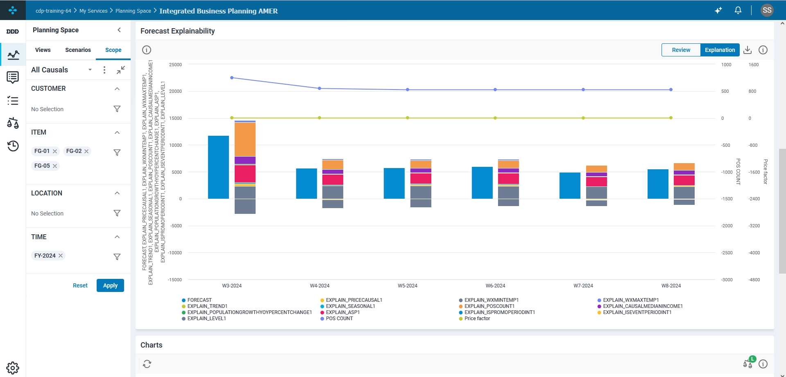
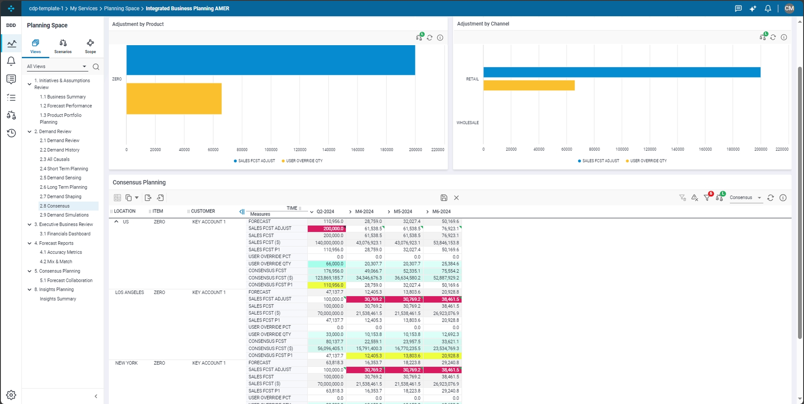
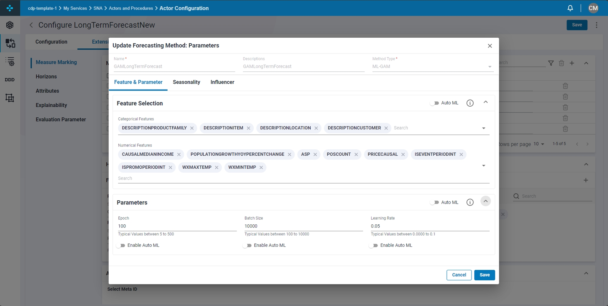
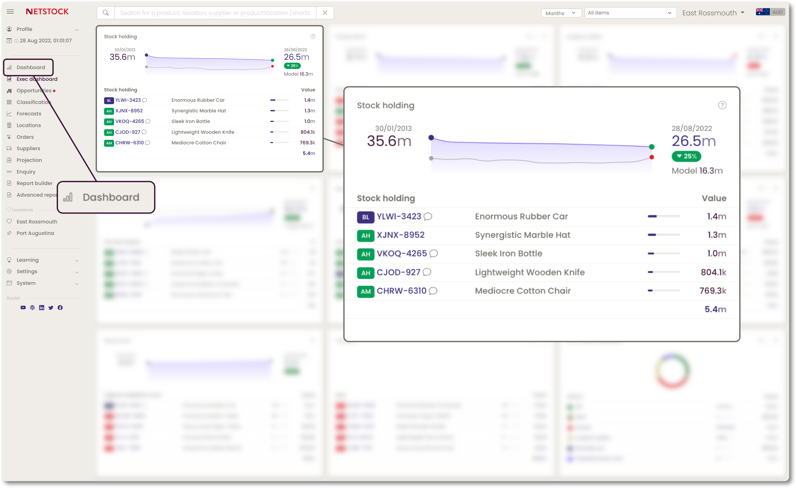
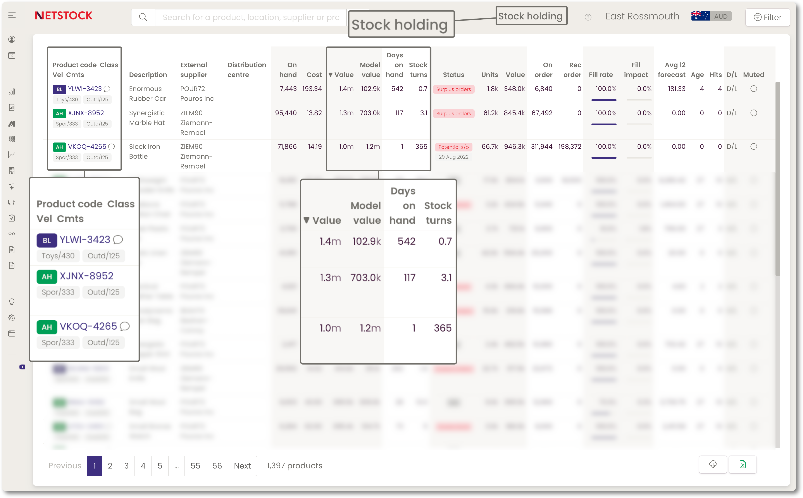

# Entrega 2 — Público-alvo e análise de concorrência

**Data original:** 26/08/2026  
**Consulta registrada na versão original:** 02/09/2026  
**Revisão e nova consulta às fontes oficiais:** 13/10/2026  
**Status:** 🟦 revisada após feedback
**Responsabilidade:** Paulo Andre de Oliveira Hirata — C01; Victor Merker Binda — C02.

## Método, evidências e escopo da revisão

O conjunto adotado é **C01 — Blue Yonder Demand Planning** e **C02 — Netstock**, conforme a análise textual e a decisão da equipe nesta revisão. Odoo e Zoho não sustentam as conclusões atuais. Os arquivos antigos foram preservados em uma pasta histórica, com a divergência registrada na [matriz](../RASTREABILIDADE.md).

Esta é uma **análise documental de interfaces divulgadas publicamente**, não um teste de usabilidade ou uso autenticado dos produtos. As figuras são capturas publicadas pelos fornecedores; os destaques e desfoques das imagens Netstock pertencem à documentação original. As datas exibidas nos dados de demonstração não indicam a data desta revisão.

Cada conclusão distingue:

- **Observação visual:** elemento legível em uma figura identificada.
- **Descrição documental:** capacidade ou procedimento informado pelo fabricante, com link.
- **Inferência/proposta da equipe:** interpretação de IHC ou aplicação candidata ao projeto; não é resultado medido com usuários.

## Entrada da Entrega 1

| Item inicial | Situação naquela etapa | Tratamento nesta entrega |
|---|---|---|
| Blue Yonder | Produto citado, sem fonte registrada na Entrega 1 | Investigar como C01; documentar fontes e figuras |
| Netstock | Produto citado, sem fonte registrada na Entrega 1 | Investigar como C02; documentar fontes e figuras |
| Planilhas/anotações e experiência comercial | [H] Alternativas possíveis na loja | Manter como hipóteses de prática atual |
| Sistema de vendas/PDV | [?] Existência e uso desconhecidos | Investigar ferramentas e responsáveis com o público |

A existência de uma solução de mercado não confirma o usuário prioritário, o esforço do processo atual ou os benefícios esperados do nosso produto.

## 1. Público-alvo desta análise

[H] O perfil provisório é o responsável pelo estoque de pequeno comércio, que pode ser proprietário, gerente ou outro funcionário. O acúmulo de compra, venda e controle operacional é uma hipótese. A distribuição de responsabilidades ainda precisa ser investigada.

[H] Familiaridade com linguagem comercial e dificuldade com métricas de ML orientam a análise, sem serem características já comprovadas do público. O objetivo de negócio proposto é evitar falta e excesso. O recorte do TCC confirmado documentalmente é previsão e comparação de modelos; o cálculo de quantidade e momento de reposição ainda requer confirmação de escopo e regras.

## 2. Concorrentes e interfaces profissionais análogas

### Análise C01 — Blue Yonder Demand Planning

**Autor:** Paulo Andre de Oliveira Hirata — 22.125.072-3  
**Tipo:** concorrente indireto/interface profissional análoga  
**Fonte principal:** [Demand Planning](https://blueyonder.com/solutions/supply-chain-planning/demand-planning).

#### Contexto e proposta

A página oficial descreve previsão com métodos estatísticos, ML e IA, planejamento multidimensional e explicação de fatores de demanda. Essas são capacidades declaradas pelo fornecedor. A equipe usa o produto como referência de apresentação e interpretação de previsões; sua adequação a microcomércios não foi testada.

#### Figuras e observações de IHC

##### Figura C01.1 — Explicação da previsão

**Origem:** captura publicada na página oficial de Demand Planning, arquivo original identificado no [registro de fontes](../assets/02_concorrencia/README.md).

**Observação visual:** o painel esquerdo reúne cliente, item, localização e período; a área central combina séries e fatores com legenda extensa. Há rótulos técnicos como “EXPLAIN_TREND1”. **Interpretação da equipe:** concentrar filtros e resultado pode facilitar a conferência do recorte, mas quantidade de séries e nomenclatura podem exigir conhecimento especializado. **Aplicação candidata:** explicar a estimativa em linguagem comercial, com poucos detalhes iniciais e possibilidade de aprofundamento — RC02, RC05, RC06 e RC07. A captura não comprova compreensão, facilidade de uso ou redução de tempo.

##### Figura C01.2 — Planejamento de consenso

**Origem:** captura publicada na mesma página oficial.

**Observação visual:** gráficos ocupam a parte superior; a tabela reúne local, item, cliente, medidas e períodos. O menu lateral oferece várias áreas de análise. **Interpretação da equipe:** a proximidade permite comparar representações, enquanto a densidade pode dificultar localizar a informação relevante. **Aplicação candidata:** limitar as informações ao problema da reposição e apresentar rótulos claros — RC02, RC07 e RC12. Esta tela mostra medidas de previsão e ajustes; não comprova, isoladamente, comparação de demanda prevista com vendas efetivamente realizadas.

##### Figura C01.3 — Configuração do método

**Origem:** captura publicada na mesma página oficial.

**Observação visual:** a janela exibe variáveis, “Epoch”, “Batch Size”, “Learning Rate” e ações “Cancel” e “Save”. **Interpretação da equipe:** esse vocabulário corresponde a configuração técnica e não deve ser exigido do comerciante apenas porque existe no concorrente. **Aplicação candidata:** separar configuração dos modelos da consulta comercial — RC07 e RC12. Os botões visíveis não demonstram confirmação de compra, desfazer ou recuperação de erro.

#### Capacidades e alcance da evidência

| Aspecto | Evidência | O que podemos concluir |
|---|---|---|
| Explicação de fatores | Figura C01.1 e página oficial | Existe apresentação de fatores; compreensão pelo público não foi testada |
| Comparação de medidas e períodos | Figura C01.2 | Há visualizações e tabela; não se infere o comportamento de todos os comandos |
| Configuração técnica | Figura C01.3 | Há parâmetros especializados; isso não os torna necessários na interface do TCC |
| Insights e ações | [Estratégia de experiência do fabricante](https://blueyonder.com/why-blue-yonder/user-experience) | O fabricante propõe explicar acontecimentos e orientar atenção; a sequência exata não foi testada |

#### Experiência do usuário e opiniões públicas

**Registro histórico da análise original, com consulta declarada pela equipe em 02/09/2026:** G2 — 4,1/5 em 30 avaliações; Gartner Peer Insights — 4,6/5 em 224 avaliações. O segundo valor se refere ao conjunto Supply Chain Planning, não apenas ao módulo de demanda. A equipe registrou relatos sobre economia de tempo e possibilidade de ajustes, além de aprendizagem e treinamento. Parte dos relatos era antiga e mencionava a marca anterior.

Fontes do registro: [G2](https://www.g2.com/products/blue-yonder-demand-planning/reviews) e [Gartner](https://www.gartner.com/reviews/market/supply-chain-planning-solutions/vendor/blue-yonder/product/blue-yonder-supply-chain-planning/likes-dislikes). Esses valores são preservados como dados da versão entregue, não como levantamento atualizado nesta revisão. A ausência de capturas históricas limita sua auditoria. As opiniões de terceiros não comprovam usabilidade para o público do projeto.

Os pontos positivos e riscos discutidos aqui são interpretações das figuras: filtros junto aos resultados, contraste entre resumo e detalhamento, alta densidade e linguagem técnica. Aprendizagem, satisfação e eficiência exigem avaliação com tarefas e participantes.

#### Preço/modelo de negócio

Na página oficial consultada há direcionamento para contato comercial, sem valor fixo apresentado para o produto. [?] Custo total, implantação e condições para um microcomércio não foram apurados. A equipe não conclui inviabilidade financeira apenas pela ausência de preço público.

### Análise C02 — Netstock

**Autor:** Victor Merker Binda — 22.125.075-6  
**Tipo:** concorrente indireto/interface profissional análoga  
**Fontes principais:** [Executive Dashboard](https://www.netstock.com/executive-dashboard/), [Dashboard KPIs Explained](https://help.netstock.com/en/articles/12136304-dashboard-kpis-explained) e [Access the Full Stock Holding Report](https://help.netstock.com/en/articles/12470747-how-to-access-the-full-stock-holding-report).

**Identificação:** matrícula padronizada conforme Entrega 1, Entrega 3 e README; não houve consulta a cadastro acadêmico externo.

#### Contexto e proposta

A documentação descreve painéis de indicadores e listas de exceções para orientar a atenção, além de relatórios para aprofundamento. A página institucional apresenta previsão, recomendações de pedidos e integração com ERP. Essas capacidades são informadas pelo fabricante, sem demonstração de desempenho no comércio estudado.

#### Figura C02.1 — Painel de estoque

**Origem:** primeira captura do artigo oficial “How To: Access the Full Stock Holding Report”. A documentação amplia o painel e desfoca áreas externas ao exemplo.

**Observação visual:** valor atual, comparação com modelo, variação percentual e lista de cinco itens estão reunidos no mesmo painel. **Interpretação da equipe:** há uma hierarquia entre visão agregada e produtos; a concentração pode orientar uma consulta inicial. **Aplicação candidata:** começar com resumo e itens relevantes — RC01 e RC12. A lista dessa figura é de valor de estoque: não é evidência de que esses cinco itens sejam os de maior risco de ruptura. A priorização por exceção de RC04 tem suporte documental específico na explicação de KPIs.

#### Figura C02.2 — Relatório de estoque

**Origem:** terceira captura do mesmo artigo oficial; ampliações e desfoques já constam na fonte.

**Observação visual:** há código, descrição, saldo, valor, comparação com modelo, cobertura, situação e pedidos na mesma tabela; o comando “Filter” aparece no topo. Situações como “Surplus orders” são escritas em etiquetas coloridas. **Interpretação da equipe:** proximidade ajuda a comparação, mas muitas colunas e abreviações podem aumentar esforço de leitura. **Aplicação candidata:** selecionar campos essenciais, traduzir termos e combinar estado textual com outros sinais — RC02, RC06, RC07, RC10 e RC12. Não foram testados filtros, exportação ou confirmação de pedidos.

#### Capacidades e alcance da evidência

| Aspecto | Evidência | O que podemos concluir |
|---|---|---|
| Resumo seguido de detalhamento | Figuras C02.1/C02.2 e artigo de acesso ao relatório | A documentação descreve passagem do painel para lista e detalhe de item; não foi executada em sessão de uso |
| Gestão por exceção | Artigo “Dashboard KPIs Explained” | O fabricante descreve listas dos itens que mais contribuem para cada indicador |
| Situação e dados próximos | Figura C02.2 | Há comparação tabular e etiquetas; eficácia com nosso público não foi medida |
| Previsão, pedidos e ERP | Página “Executive Dashboard” | Capacidades declaradas; não implicam que o nosso TCC as possua |

#### Experiência do usuário e opiniões públicas

**Registro histórico da análise original, com consulta declarada pela equipe em 02/09/2026:** Capterra — 4,8/5 em 75 avaliações e 4,7/5 em facilidade de uso; G2 — 4,6/5 em 171 avaliações. A equipe registrou opiniões favoráveis à visibilidade do estoque e à identificação de problemas, além de limitações de configuração e personalização. Também registrou que algumas avaliações eram incentivadas ou encaminhadas pelo fornecedor.

Fontes do registro: [Capterra](https://www.capterra.com/p/152724/NETSTOCK/) e [G2](https://www.g2.com/products/netstock/reviews). São dados preservados da versão entregue, sem nova apuração das notas nesta revisão; faltam capturas históricas para auditoria. Esses relatos não permitem afirmar que o produto é intuitivo ou rápido para Mariana ou para participantes ainda não pesquisados.

Como inferência da equipe, resumo e detalhamento podem ajudar a investigação; densidade, abreviações e distinção entre estoque real e valor de referência merecem teste de compreensão.

#### Preço/modelo de negócio

A página consultada oferece “Get Pricing”. [?] Não foi apurado um orçamento aplicável ao comércio estudado. Integração, configuração e adequação financeira precisam ser verificadas antes de qualquer conclusão de adoção.

## 3. Interfaces possivelmente familiares ao público

| Interface | Possível atividade | Convenções a investigar | Estado/evidência |
|---|---|---|---|
| Planilha | Registrar ou conferir movimentações | Linhas, colunas, ordenação e filtros | [H] Uso e familiaridade do público não confirmados; sem print de prática real |
| Sistema de vendas/PDV | Localizar produto e registrar venda | Código, quantidade e retorno da operação | [?] Não sabemos qual sistema existe nem quem o utiliza |
| Aplicativo de mensagens | Trocar informações e pedidos | Conversas, avisos e pendências | [H] Uso comercial e frequência ainda não verificados |

Importação, tabelas ou alertas não se tornam requisitos pela suposição de familiaridade.

## 3.1 Padrões, características específicas e decisões próprias

| Categoria | Elemento | Evidência | Aplicação candidata e limite |
|---|---|---|---|
| Recorrência nas duas interfaces analisadas | Gráficos e dados tabulares/numéricos | C01.2, C02.1 e C02.2 | Comparar informações; dois produtos não representam todo o mercado |
| Recorrência nas duas interfaces | Controles para delimitar consulta | C01.1 e comando Filter em C02.2 | Investigar filtros úteis; funcionamento não testado |
| Característica específica | Explicação de fatores da previsão | C01.1 | Investigar explicações compreensíveis e tecnicamente disponíveis |
| Característica específica documentada | Lista de exceções por indicador | Documentação de KPIs do Netstock | Investigar quais prioridades fazem sentido no comércio |
| Decisão própria | Confirmar e revisar registro de reposição | Risco hipotético de erro de decisão | RC09; nenhum print comprova confirmação de compra |
| Decisão própria | Não depender de cor | Fundamento de acessibilidade; C02.2 mostra texto junto à cor | RC10; não equivale a auditoria de conformidade dos produtos |
| Decisão própria condicionada | Cadastro/importação sem ERP obrigatório | Lacuna sobre dados atuais | RC11; depende da investigação, sem justificativa para CRUD completo |

## 4. Síntese comparativa

| Critério | C01 — Blue Yonder | C02 — Netstock | Interpretação para o projeto |
|---|---|---|---|
| Organização | Filtros, navegação ampla, gráficos e tabelas | Painel resumido e relatório detalhado | Investigar entrada simples e acesso ao detalhe |
| Informação de estado | Medidas, períodos e fatores da previsão | Estoque, referência e situações por item | Explicitar significado, unidade e data disponível |
| Terminologia | Nomes de variáveis e parâmetros técnicos | Abreviações e indicadores de estoque | Usar vocabulário a validar com o público |
| Prevenção/recuperação de erro | Não testadas | Não testadas | Propor revisão e correção com base na tarefa, sem atribuir comportamento não observado |
| Acessibilidade | Conformidade não avaliada | Há texto e cor em etiquetas; conformidade não avaliada | Avaliar contraste, compreensão e alternativas de interação futuramente |
| Eficiência | Nenhum tempo medido | Nenhum tempo medido | Organização sugere possibilidades; eficiência precisa de teste |

## 5. Recomendações candidatas e sua origem

Todas as recomendações dependem de tarefas e dados do público. Figuras de mercado não validam necessidades locais.

| ID | Recomendação | Origem correta | Validação/dependência |
|---|---|---|---|
| RC01 | Organizar consulta de prioridades → detalhe → decisão | C02.1/C02.2 e procedimento documentado; decisão final é adaptação da equipe | Verificar sequência útil ao responsável |
| RC02 | Apresentar dados disponíveis com unidade, período e atualização | C01.1/C01.2/C02.2; atualização explícita é proposta da equipe | Quantidade de compra calculada somente se capacidade for confirmada |
| RC03 | Explicar o aviso, sua relevância e possível próxima ação | Estratégia pública de UX da Blue Yonder, não sequência testada em print | Investigar compreensão e suporte técnico à explicação |
| RC04 | Priorizar itens por exceção relevante | Descrição de listas por KPI na documentação Netstock | Definir critério; não confundir alto valor de estoque com ruptura |
| RC05 | Investigar comparação de previsto e realizado e explicação de fatores | Fatores observados em C01.1; comparação com realizado é hipótese da Entrega 1 | Confirmar necessidade comercial e disponibilidade de histórico |
| RC06 | Oferecer poucos filtros úteis e opcionais | C01.1 e C02.2 mostram controles; limitação de quantidade é proposta da equipe | Verificar volume, critérios e familiaridade |
| RC07 | Traduzir termos técnicos para linguagem comercial | Vocabulário observado em C01.1/C01.3/C02.2 e hipótese sobre público | Testar termos com participantes |
| RC08 | Informar dados insuficientes e limites da previsão | Inferência da equipe sobre dependência de dados na proposta de ML | Não foi observado fluxo de validação de entradas nos concorrentes |
| RC09 | Permitir revisar, corrigir e confirmar um registro de reposição | Proposta da equipe para controle humano e prevenção de erro | Depende da necessidade de registro; não comprovada como comportamento do Netstock |
| RC10 | Comunicar estado com texto e sinais adicionais, sem depender de cor | Princípio de acessibilidade; combinação texto/cor observável em C02.2 | Ícones/prioridade são propostas; conformidade dos concorrentes não verificada |
| RC11 | Investigar cadastro ou importação que não exijam ERP | Lacuna sobre dados da loja e integração descrita pelo Netstock | Escolher entrada conforme fontes reais, sem exigir ambos os fluxos |
| RC12 | Limitar densidade ao necessário à tarefa | C01.2/C01.3/C02.2 mostram amplitude e densidade; recorte da Entrega 1 | Validar quais campos ajudam a decisão |

## Referências e proveniência

- BLUE YONDER. [Demand Planning](https://blueyonder.com/solutions/supply-chain-planning/demand-planning). Fonte das figuras C01.1–C01.3 e da proposta comercial.
- BLUE YONDER. [User Experience Strategy](https://blueyonder.com/why-blue-yonder/user-experience). Declarações de estratégia, distintas de observação de comportamento.
- NETSTOCK. [Executive Dashboard](https://www.netstock.com/executive-dashboard/). Proposta de painéis e capacidades.
- NETSTOCK. [Dashboard KPIs Explained](https://help.netstock.com/en/articles/12136304-dashboard-kpis-explained). Listas de exceções e finalidade dos indicadores.
- NETSTOCK. [How To: Access the Full Stock Holding Report](https://help.netstock.com/en/articles/12470747-how-to-access-the-full-stock-holding-report). Figuras C02.1/C02.2 e procedimento de detalhamento.
- [G2 — Blue Yonder](https://www.g2.com/products/blue-yonder-demand-planning/reviews).
- [Gartner — Blue Yonder Supply Chain Planning](https://www.gartner.com/reviews/market/supply-chain-planning-solutions/vendor/blue-yonder/product/blue-yonder-supply-chain-planning/likes-dislikes).
- [Capterra — Netstock](https://www.capterra.com/p/152724/NETSTOCK/).
- [G2 — Netstock](https://www.g2.com/products/netstock/reviews).

# Checklist
- [ ] O mapa inicial de alternativas da Entrega 1 foi revisitado e aprofundado.
- [ ] Hipóteses relevantes sobre mercado/padrões foram atualizadas na rastreabilidade quando surgiram evidências.
- [ ] Há pelo menos uma análise completa por integrante.
- [ ] Cada análise contém prints legíveis da interface.
- [ ] Prints mostram telas/estados relevantes, não apenas logos/homepage.
- [ ] Foram analisados concorrentes e/ou interfaces representativas ao público.
- [ ] Em TCC sem interface original, foram investigadas ferramentas profissionais análogas às atividades do usuário escolhido.
- [ ] Padrões como dashboard, relatório, filtros e CRUD foram analisados como soluções para tarefas, não como requisitos automáticos.
- [ ] Opiniões de UX têm fonte.
- [ ] A síntese compara critérios comuns e produz recomendações.
- [ ] Não há “copiar porque o concorrente faz”; há justificativa de adequação ao público/contexto.

