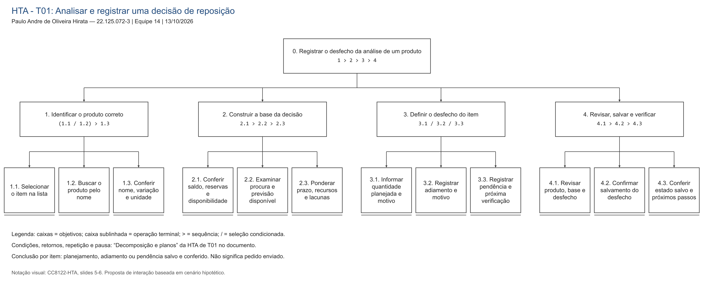
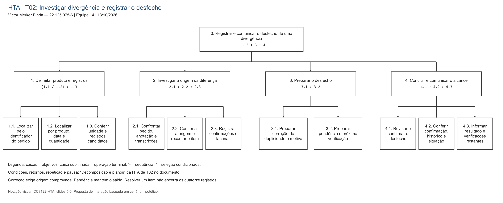
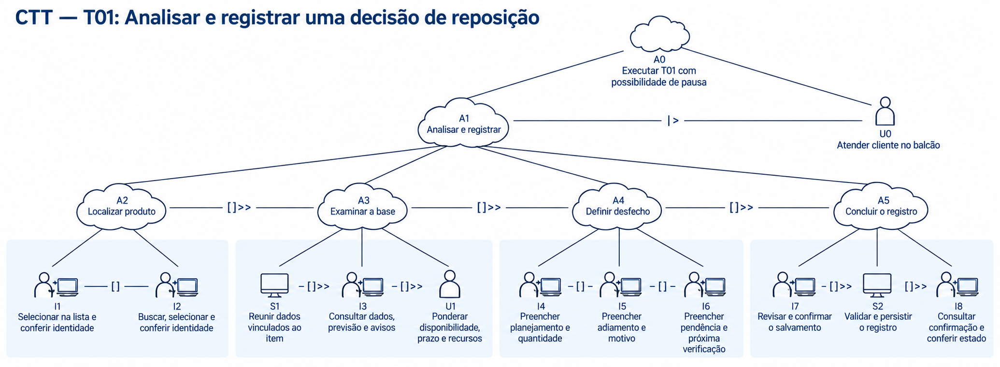
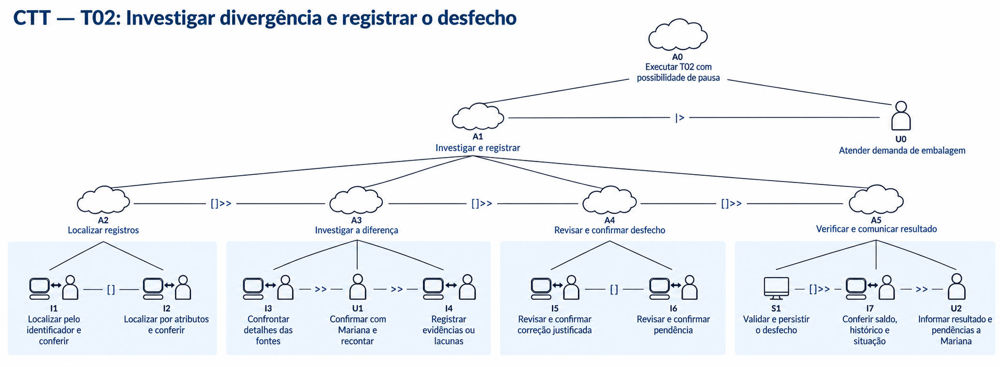

# Entrega 5 — Análise de tarefas: HTA, GOMS e CTT

**Data:** 13/10/2026   
**Status:** 🟨 em andamento
**Responsabilidade:** cada integrante modela pelo menos 1 HTA, 1 GOMS e 1 CTT. As três técnicas podem abordar a mesma funcionalidade ou funcionalidades distintas, conforme a orientação da disciplina.

## Objetivo da atividade

Modelar tarefas importantes sob perspectivas complementares: decomposição hierárquica (HTA), estrutura de metas/métodos/operações (GOMS) e relações temporais entre tarefas (CTT). O diagrama deve ser acompanhado de interpretação textual.

## Para projetos cujo TCC não previa interface

Modele **tarefas humanas relacionadas ao uso da contribuição técnica**, e não a implementação interna do algoritmo. Exemplos de boas tarefas para análise:

- investigar uma consulta de baixo desempenho;
- configurar uma análise e selecionar parâmetros;
- submeter um dataset e verificar sua validade;
- acompanhar uma execução demorada;
- comparar dois resultados/modelos;
- interpretar uma recomendação e decidir se a aceita;
- localizar uma execução anterior usando busca/filtros;
- gerar e compartilhar um relatório;
- administrar papéis/permissões quando isso for parte do trabalho real;
- revisar um alerta e registrar uma decisão.

Um CRUD pode gerar tarefas relevantes, mas “cadastrar usuário” só merece modelagem se tiver significado no domínio (papéis, validações, riscos, permissões, dependências).

## Seleção das tarefas

Os mesmos IDs são mantidos nas três técnicas para facilitar a comparação. T01 e T02 identificam tarefas; os códigos antigos de hipóteses não são reintroduzidos.

| ID | Tarefa | Persona/cenário de origem | Frequência/criticidade | Autor responsável |
|---|---|---|---|---|
| T01 | Analisar um produto e registrar uma decisão de reposição: planejar compra, adiar ou deixar pendente | P01 — Mariana Alves; E4-C01; R04-01 | [H] A cada ciclo de análise de compra, sem frequência medida. Crítica por envolver prazo do fornecedor, caixa e risco de falta/excesso | Paulo Andre de Oliveira Hirata — 22.125.072-3 |
| T02 | Investigar uma divergência de um produto e registrar seu desfecho: correção justificada ou pendência | P02 — Rafael Costa; P01 como fonte e destinatária; E4-C02; R04-02 | [H] Quando aparece divergência durante a conferência; incidência desconhecida. Crítica porque saldo incorreto pode contaminar decisões e previsões | Victor Merker Binda — 22.125.075-6 |

**Recorte:** cada execução trata um produto/episódio. Outros produtos ou registros iniciam novas execuções. T01 não cobre envio, recebimento ou avaliação posterior da compra. T02 não cobre o fechamento de todo o conjunto de quatorze registros. Esses limites tornam o término verificável e preservam a distinção entre progresso parcial e conclusão global.

---

<a id="t01-hta"></a>

## HTA — T01: analisar e registrar uma decisão de reposição

**Autor(a):** Paulo Andre de Oliveira Hirata — 22.125.072-3.

### Descrição da tarefa

**Objetivo 0:** deixar registrado um desfecho compreensível para a reposição de um produto, com a base utilizada e as limitações percebidas. **Início:** Mariana decide analisar um item antes do prazo do fornecedor, com acesso à identificação do produto e aos registros disponíveis. **Conclusão:** o desfecho do item foi salvo e conferido; pode ser planejamento, adiamento ou pendência. Uma pendência conclui o registro do episódio, mas não resolve a necessidade de decidir a compra.

**Contexto:** Mariana divide a atenção com o balcão e pode precisar consultar Rafael. O modelo oferece apoio à comparação; não substitui conhecimento comercial nem torna confiável uma informação incompleta apenas por exibi-la na interface.

### Diagrama



[Abrir imagem PNG em tamanho original](../assets/05_tarefas/hta_t01.png). A árvore segue o modelo dos slides 5–6 de `CC8122-HTA.pdf`: objetivos em caixas retangulares, planos dentro dos objetivos e operações terminais sublinhadas. As setas ligam os níveis da decomposição; os planos indicam a ordem de execução.

### Decomposição e planos

Em HTA, `>` indica sequência e `/` alternativa condicionada, conforme a notação da aula. Repetições e condições são escritas por extenso. Os IDs abaixo são locais à HTA de T01.

| ID | Objetivo/operação | Plano/ordem | Problema ou decisão de design derivada |
|---|---|---|---|
| 0 | Registrar o desfecho da análise de um produto | 1 > 2 > 3 > 4; aplicar as regras de retorno e pausa abaixo | Um registro salvo precisa indicar se há decisão ou pendência, sem sugerir pedido enviado |
| 1 | Identificar o produto correto | (1.1 / 1.2) > 1.3 | Duas formas de acesso servem à mesma identificação |
| 1.1 | Selecionar o item na lista de análise | Se estiver visível e reconhecível | Lista curta pode reduzir procura; prioridade ainda é proposta |
| 1.2 | Buscar o produto pelo nome | Se não estiver visível ou houver dúvida; refinar a busca se necessário | Não exigir domínio de filtros avançados |
| 1.3 | Conferir nome, variação e unidade de venda | Após 1.1 ou 1.2; voltar a 1 se o resultado não for o desejado | “Garrafa” não distingue cor, capacidade ou unidade |
| 2 | Construir a base da decisão | 2.1 > 2.2 > 2.3; registrar lacunas em vez de completá-las por suposição | Exibir dados e sua situação de conferência |
| 2.1 | Conferir saldo físico, reservas e disponibilidade | Comparar fontes disponíveis e data de atualização | Seis unidades presentes e duas comprometidas não significam seis livres |
| 2.2 | Examinar procura e previsão disponível | Distinguir venda confirmada de consulta; ler período, unidade e limites; se não houver previsão, reconhecer a ausência | Estimativa ausente não equivale a demanda zero |
| 2.3 | Ponderar prazo do fornecedor, recursos e lacunas | Confrontar os dados com prazo e orçamento conhecidos; identificar o que precisa de confirmação | A previsão, sozinha, não determina quantidade ou momento de compra |
| 3 | Definir o desfecho do item | 3.1 / 3.2 / 3.3, segundo critérios abaixo | As alternativas são estados diferentes e devem ter nomes claros |
| 3.1 | Informar quantidade planejada e motivo | Se Mariana julgar a base suficiente e decidir comprar; quantidade definida por ela | Evitar aceitação implícita de uma sugestão automática |
| 3.2 | Registrar adiamento e motivo | Se a base permitir decidir não comprar neste ciclo | Adiamento consciente difere de esquecimento |
| 3.3 | Registrar pendência, motivo e próxima verificação | Se uma lacuna impedir uma decisão sustentada | Não forçar quantidade com base desconhecida |
| 4 | Revisar, salvar e verificar o registro | 4.1 > 4.2 > 4.3 | A conclusão depende de confirmação verificável |
| 4.1 | Revisar produto, base, desfecho e quantidade, se houver | Corrigir erros voltando à etapa correspondente antes de confirmar | Prevenir registro no produto errado ou em unidade errada |
| 4.2 | Confirmar o salvamento do desfecho | Depois da revisão; aguardar retorno antes de reenviar | Não confundir ação solicitada com gravação concluída |
| 4.3 | Conferir o estado salvo e o que ainda falta fazer | Comparar o retorno com o resumo revisado | “Planejamento salvo” deve distinguir-se de “pedido enviado” |

**Plano de exceções e repetição:** se a identificação estiver errada, repetir 1; se surgir informação nova que altere a base, repetir 2 e reavaliar 3 antes de salvar. Para analisar outro produto, iniciar nova execução de 0. A insuficiência relevante de dados leva a 3.3; não impede registrar a pendência. Erro de preenchimento em 4 retorna ao campo indicado, preservando os demais dados. Falha de gravação mantém o estado “não salvo”; verificar se houve confirmação antes de repetir a solicitação.

**Plano de interrupção:** entre operações, preservar produto, etapa e rascunho; atender a demanda externa; retomar a etapa pendente e conferir a atualização dos dados. Se o salvamento já tiver sido confirmado, recuperar o registro existente. Preservação do progresso é requisito proposto, não uma capacidade atual demonstrada.

O modelo separa quatro dificuldades que no cenário se misturam: identificar o item, reconstruir os dados, fazer a escolha comercial e comprovar o registro. No exemplo da garrafa azul de 500 ml, `6 − 2 = 4` unidades disponíveis só é uma conta utilizável se as duas unidades estiverem de fato comprometidas e incluídas nas seis contadas. As seis unidades pedidas no cenário são uma escolha baseada na compra anterior, não a saída de uma fórmula de previsão.

**Verificação do HTA:**

- O objetivo 0 representa uma meta do usuário, com estado final verificável por item.
- As subtarefas cobrem identificação, análise, definição do desfecho e confirmação, incluindo a comunicação quando necessária.
- Os planos indicam sequência, alternativas, retorno, repetição e condições de pausa e retomada.
- A decomposição termina em operações úteis ao projeto de interação, sem antecipar cliques ou implementação do algoritmo.

---

<a id="t02-hta"></a>

## HTA — T02: investigar divergência e registrar o desfecho

**Autor(a):** Victor Merker Binda — 22.125.075-6.

### Descrição da tarefa

**Objetivo 0:** deixar uma divergência de um produto com desfecho explicável, corrigido ou pendente, e comunicar o alcance da conferência. **Início:** Rafael identifica diferença entre registros e contagem e delimita o item/episódio a investigar. **Conclusão:** correção fundamentada ou pendência foi registrada e conferida, e Mariana recebeu a informação sobre o item e o que ainda falta verificar.

**Contexto:** computador compartilhado, fontes distribuídas e interrupções para embalagem. O caso estudado envolve um conjunto de três potes como **uma unidade de venda**, saldo registrado de oito e contagem de dez. Duas transcrições podem representar a mesma saída de duas unidades. Sem confirmação de origem, a diferença numérica não autoriza correção.

### Diagrama



[Abrir imagem PNG em tamanho original](../assets/05_tarefas/hta_t02.png). Os mesmos IDs relacionam os nós da árvore à tabela. Conforme os slides 5–6 de `CC8122-HTA.pdf`, os planos aparecem nas caixas dos objetivos e uma linha sob a caixa identifica cada operação terminal.

### Decomposição e planos

| ID | Objetivo/operação | Plano/ordem | Problema ou decisão de design derivada |
|---|---|---|---|
| 0 | Registrar e comunicar o desfecho de uma divergência | 1 > 2 > 3 > 4; aplicar retornos e pausa abaixo | Investigar é diferente de substituir um número |
| 1 | Delimitar o produto e os registros | (1.1 / 1.2) > 1.3 | O acesso depende da identificação disponível |
| 1.1 | Localizar pelo identificador do pedido | Quando houver identificador confiável | O vínculo com a origem reduz ambiguidade |
| 1.2 | Localizar por produto, data e quantidade | Quando a anotação não tiver identificador; restringir até reconhecer o episódio | Mesmo nome ou quantidade não comprova mesma venda |
| 1.3 | Conferir produto, unidade e registros candidatos | Antes de atribuir causa à divergência | Conjunto de três potes não equivale a três unidades comerciais |
| 2 | Investigar a origem da diferença | 2.1 > 2.2 > 2.3 | Reconciliar exige evidência, não apenas igualdade de saldos |
| 2.1 | Confrontar pedido, anotação e transcrições | Comparar identificação, data, item, quantidade e situação do pedido | Distinguir duas vendas de duas cópias do mesmo evento |
| 2.2 | Confirmar a origem e recontar o item | Consultar Mariana se necessário; conferir envio/cancelamento e contagem; se indisponível, reconhecer a lacuna | Memória de outra pessoa pode ser necessária e não estar acessível |
| 2.3 | Registrar o que foi confirmado e o que falta | Relacionar evidências às linhas verificadas; separar suspeita de causa confirmada | Preservar o raciocínio para retomada e revisão |
| 3 | Preparar o desfecho da investigação | 3.1 / 3.2 conforme suficiência da evidência | Correção e pendência são caminhos legítimos e distintos |
| 3.1 | Preparar correção da duplicidade e justificativa | Somente se a mesma saída estiver comprovadamente descontada duas vezes e Rafael puder corrigir | Corrigir a transcrição indevida mantendo histórico; não simular entrada de mercadoria |
| 3.2 | Preparar pendência e próxima verificação | Se origem, autorização ou evidência suficiente não estiver disponível | Preservar o saldo registrado e sinalizar que não foi confirmado |
| 4 | Concluir o registro e comunicar seu alcance | 4.1 > 4.2 > 4.3 | Não declarar todos os registros conferidos após resolver um item |
| 4.1 | Revisar e confirmar correção ou pendência | Conferir produto, fontes, motivo, alteração pretendida e saldo resultante quando aplicável | Confirmar antes de alterar dado que sustentará a decisão de Mariana |
| 4.2 | Conferir confirmação, histórico e situação do item | Aguardar gravação e verificar o resultado; se corrigido, comparar com a contagem | Solicitação de correção não equivale a correção efetivada |
| 4.3 | Informar Mariana sobre resultado e registros restantes | Comunicar o item conferido/pendente e o alcance parcial da verificação | Evitar que a proprietária interprete o conjunto inteiro como confiável |

**Regras de retorno:** inconsistência de identidade retorna a 1; evidência contraditória retorna a 2; falta de confirmação leva a 3.2. O caminho 3.1 cobre a duplicidade descrita em E4-C02; outras causas exigem investigação e um procedimento apropriado, sem aplicar a mesma correção automaticamente. Após gravar, diferença ainda não explicada deve ser registrada como pendência; não repetir o ajuste até os números coincidirem.

**Repetição e pausa:** executar 0 novamente para cada outro episódio. Ao ser interrompido, preservar linhas já conferidas, hipótese de causa e próxima verificação; ao voltar, recuperar o ponto e conferir se houve alterações por outra pessoa. Uma mudança relevante exige rever a etapa afetada antes de confirmar. Se a gravação falhar, manter a proposta sem anunciá-la como efetivada e conferir o histórico antes de reenviar.

No percurso do cenário, o pedido foi enviado, Mariana confirma que sua anotação representa a mesma venda online e não há outra saída correspondente. Só então se corrige o segundo desconto de duas unidades: o saldo passa de oito para dez, sem registrar recebimento de duas unidades. No percurso alternativo, Mariana não consegue confirmar a origem; Rafael registra a pendência e informa que o saldo continua não confirmado.

**Verificação do HTA:**

- O objetivo 0 representa uma meta do usuário, com estado final verificável por item.
- As subtarefas cobrem identificação, análise, definição do desfecho e confirmação, incluindo a comunicação quando necessária.
- Os planos indicam sequência, alternativas, retorno, repetição e condições de pausa e retomada.
- A decomposição termina em operações úteis ao projeto de interação, sem antecipar cliques ou implementação do algoritmo.

---

<a id="t01-goms"></a>

## GOMS — T01: analisar e registrar uma decisão de reposição

**Autor(a):** Paulo Andre de Oliveira Hirata — 22.125.072-3.

### Goal

`G0: registrar o desfecho da análise de reposição de um produto.`

- `G1`: identificar o produto correto.
- `G2`: avaliar a base da decisão e suas limitações.
- `G3`: estabelecer o desfecho do item.
- `G4`: salvar e conferir o registro.

O nível é de operações semânticas de interação e operações cognitivas delimitadas, pois ainda não há interface detalhada. O GOMS representa a rotina após familiarização; não prevê o desempenho inicial de Mariana nem supõe que idade determine habilidade. Não se aplicam tempos KLM a controles que ainda não foram definidos.

### Métodos, operadores e regras de seleção

| Operador | Tipo | Ação delimitada |
|---|---|---|
| O1 | Cognitivo/perceptivo | Reconhecer um nome e uma variação apresentados |
| O2 | Interação | Selecionar um item exibido |
| O3 | Interação | Informar um termo de busca |
| O4 | Interação | Acionar a busca |
| O5 | Cognitivo/perceptivo | Conferir a identidade e a unidade do produto aberto |
| O6 | Interação | Consultar o quadro de dados do item |
| O7 | Cognitivo | Comparar saldo físico, compromissos e disponibilidade apresentados |
| O8 | Cognitivo | Interpretar período, unidade, atualização e limitações da procura/previsão |
| O9 | Cognitivo | Confrontar a base com prazo, recursos e informação ainda ausente |
| O10 | Interação | Informar o desfecho e seus campos correspondentes |
| O11 | Cognitivo | Conferir o resumo antes de confirmar |
| O12 | Interação | Confirmar o salvamento |
| O13 | Cognitivo/perceptivo | Ler o retorno e conferir o estado efetivamente salvo |

O7–O9 representam avaliações humanas no nível escolhido, não uma fórmula ou duração conhecida. Consulta adicional a pessoas/fontes, erros e aprendizagem ficam fora da rotina GOMS; aparecem nos planos da HTA e nos limites do CTT.

**Método comum de G0:** realizar G1 por um dos métodos abaixo; executar G2 (`O6 > O7 > O8 > O9`); realizar G3, escolhendo o desfecho e executando O10; executar G4 (`O11 > O12 > O13`). Ao final, produto e desfecho devem coincidir com o resumo revisado.

| Método alternativo para G1 | Sequência de operadores | Resultado comum |
|---|---|---|
| M1 — localizar pela lista de análise | O1 reconhecer item visível > O2 selecioná-lo > O5 conferir identidade/unidade | Produto correto aberto para análise |
| M2 — localizar pela busca | O3 informar nome > O4 buscar > O1 reconhecer correspondência > O2 selecionar resultado > O5 conferir identidade/unidade | Produto correto aberto para análise |

**SR1:** escolher M1 se o item estiver visível e reconhecível na lista; escolher M2 se não estiver visível ou se o nome/variação precisar ser procurado. Se ambas as condições permitirem acesso, adotar M1 como regra provisória a avaliar no protótipo. Resultado ambíguo exige refinar o termo e repetir a busca; sem correspondência, não prosseguir sobre outro produto.

Assim, há duas sequências completas possíveis para G0: `M1 > G2 > G3 > G4` e `M2 > G2 > G3 > G4`. M1 e M2 são alternativas para a **mesma submeta G1**, como no exemplo de localização de rua da aula; G2–G4 são a sequência comum e não são apresentados como alternativas entre si.

**Critérios de G3:** planejar compra quando Mariana decidir comprar com base que considera suficiente; adiar quando decidir não comprar no ciclo; registrar pendência quando faltar informação indispensável. Esses critérios são decisões do domínio, não métodos GOMS concorrentes nem um cálculo automatizado. Quantidade de compra, se informada, é revisada pela usuária.

---

<a id="t02-goms"></a>

## GOMS — T02: investigar divergência e registrar o desfecho

**Autor(a):** Victor Merker Binda — 22.125.075-6.

### Goal

`G0: registrar e comunicar um desfecho fundamentado para a divergência de um produto.`

- `G1`: localizar os registros relevantes ao episódio.
- `G2`: determinar o que as fontes permitem concluir.
- `G3`: preparar uma correção justificada ou uma pendência.
- `G4`: confirmar, conferir e comunicar o resultado.

### Métodos, operadores e regras de seleção

| Operador | Tipo | Ação delimitada |
|---|---|---|
| O1 | Cognitivo/perceptivo | Ler um identificador ou um atributo da fonte |
| O2 | Interação | Preencher um campo de busca/filtro |
| O3 | Interação | Executar a consulta |
| O4 | Cognitivo | Comparar uma correspondência por item, unidade, data, quantidade e situação |
| O5 | Interação | Abrir o registro candidato e seus vínculos |
| O6 | Interação | Consultar os detalhes dos registros relacionados |
| O7 | Cognitivo | Comparar as transcrições com a fonte e a contagem já obtida |
| O8 | Interação | Registrar evidência, confirmação obtida ou lacuna |
| O9 | Interação | Preparar a correção ou marcar pendência com motivo |
| O10 | Cognitivo | Conferir o resumo e o efeito previsto sobre o saldo/histórico |
| O11 | Interação | Confirmar a gravação |
| O12 | Cognitivo/perceptivo | Conferir a confirmação, o histórico e a situação do item |
| O13 | Ação humana externa | Comunicar a Mariana o desfecho e as verificações restantes |

O modelo descreve a rotina de um usuário familiarizado com o procedimento. Para o percurso rotineiro de correção, a confirmação externa e a recontagem já precisam estar disponíveis em G2; quando não estiverem, a pendência é um desfecho possível. O tempo de obter uma resposta de Mariana ou realizar investigação inédita não é estimado por esses operadores.

**Método comum de G0:** realizar G1 por M1 ou M2; executar G2 (`O6 > O7 > O8`); realizar G3 por O9, conforme a evidência; executar G4 (`O10 > O11 > O12 > O13`). A rotina só termina após registro conferido e comunicação do alcance parcial.

| Método alternativo para G1 | Sequência de operadores | Resultado comum |
|---|---|---|
| M1 — localizar por identificador | O1 ler identificador confiável > O2 informá-lo > O3 consultar > O4 conferir correspondência > O5 abrir o registro e os vínculos | Episódio correto localizado para comparação das fontes |
| M2 — localizar por atributos do episódio | O1 ler produto, data e quantidade > O2 preencher nome/data disponíveis > O3 consultar > O4 comparar candidatos > O5 abrir a correspondência reconhecida | Mesmo episódio correto localizado, ainda que a anotação não tenha ID |

**SR1:** usar M1 quando houver identificador confiável e pesquisável. Usar M2 quando ele faltar ou quando o resultado do identificador não corresponder à fonte após conferência. Se ambas as vias forem possíveis, priorizar M1 por vincular diretamente a origem; essa preferência é proposta a testar.

**SR2:** em M2, se os atributos não distinguirem as correspondências, acrescentar um atributo disponível e repetir a consulta; não escolher arbitrariamente a primeira linha. Se a ambiguidade persistir, a investigação não sustenta correção: registrar a lacuna no episódio e seguir pelo desfecho pendente. Nesse caso G1 não atingiu a localização inequívoca prevista pelo método; trata-se de uma exceção, não de sucesso do método.

As alternativas completas de execução rotineira são `M1 > G2 > G3 > G4` e `M2 > G2 > G3 > G4`. A escolha entre correção e pendência em G3 depende da suficiência da evidência e da autorização. **Alterar diretamente oito para dez não é um terceiro método equivalente:** não alcança a meta de explicar a origem e preservar histórico.

---

<a id="t01-ctt"></a>

## CTT — T01: analisar e registrar uma decisão de reposição

**Autor(a):** Paulo Andre de Oliveira Hirata — 22.125.072-3.

### Descrição

Mariana identifica um produto, examina a base disponível, define planejamento, adiamento ou pendência e confere o registro salvo. A árvore explicita a passagem das informações entre etapas e a possibilidade de suspender a análise para atender um cliente. A conclusão é o registro do desfecho de um item, sem envio de pedido.

### Diagrama



[Abrir imagem PNG em tamanho original](../assets/05_tarefas/ctt_t01.png). A árvore utiliza os pictogramas dos slides 23–24 de `CC8122-GOMS-CTT.pdf`: nuvem para tarefa abstrata, pessoa para tarefa do usuário, computador para tarefa do sistema e pessoa-computador com seta dupla para interação. As linhas inclinadas decompõem a tarefa; os operadores entre nós irmãos indicam as relações temporais. A, U, S e I identificam os nós na tabela e nas expressões abaixo.

```text
A0 Executar T01 com possibilidade de pausa
  = A1 |> U0
A1 Analisar e registrar
  = A2 []>> A3 []>> A4 []>> A5
A2 Localizar produto
  = I1 [] I2
A3 Examinar a base
  = S1 []>> I3 []>> U1
A4 Definir desfecho
  = I4 [] I5 [] I6
A5 Concluir o registro
  = I7 []>> S2 []>> I8
```

### Legenda e relações temporais usadas

| Nó | Tipo | Conteúdo e critério de término |
|---|---|---|
| A0–A5 | Abstrata | Composição de tarefas; os IDs e seus nomes estão nas expressões acima |
| U0 | Usuário | Atender cliente no balcão; a demanda externa terminou e Mariana pode retomar a análise |
| I1 | Interação | Selecionar na lista e conferir identidade/unidade; produto correto identificado |
| I2 | Interação | Buscar, selecionar e conferir identidade/unidade; mesmo resultado de I1 |
| S1 | Sistema | Reunir os dados vinculados ao item e sinalizar disponibilidade/atualização; sem presumir integração externa ou cálculo novo de previsão |
| I3 | Interação | Consultar os dados, a previsão se disponível e avisos de ausência; informações apresentadas à usuária |
| U1 | Usuário | Ponderar disponibilidade, prazo, recursos e lacunas fora do diálogo com o sistema; estabelecer critério para o desfecho |
| I4 | Interação | Preencher planejamento com quantidade humana e motivo, quando decidir comprar |
| I5 | Interação | Preencher adiamento e motivo, quando decidir não comprar neste ciclo |
| I6 | Interação | Preencher pendência, motivo e próxima verificação, quando a base for insuficiente |
| I7 | Interação | Revisar produto, base e desfecho; confirmar salvamento após eventual ajuste |
| S2 | Sistema | Validar e persistir o registro; produzir confirmação com o estado salvo |
| I8 | Interação | Consultar a confirmação e conferir o registro; reconhecer o que ainda exige ação externa |

I1/I2 são macrotarefas de interação: seu detalhe operacional está nos métodos GOMS. I4–I6 produzem um rascunho; a escolha passa a compor o registro persistido somente após I7 e S2. As condições de compra, adiamento e pendência restringem as opções pertinentes; não são novos operadores CTT. Se um dado não existir, S1 deve informar essa ausência para permitir I6, e não inventar um valor.

| Operador | Significado no modelo | Exemplo concreto |
|---|---|---|
| `[]` | Escolha: iniciar uma alternativa desabilita as demais naquele ponto da execução | I1 ou I2 levam ao mesmo produto; I4, I5 ou I6 definem um único desfecho |
| `[]>>` | A tarefa seguinte começa após a anterior e recebe sua informação | A2 passa a identidade do produto a A3; I7 passa o registro confirmado a S2; S2 passa a confirmação a I8 |
| `\|>` | Suspensão/retomada: uma atividade pode interromper a primeira, que depois continua do ponto suspenso | A1 pode ser suspensa por U0, atendimento ao cliente |

Conferir informação e confirmar a decisão têm dependência; não há justificativa para representá-las como concorrentes. A pausa é eventual: U0 não é uma etapa obrigatória entre selecionar e salvar. O operador de suspensão descreve a retomada lógica, enquanto preservar o rascunho e verificar dados desatualizados são requisitos para torná-la viável.

**Fronteira de exceções:** a árvore mostra o percurso que obtém confirmação de gravação e pode terminar em qualquer um dos três desfechos. S2 não conclui com sucesso se a validação/gravação falhar; I8 não pode exibir sucesso fictício. A recuperação, o retorno a etapas anteriores e novas execuções estão definidos no plano da HTA, sem disfarçar a falha como conclusão. A confirmação de I8 significa registro salvo, não compra executada.

---

<a id="t02-ctt"></a>

## CTT — T02: investigar divergência e registrar o desfecho

**Autor(a):** Victor Merker Binda — 22.125.075-6.

### Descrição

Rafael localiza os registros de um produto, investiga a diferença e confirma uma correção justificada ou uma pendência. Depois da gravação, confere o resultado e comunica a Mariana o alcance parcial da verificação. A demanda de embalagem pode suspender a atividade, que deve ser retomada sem repetir uma correção já concluída.

### Diagrama



[Abrir imagem PNG em tamanho original](../assets/05_tarefas/ctt_t02.png). IDs são locais a este modelo. A árvore utiliza a mesma notação dos slides 23–24 de `CC8122-GOMS-CTT.pdf`: nuvem, pessoa, computador e pessoa-computador representam os quatro tipos de tarefa, e os operadores entre irmãos indicam sua relação temporal.

```text
A0 Executar T02 com possibilidade de pausa
  = A1 |> U0
A1 Investigar e registrar
  = A2 []>> A3 []>> A4 []>> A5
A2 Localizar registros
  = I1 [] I2
A3 Investigar a diferença
  = I3 >> U1 >> I4
A4 Revisar e confirmar desfecho
  = I5 [] I6
A5 Verificar e comunicar resultado
  = S1 []>> I7 >> U2
```

### Legenda e relações temporais usadas

| Nó | Tipo | Conteúdo e critério de término |
|---|---|---|
| A0–A5 | Abstrata | Composição das tarefas identificadas nas expressões |
| U0 | Usuário | Atender demanda de embalagem; finalizar a interrupção externa |
| I1 | Interação | Localizar pelo identificador e conferir produto/unidade e registros candidatos |
| I2 | Interação | Localizar por atributos e conferir produto/unidade e registros candidatos |
| I3 | Interação | Consultar e confrontar os detalhes do pedido, anotação e transcrições disponíveis |
| U1 | Usuário | Confirmar a origem com Mariana quando necessário e recontar; reconhecer explicitamente confirmação indisponível |
| I4 | Interação | Registrar evidências, linhas verificadas, conclusão sustentada ou lacuna |
| I5 | Interação | Preparar, revisar e confirmar correção da duplicidade comprovada, com justificativa e efeito esperado |
| I6 | Interação | Preparar, revisar e confirmar pendência, com motivo e próxima verificação, sem corrigir o saldo |
| S1 | Sistema | Validar e persistir o desfecho; aplicar a correção confirmada, se houver, preservando o histórico; produzir confirmação |
| I7 | Interação | Conferir retorno, saldo, histórico e situação do item; identificar o restante não conferido |
| U2 | Usuário | Informar Mariana sobre o item corrigido ou pendente e as verificações restantes |

I1/I2 incluem conferência de candidatos, mas não concluem que houve duplicidade. A identificação e a investigação são metas diferentes. Em U1, perceber que a confirmação está indisponível permite registrar uma lacuna em I4 e seguir por I6; não equivale a confirmação positiva.

**Condições de I5/I6:** I5 está disponível apenas com duplicidade comprovada e autorização de correção no contexto; I6 é o caminho quando a investigação não sustenta a correção ou a autorização falta. I5 não representa compra nem entrada física. S1 só altera o saldo no caminho de correção confirmado; uma pendência mantém o valor e explicita a falta de validação.

| Operador | Significado no modelo | Exemplo concreto |
|---|---|---|
| `[]` | Alternativas de execução naquele ponto | I1 ou I2 localizam o episódio; I5 ou I6 confirmam desfechos diferentes |
| `>>` | A segunda tarefa só começa quando a primeira termina | I3 precede a confirmação externa/recontagem U1; I7 precede a comunicação U2 |
| `[]>>` | Sequência com transferência explícita de informação | A3 fornece evidências/lacunas a A4; A4 fornece o desfecho confirmado a A5; S1 fornece o registro persistido a I7 |
| `\|>` | Suspender e depois retomar o trabalho | A1 é suspensa por U0, a demanda de embalagem |

`>>` expressa a ordem mínima; não afirma que a pessoa esquece as informações anteriores. `[]>>` destaca o resultado que precisa ser transmitido como entrada do próximo diálogo/processamento. Em particular, a confirmação externa não pode ser obtida em paralelo com uma correção que depende dela.

Não se usou concorrência (`|||`), concorrência comunicante (`|[]|`), independência de ordem (`|=|`) ou desativação (`[>`) apenas para preencher a notação. A embalagem suspende o trabalho e permite retomada; não o abandona definitivamente. Tampouco se usou repetição gráfica: cada árvore cobre um episódio, e o plano da HTA determina quando iniciar o próximo. Essa escolha evita representar os quatorze registros como quatorze vendas independentes ou como um único item já resolvido.

**Fronteira de exceções:** a árvore pressupõe obtenção de confirmação em S1 para chegar a I7 e U2. Falha de validação/gravação interrompe esse percurso e aciona a recuperação definida na HTA; não se comunica correção bem-sucedida. Divergência ainda presente após a gravação exige nova investigação e comunicação explícita, não repetição cega do ajuste. Interrupções durante processamento não desfazem uma gravação já concluída: a retomada deve consultar seu estado.

---

<a id="sintese"></a>

## Síntese da equipe

As três técnicas se complementam: a HTA mostra o que é necessário para concluir o trabalho e em que condições voltar; o GOMS explicita caminhos alternativos de localização para a mesma meta; o CTT evidencia dependências, transferência de informação e o efeito de interrupções. Nenhuma delas demonstra, sozinha, facilidade de uso ou benefício econômico.

| Achado da modelagem | Origem e ligação com entregas anteriores | Requisito candidato para o protótipo | Critério verificável em avaliação futura |
|---|---|---|---|
| Produto e unidade incorretos invalidam toda a decisão | T01-HTA 1; T02-HTA 1; E4-C01-Q3/Q7 e C02-Q3; DP03/DP09; RC02 | Identificação completa e unidade visíveis no detalhe e na revisão | Participante distingue garrafa azul de 500 ml e conjunto comercial de três potes |
| Disponibilidade e previsão têm significados distintos | T01-HTA 2; T01-CTT A3; DP03/DP05/DP07; RC02/RC08 | Distinguir físico, comprometido e disponível; mostrar período, atualização e ausência da estimativa | Participante explica as quatro unidades disponíveis e não interpreta ausência de previsão como zero |
| O desfecho precisa preservar a decisão humana | T01-HTA 3–4; T01-CTT A4/A5; DP06; RC09 | Oferecer planejamento, adiamento e pendência; revisar quantidade humana antes de salvar | Participante reconhece que planejamento salvo não enviou pedido |
| Duas transcrições não significam duas vendas | T02-HTA 2–3; T02-GOMS G2; E4-C02-Q3/Q7; DP10/DP14; RC11 | Consultar vínculos e registrar motivo, autor, data e alteração na correção | Participante fundamenta a duplicidade e explica oito → dez sem inventar entrada |
| A interrupção afeta a continuidade do raciocínio | HTA de ambas as tarefas; CTT A1/U0; E4-C01-Q6 e C02-Q6; DP12/DP18 | Preservar rascunho, etapa, evidências verificadas e situação de salvamento; revalidar dados alterados | Após pausa, participante identifica próxima ação e evita salvar/corrigir novamente por engano |
| Progresso parcial pode parecer conclusão global | T02-HTA 4; T02-CTT I7/U2; E4-C02-Q8; DP11/DP14 | Distinguir item corrigido, item pendente e registros ainda não conferidos | Participante comunica exatamente o alcance da conferência |
| Acesso por lista, ID ou atributos deve convergir | GOMS de T01/T02; DP08/DP09; RC01/RC06/RC07 | Oferecer os caminhos justificados, com o mesmo conteúdo no destino e rótulos compreensíveis | Participante encontra o alvo pelos dados disponíveis sem precisar adivinhar campos |

Esses requisitos são propostas para o recorte de IHC. Não confirmam que todas as funções integrarão o TCC. Autor/data de correção, regras de autorização, origem dos dados e atualização simultânea precisam ser definidos sem pressupor uma arquitetura ou integração específica.

As tarefas abaixo serão priorizadas no protótipo e no planejamento do teste de usabilidade:

| Tarefa de avaliação proposta | Preparação do cenário no protótipo | Resultado observável esperado |
|---|---|---|
| T01 — analisar a garrafa e registrar uma decisão | Seis unidades físicas, duas comprometidas, prazo do fornecedor e contexto de recursos; dados de procura claramente identificados como simulados | Reconhecer disponibilidade, examinar a base e registrar desfecho coerente com sua justificativa; sem impor a compra de seis unidades como resposta correta |
| T01 — lidar com informação insuficiente | Um dado indispensável para decidir fica ausente; previsão, se exibida, não resolve essa lacuna | Reconhecer limite, registrar pendência/próxima verificação e distinguir isso de pedido feito |
| T02 — investigar a duplicidade confirmável | Saldo oito, contagem dez, duas transcrições da mesma saída de dois conjuntos; confirmação da origem disponível | Corrigir apenas a transcrição indevida, manter justificativa e informar que outros registros ainda não foram conferidos |
| T02 — lidar com origem não confirmada | Mesma diferença numérica, mas sem evidência suficiente para concluir a causa | Manter saldo sem ajuste arbitrário, registrar pendência e comunicar falta de confirmação |
| T01/T02 — retomar após interrupção | Interrupção controlada antes de confirmar; variante com solicitação de gravação já enviada | Recuperar produto/episódio e próxima ação; conferir estado antes de repetir a solicitação |

Os enunciados dirigidos aos participantes e os critérios finais de sucesso serão preparados na entrega de testes, sem instruir a pessoa sobre qual botão usar. Observar: conclusão e compreensão do estado, erros de produto/unidade, alterações sem base, pedidos de ajuda, releituras e retomada. Tempo pode ser coletado como medida exploratória; não há meta numérica ou ganho comprovado definido aqui. Entrevistas/observação anteriores ao teste devem verificar a plausibilidade dos papéis e do processo.

Permanecem a investigar a plausibilidade dos papéis e processos, os dados disponíveis para previsão e as permissões de correção. As propostas serão revistas com usuários e com o orientador; não representam resultados de avaliação já realizada.


## Checklist

- [ ] Cada integrante produziu ao menos 1 HTA, 1 GOMS e 1 CTT.
- [ ] Cada artefato identifica autor e tarefa.
- [ ] Diagramas são legíveis e possuem fonte editável quando possível.
- [ ] HTA contém planos, não apenas árvore de tópicos.
- [ ] GOMS distingue Goals, Operators, Methods e Selection Rules.
- [ ] CTT usa operadores temporais e tipos de tarefa coerentes.
- [ ] Há texto explicando cada diagrama.
- [ ] Tarefas estão ligadas a cenários/personas na rastreabilidade.
- [ ] Em TCC técnico, as tarefas descrevem o que a pessoa faz com a contribuição/resultados, não passos internos do código.
- [ ] CRUDs, relatórios, filtros e atividades administrativas foram escolhidos por relevância ao objetivo do usuário.
