# Entrega 6 — Prototipação em papel

**Data:** 21/10/2026  
**Status:**  🟨 em andamento
**Responsabilidade:** 1 solução integrada por equipe

**OBS:** ja existiam essas telas desenhadas no nosso projeto entao estamos usando elas de prototipo

## Objetivo da atividade

Externalizar rapidamente ideias de interação em baixa fidelidade para explorar alternativas antes de investir em detalhes visuais. O valor da atividade está no **ciclo construir → simular → observar → revisar**, não na beleza do desenho.

## 1. Escopo do protótipo

**Personas:**

- **Mariana Alves, 65 anos:** proprietária de pequeno comércio, com experiência comercial e pouca familiaridade com tecnologia. Precisa identificar o produto, compreender o saldo e a previsão e manter a decisão de reposição sob seu controle.
- **Rafael Costa, 22 anos:** auxiliar operacional e de estoque, familiarizado com formulários e planilhas. Precisa consultar produtos e registros de vendas para apoiar a conferência do estoque e comunicar divergências à proprietária.

Os perfis continuam sendo personas de projeto, sem validação empírica registrada nesta entrega. Os códigos `P01` a `P11` abaixo identificam **telas/estados**, não substituem os IDs das personas das entregas anteriores.

**Cenários/tarefas cobertos:**

| Referência anterior | Recorte representado nas imagens | Limite da cobertura atual |
|---|---|---|
| E4-C01 / T01 — Analisar um produto e registrar uma decisão de reposição | Consultar saldo e histórico, selecionar produto e horizonte, examinar comparação e sugestão de reposição. | Cobertura parcial. As imagens não mostram o registro de planejamento, adiamento ou pendência com motivo e confirmação do desfecho. |
| E4-C02 / T02 — Investigar divergência e registrar seu desfecho | Consultar catálogo, saldo, últimas vendas e área de importação como fontes iniciais da investigação. | Cobertura parcial. Não há, nas telas capturadas, um fluxo específico de confronto por pedido, correção justificada, registro de pendência e comunicação do resultado. |

**Objetivos principais:** tornar visível a base da decisão de reposição; permitir reconhecer o produto e o período analisado; separar informação histórica de previsão; apoiar a consulta inicial de divergências; evidenciar dúvidas e lacunas antes de propor novas telas.

**Fora do escopo:** compra efetiva, envio de pedido ao fornecedor, validação dos modelos, comprovação de desempenho, operação completa do sistema e avaliação final com usuários. O catálogo ilustrativo não reproduz literalmente os produtos e as quantidades dos cenários anteriores, mas permite discutir as mesmas necessidades de informação.

## 1.1 Possíveis famílias de interface

Foram selecionadas apenas as famílias que já existem no projeto e ajudam a discutir as tarefas:

| Família | Telas | Justificativa |
|---|---|---|
| Painel de acompanhamento | P02 | Oferece uma visão inicial de vendas e posição do estoque. O alerta de saldo baixo não equivale a uma recomendação de compra. |
| Entrada e consulta de dados | P03, P04, P05, P11 | Apresenta identificação do produto, parâmetros, saldo, registro de vendas, importação e retorno de erro. |
| Análise e comparação | P06, P07, P08 | Expõe histórico, seleção de período, previsão e comparação dos métodos que apoiam T01. |
| Histórico | P09 | Permite discutir a consulta de uma execução anterior, sem confundi-la com um registro da decisão da proprietária. |
| Acesso e configuração | P01, P10 | Telas auxiliares já existentes; situam o acesso e a empresa. Não são o objetivo principal de T01/T02. |

Não foram acrescentadas telas de administração ou funcionalidades apenas para aumentar a quantidade de imagens.

## 2. Fluxos escolhidos

| Fluxo | Tarefa/objetivo | Por que foi priorizado |
|---|---|---|
| PF01 — Consultar informações para a reposição | Mariana reconhece o item no catálogo (P03), consulta o histórico (P06), seleciona produto e horizonte (P07), examina um resultado (P08) e pode consultar uma execução anterior (P09). P02 é o ponto de entrada. | É o núcleo do TCC e a base informacional de T01. Permite discutir clareza da previsão e autonomia da proprietária. O registro final da decisão ainda é uma lacuna. |
| PF02 — Iniciar a conferência de uma divergência | Rafael consulta o saldo em P03, confronta as vendas disponíveis em P05 e utiliza P06 como apoio. Retorna a P03 para conferir a identidade do item. | Um saldo incorreto pode comprometer a reposição. O fluxo representa apenas o início de T02; investigar a origem e registrar correção ou pendência exige uma próxima iteração. |
| PF03 — Preparar e revisar informações do produto | Consultar P03, visualizar campos de validade em P04 e compreender o erro de código duplicado em P11. P05 oferece a entrada do histórico de vendas. | Produto, prazo e qualidade dos registros são pré-condições das análises. O caminho de erro permite discutir como orientar a recuperação. |

**Percurso do conjunto estático:** P01 → P02; PF01: P02 → P03 → P06 → P07 → P08 → P09; PF02: P03 ↔ P05, com apoio de P06; PF03: P03 ↔ P04 e P03 → P11 → P03. O facilitador troca as imagens conforme a ação indicada pelo participante. P07 e P08 representam estados possíveis com produtos ilustrativos diferentes, não uma única execução sequencial registrada.

## 3. Telas e estados

As imagens estão incorporadas neste documento e também disponíveis individualmente na pasta `assets/06_prototipos`. A navegação descrita serve como roteiro de um protótipo estático; não pressupõe que clicar na imagem execute uma função.

| Tela/estado | Informação ou decisão apoiada | Controles e transições representados |
|---|---|---|
| P01 — Acesso | Reconhecer o sistema e acessar a empresa. | E-mail, senha, Mostrar e Entrar; após acesso, P02. Criar conta aparece na interface, mas seu fluxo não foi priorizado. |
| P02 — Visão geral | Identificar a posição do estoque e a evolução das vendas. | Menu lateral para P03/P05/P06/P07/P09/P10; Comparar previsões para P07 ou resultado disponível. |
| P03 — Produtos | Conferir código, nome, saldo e prazo de reposição. | Formulário de produto; Produto perecível abre P04; código já existente leva ao retorno P11. |
| P04 — Produto perecível | Entender a diferença entre vida útil e validade do lote. | Seleção de Produto perecível exibe campos adicionais; desmarcar retorna ao formulário de P03. |
| P05 — Vendas e importações | Consultar vendas e reconhecer meios de entrada do histórico. | Seleção de arquivo, Importar vendas e formulário de venda. Sem arquivo, a importação está desabilitada; há estado vazio em Importações recentes. |
| P06 — Análises | Comparar vendas por período e produto. | Janelas de dias, ano/mês, métrica do ranking e Baixar CSV para Excel; retorno pelo menu. A exportação não é exigida para a simulação visual. |
| P07 — Previsão sem resultado | Reconhecer produto, horizonte e ausência de resultado exibido. | Seletor de produto, horizonte, atalhos de dias e Executar comparação; retorno a Vendas e CSV para revisar a base. |
| P08 — Resultado da previsão | Comparar métodos, observar sugestão, saldo, validade e limites da interpretação. | Usar Estatística/Usando na sugestão, modos de visualização, explicação expansível e Ver histórico. Selecionar família não registra uma compra. |
| P09 — Histórico e simulações | Identificar registros anteriores e o contexto de uma execução. | Filtrar produto e Ver execução; campos de produto/período e confirmação sobre vendas para simulação passada. Controles inicialmente desabilitados deixam visíveis pré-condições. |
| P10 — Empresa | Reconhecer a organização em uso e seus dados básicos. | Campos do perfil, Salvar alterações e retorno pelo menu. Tela auxiliar, fora do percurso principal das tarefas. |
| P11 — Erro de código duplicado | Perceber que o cadastro não foi aceito e revisar a identificação do produto. | Mensagem “SKU já cadastrado”, com campos ainda preenchidos; revisar o código ou consultar o item existente em P03. |

### P01 — Acesso

Tela já existente para entrada no sistema. Não representa uma pesquisa com Mariana nem uso de uma conta real dela.

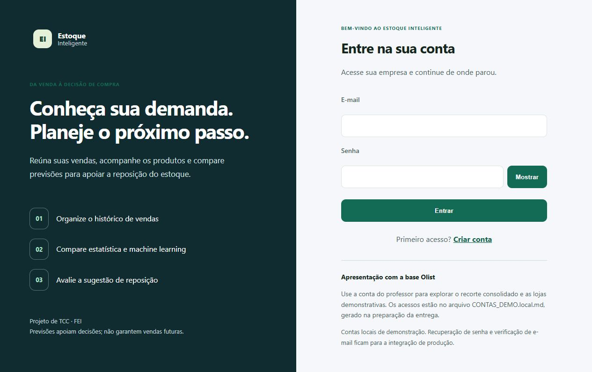

### P02 — Visão geral da operação

Indicadores e gráficos ilustrativos, acompanhados da posição de estoque. Os saldos baixos servem à triagem; a decisão precisa das demais informações do produto.

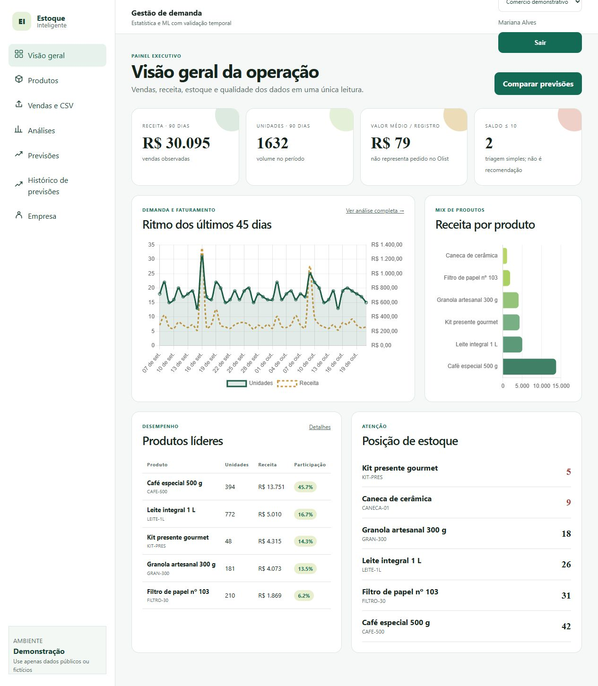

### P03 — Produtos: identificação, parâmetros e saldo

Reúne cadastro e consulta. A tabela possui mais colunas do que cabem simultaneamente na área visível da captura, aspecto a considerar na revisão da navegação horizontal.

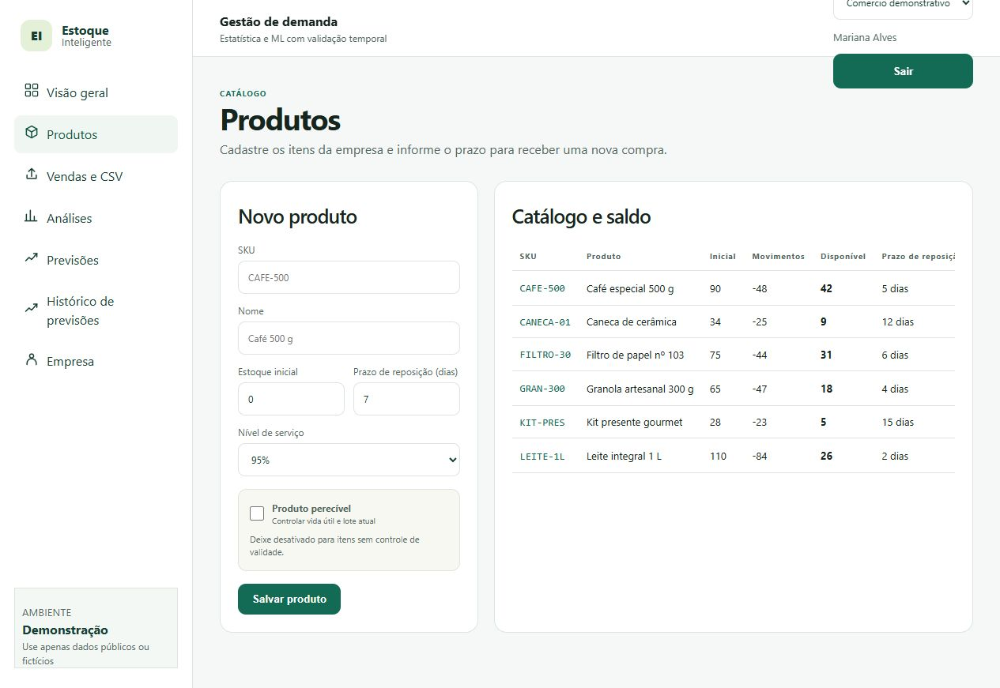

### P04 — Campos de validade do produto

Variação de P03 com a opção de produto perecível selecionada. O estado mostra campos adicionais, sem exigir o salvamento de um novo produto na atividade.

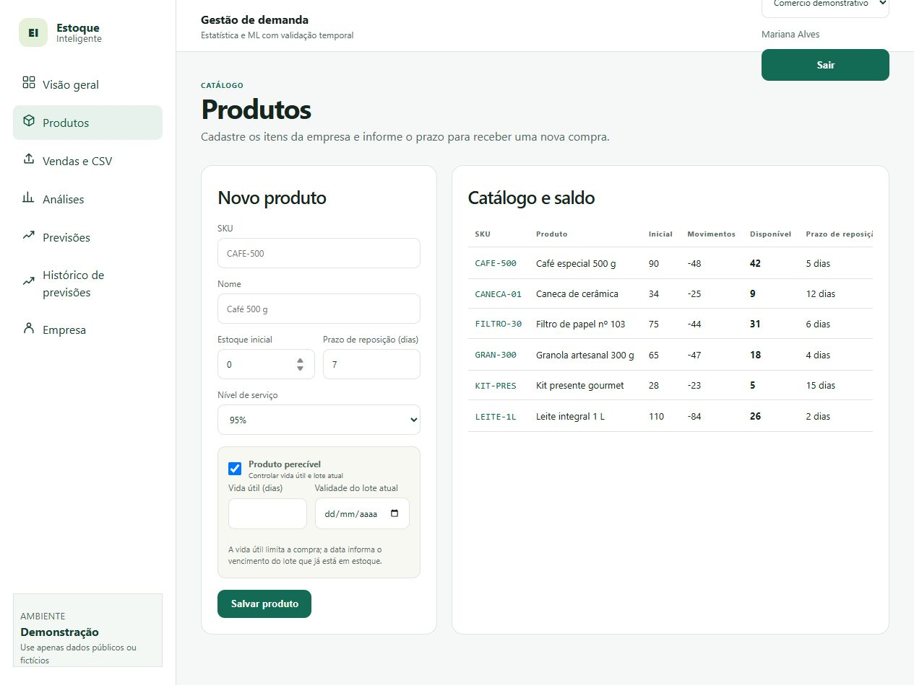

### P05 — Vendas e importações

Oferece entrada manual, importação e consulta das últimas vendas. A consulta é uma fonte inicial para Rafael, mas não equivale ao tratamento completo de uma divergência.

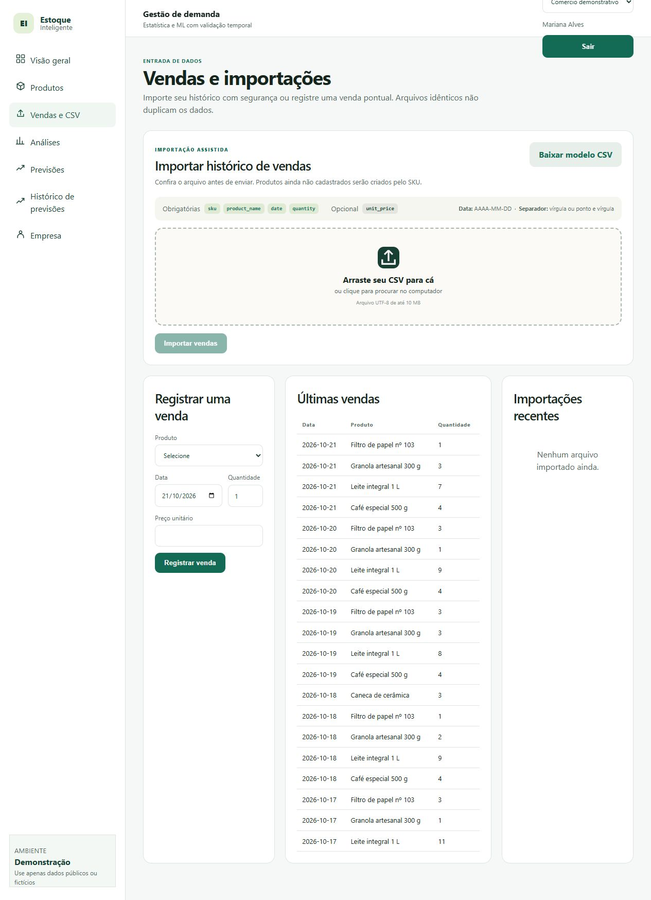

### P06 — Análise de vendas

Mostra períodos, evolução das vendas, participação dos produtos e registros recentes. O facilitador pode perguntar como Mariana distingue histórico observado de valores previstos.

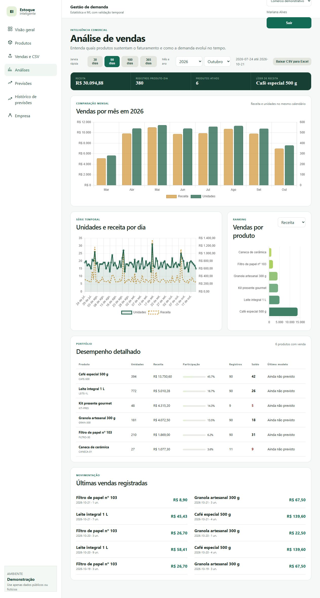

### P07 — Previsões: estado sem resultado exibido

O exemplo mostra Caneca de cerâmica selecionada e nenhum resultado salvo exibido. A mensagem ainda pede que se selecione um produto, embora essa seleção já esteja preenchida; isso é uma oportunidade de revisão do texto, não uma conclusão de teste com usuário.

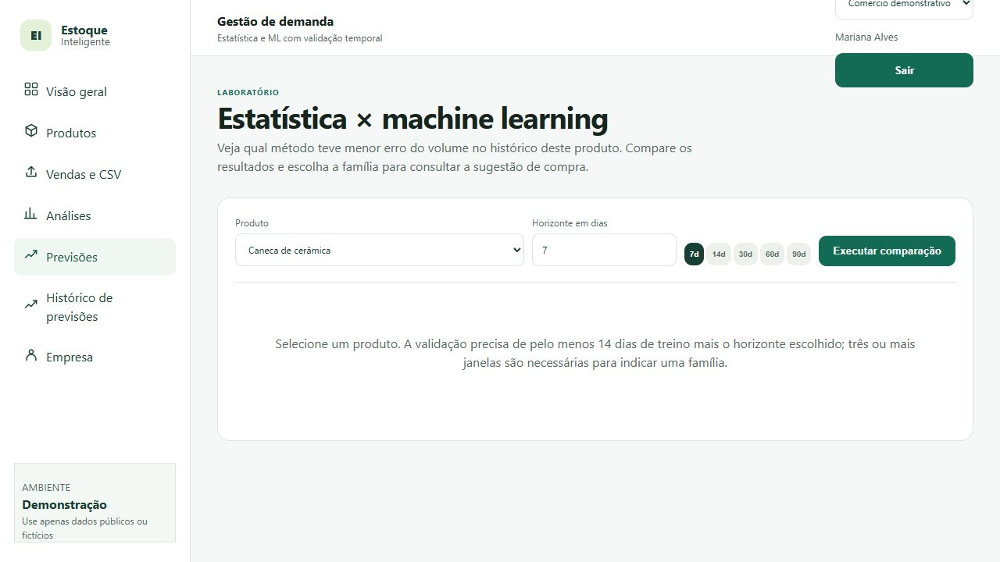

### P08 — Comparação e sugestão de reposição

Exemplo visual para Café especial 500 g, com comparação entre famílias, sugestão, posição de estoque, validade, gráfico e métricas. A imagem registra a interface inteira, incluindo a área abaixo da dobra. Os resultados obtidos sobre dados sintéticos não permitem afirmar superioridade do machine learning em lojas reais.

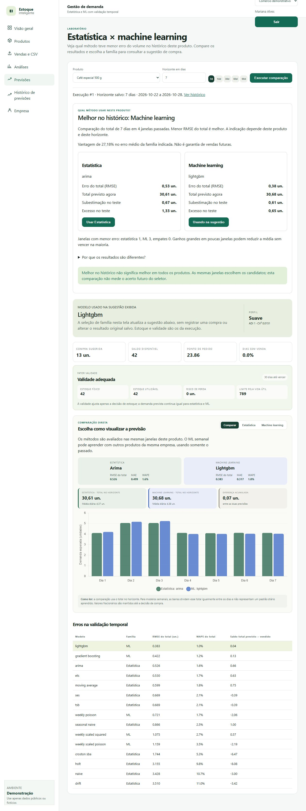

### P09 — Histórico e simulações

Apresenta uma execução demonstrativa salva e a estrutura para selecionar um período passado. Histórico de previsão não é histórico de decisão de compra nem de correção de estoque.

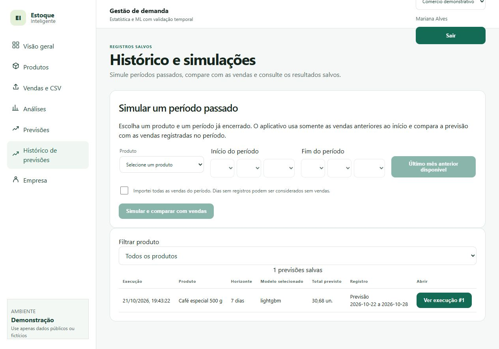

### P10 — Perfil da empresa

Contexto auxiliar da organização. O nome e o endereço de contato são demonstrativos; documentos pessoais e empresariais não foram preenchidos.

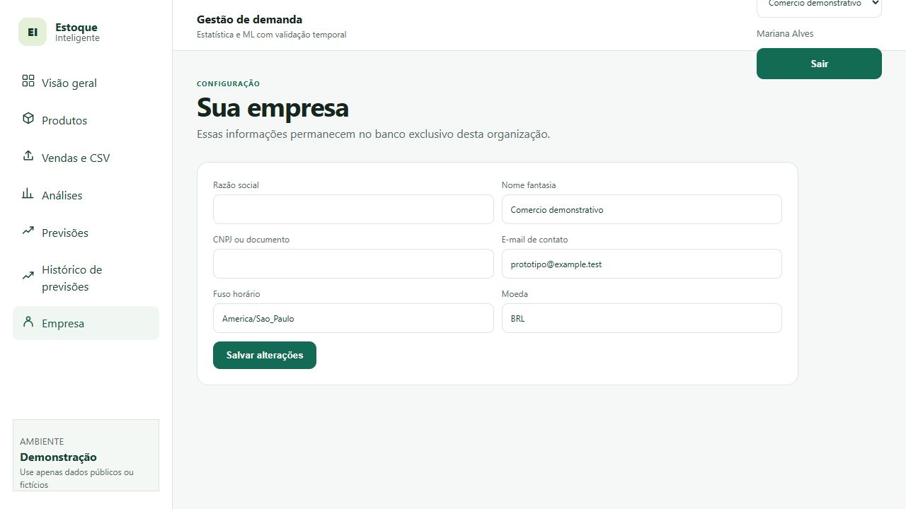

### P11 — Retorno de erro: SKU já cadastrado

Estado capturado ao informar um código já existente na base de demonstração. A mensagem aparece abaixo do formulário e preserva o preenchimento para revisão.

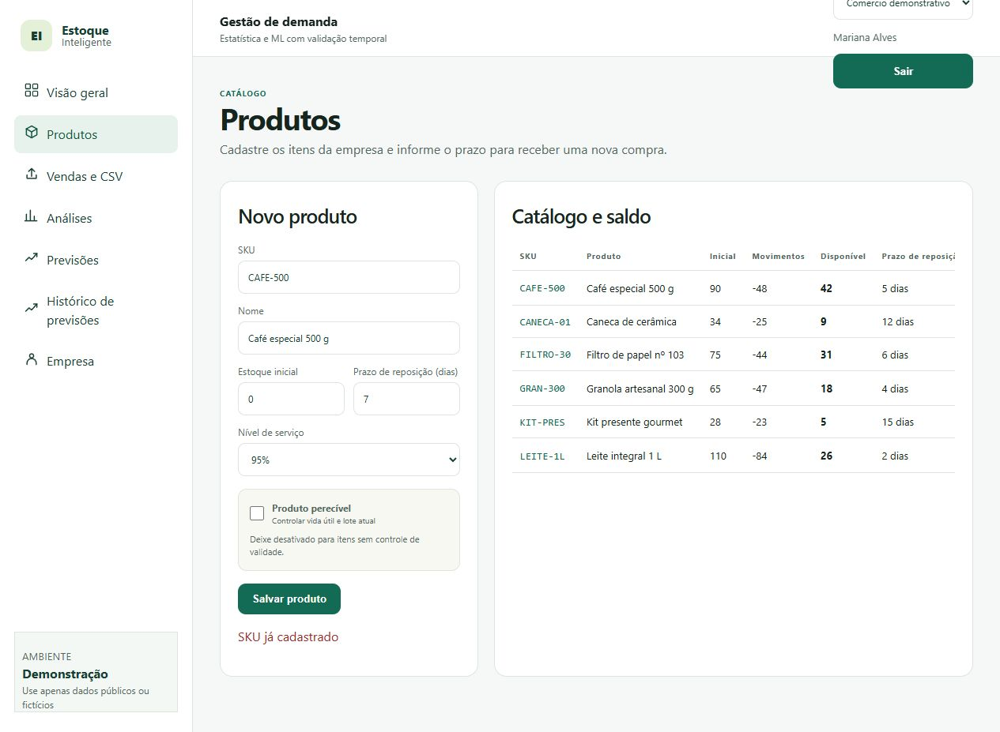

## 4. Simulação / walkthrough

**Situação da etapa:** não foi informada uma simulação com pessoa que não participou da elaboração das telas. Foi realizada somente uma navegação de preparação e conferência das capturas. Isso não substitui o walkthrough formativo solicitado pelo professor, nem os participantes finais da Entrega 14. Não foram coletados falas, tempos, taxas de sucesso ou satisfação de usuários.

As observações abaixo são da inspeção das interfaces e da comparação com as tarefas anteriores. As possíveis dificuldades são hipóteses para investigar com participantes.

| Observação | Tela/ação | Evidência | Consequência para o design |
|---|---|---|---|
| A interface reúne saldo, histórico e previsão, mas exige alternar entre páginas. | P03 → P06 → P08 | Catálogo, análises e previsão aparecem em telas separadas. | Avaliar se o produto e o período ficam claros durante a troca de telas; considerar preservar o contexto do item. |
| A comparação apresenta vocabulário especializado. | P08: interpretar RMSE, WAPE, ADI e CV². | Rótulos e métricas visíveis no resultado. | Investigar a compreensão de Mariana; priorizar linguagem cotidiana e detalhes técnicos sob consulta. |
| A mensagem do estado sem previsão não acompanha completamente a seleção atual. | P07: Caneca de cerâmica selecionada. | Texto “Selecione um produto” permanece com o seletor preenchido. | Propor mensagem específica para ausência de resultado e uma indicação clara do próximo passo. |
| O erro identifica o código duplicado, mas a recuperação pode ser mais orientada. | P11: tentar cadastrar CAFE-500 novamente. | Mensagem “SKU já cadastrado”, mantendo os dados informados. | Propor indicação junto ao campo e caminho para consultar o produto existente. |
| A investigação de divergência não tem desfecho próprio nas imagens atuais. | PF02, P03 e P05. | Saldo e últimas vendas estão disponíveis; não aparece formulário de correção justificada ou pendência. | Projetar o complemento de T02, distinguindo correção de duplicidade de recebimento de mercadoria. |
| Uma execução de previsão não registra a decisão humana. | P08 e P09. | A tela informa que selecionar família não registra compra; o histórico lista previsões. | Projetar planejamento, adiamento e pendência com motivo e confirmação, conforme T01. |
| Há limitações de apresentação no enquadramento atual. | Cabeçalho e tabela de P03; extensão vertical de P08. | Seletor da empresa parcialmente cortado no topo, colunas fora da área inicial e resultado longo. | Revisar o cabeçalho e a leitura das tabelas; avaliar um resumo da decisão antes dos detalhes. Nenhum ajuste foi aplicado nas capturas. |

### Roteiro proposto para a simulação com outra pessoa

1. Apresentar as imagens e informar que os dados são ilustrativos. Pedir que a pessoa indique onde agiria e explique o que espera encontrar, sem exigir operação funcional.
2. **PF01 / contexto de Mariana:** antes do prazo de falar com o fornecedor, consultar um produto para decidir se há informação suficiente para considerar reposição. Perguntar qual é o saldo, qual é o período e o que a previsão permite ou não concluir. Ao chegar à necessidade de registrar a decisão, anotar a ausência dessa tela.
3. **PF02 / contexto de Rafael:** uma contagem física não coincide com o saldo registrado. Pedir que indique quais registros consultaria e como comunicaria o que ainda não conseguiu confirmar. Não tratar alteração do estoque inicial ou novo recebimento como solução automática da divergência.
4. **Retorno de erro:** apresentar P11 e perguntar o que aconteceu e como a pessoa continuaria sem duplicar o produto.
5. Registrar caminhos escolhidos, dúvidas, informações procuradas, necessidade de ajuda e expectativas não atendidas. Identificar as observações com tela e ação, sem atribuir resultados aos perfis fictícios.
6. Após a sessão, converter as observações em decisões de revisão e atualizar a seção 5 com o que efetivamente mudou.

## 5. Alterações após a simulação

**Não há alterações pós-simulação comprovadas nesta versão**, pois a sessão com participante não foi informada. A mudança realizada nesta entrega foi documental: organização das capturas, numeração dos estados e relação com as tarefas. O layout do aplicativo foi preservado. A tabela abaixo registra propostas para uma próxima iteração, e não melhorias já implementadas ou validadas.

| Antes | Problema | Depois | Justificativa |
|---|---|---|---|
| P07 pede seleção mesmo com produto selecionado. | Orientação pouco específica para o estado sem resultado. | **Proposto:** informar “Este produto ainda não tem previsão exibida” e orientar a próxima ação. | Reduzir ambiguidade entre seleção pendente e ausência de previsão. |
| P08 concentra explicações, indicadores e métricas técnicas em uma página longa. | Pode dificultar encontrar a informação prioritária; hipótese a verificar. | **Proposto:** resumo inicial com produto, período, saldo, sugestão e limitações; detalhes técnicos expansíveis. | Aproximar a apresentação da necessidade de Mariana sem ocultar a incerteza. |
| P11 mostra mensagem abaixo do formulário. | O retorno não oferece acesso direto ao cadastro existente. | **Proposto:** destacar o campo SKU e oferecer consulta ao item já cadastrado. | Facilitar recuperação sem repetição do cadastro. |
| P08/P09 mostram resultado e histórico da previsão. | Não atendem ao encerramento de T01. | **Proposto:** estado para planejar, adiar ou deixar pendente, informar motivo, revisar e conferir o registro. | Preservar decisão humana e distinguir previsão, decisão e compra efetiva. |
| P03/P05 apresentam apenas parte das fontes necessárias a T02. | Falta o registro rastreável do desfecho da investigação. | **Proposto:** tela para reunir evidências, confirmar correção fundamentada ou registrar pendência e comunicar seu alcance. | Evitar ajuste arbitrário do saldo e falsa conclusão de que todos os registros foram conferidos. |
| Cabeçalho com conteúdo parcialmente cortado e tabela com colunas fora da área inicial. | Parte do contexto pode passar despercebida na leitura. | **Proposto:** revisar altura/disposição do cabeçalho e tornar evidente a navegação da tabela. | Melhorar visibilidade do contexto sem alterar os dados ou o sentido da tarefa. |

## Checklist

- [ ] O protótipo cobre tarefas relevantes da Entrega 5.
- [ ] Cada tela/estado pode ser justificado por uma tarefa, decisão ou informação necessária.
- [ ] O projeto não criou dashboard/CRUD/login apenas para parecer “completo”.
- [ ] Telas/estados estão numerados e navegáveis na documentação.
- [ ] Há pelo menos uma simulação/walkthrough documentado.
- [ ] Críticas não foram apenas listadas: geraram decisão de revisão.
- [ ] O protótipo continua em baixa fidelidade; detalhes visuais não mascaram problemas de fluxo.
