# Entrega 6 — Prototipação em papel

**Data:** 21/10/2026  
**Revisão:** 25/11/2026  
**Status:** 🟦 revisada após feedback. O walkthrough cognitivo simulado foi documentado em 25/11/2026, sem participante. A sessão de 23/11/2026 com pessoa externa (W01) continua sem observações registradas.  
**Responsabilidade:** 1 solução integrada por equipe — Equipe 14  
**Integrantes:** Paulo Andre de Oliveira Hirata — 22.125.072-3; Victor Merker Binda — 22.125.075-6.  
**Projeto:** Previsão de estoque em pequenos comércios usando machine learning — Estoque Inteligente.

> **Origem e fidelidade das telas.** P01–P11 são capturas de telas que já existiam no projeto e foram reaproveitadas como protótipo. P07-0 a P17P são cartões de baixa fidelidade criados para a simulação. Como as capturas parecem acabadas, a pessoa observada e a própria equipe podem tratar decisões de design como definitivas. Na simulação, essas telas continuam abertas a mudanças: eliminar ou dividir telas, mudar a sequência, reorganizar informações, trocar rótulos e criar estados novos. O objetivo do walkthrough é encontrar problemas, não aprovar a interface atual.

## Objetivo da atividade

Explorar como uma pessoa decide sobre a reposição de um produto e como investiga uma divergência de estoque. A equipe usa imagens que podem ser trocadas, anotadas ou reorganizadas durante a conversa.

As capturas iniciais vieram de `tcc_envio`, com seis produtos demonstrativos e histórico sintético de vendas. A revisão reúne essas capturas e cartões de baixa fidelidade criados para a simulação. As revisões visuais desta entrega estão nos cartões. Os valores usados servem para discutir a interação.

## 1. Escopo do protótipo

**Personas:**

- **Mariana Alves, 65 anos:** proprietária de pequeno comércio, com experiência comercial e pouca familiaridade com tecnologia. Precisa identificar o produto, compreender o saldo e a previsão e manter a decisão de reposição sob seu controle.
- **Rafael Costa, 22 anos:** auxiliar operacional e de estoque, familiarizado com formulários e planilhas. Precisa consultar produtos e registros de vendas para apoiar a conferência do estoque e comunicar divergências à proprietária.

Os perfis continuam sendo personas de projeto, sem validação empírica registrada nesta entrega. Neste documento, os códigos P01 a P17P identificam telas e estados.

**Cenários/tarefas cobertos:**

| Referência anterior | Situação a simular | Desfecho visível |
|---|---|---|
| E4-C01 / T01 · Reposição | Mariana considera o saldo e a previsão do café antes de falar com o fornecedor. | Escolhe planejar uma quantidade, adiar ou deixar uma verificação pendente. Revisa o motivo e confere a decisão registrada em P14. |
| E4-C02 / T02 · Divergência | Rafael investiga se duas anotações representam uma ou duas saídas de conjuntos de potes. | Com origem confirmada e autorização, corrige o desconto duplicado. Com origem incerta, guarda a pendência e preserva o saldo. O histórico mostra o alcance de cada desfecho. |

O catálogo e o episódio do pedido 1042 fornecem exemplos independentes com dados fictícios. O contato com o fornecedor e a conversa final com a proprietária ocorrem fora da interface.

## 1.1 Possíveis famílias de interface

As famílias abaixo organizam as capturas do projeto e os cartões da revisão.

| Família | Telas | Justificativa |
|---|---|---|
| Painel de acompanhamento | P02 | Oferece uma visão inicial de vendas e posição do estoque. O alerta de saldo baixo não equivale a uma recomendação de compra. |
| Entrada e consulta de dados | P03, P04, P05, P11 | Apresenta identificação do produto, parâmetros, saldo, registro de vendas, importação e retorno de erro. |
| Análise e comparação | P06, P07, P08 | Expõe histórico, seleção de período, previsão e comparação dos métodos que apoiam T01. |
| Decisão e conferência | P08-R, P12–P17P | Representa análise, revisão, confirmação e pendência nos dois fluxos. |
| Histórico | P09 | Permite discutir a consulta de uma execução anterior, sem confundi-la com um registro da decisão da proprietária. |
| Acesso e configuração | P01, P10 | Telas auxiliares já existentes; situam o acesso e a empresa. Não são o objetivo principal de T01/T02. |

Não foram acrescentadas telas de administração ou funcionalidades apenas para aumentar a quantidade de imagens.

## 2. Fluxos escolhidos

| Fluxo | Percurso disponível ao facilitador | Por que foi priorizado |
|---|---|---|
| PF01 · Reposição | P02 → P03/P06 → P07-C → P07-P → P08-R → P12 → P13 → P14. A partir de P08-R, abrir P08 para o detalhe ou P09 para o histórico. Em P13, editar volta a P12. | Mariana precisa decidir antes do contato com o fornecedor. Interpretar uma estimativa de vendas como quantidade a comprar mudaria a decisão comercial. |
| PF02 · Conferência | P15 → P16C → P17C quando a origem e a autorização são confirmadas. P15 → P16P → P17P quando falta evidência. Ambas as revisões permitem voltar às fontes. | Um ajuste sem comprovação alteraria o saldo que orienta a próxima reposição. Rafael precisa informar à proprietária qual item foi resolvido e qual verificação continua pendente. |
| PF03 · Cadastro | P03 → P11 → P03. P04 está disponível para consultar os campos de validade. | Um código duplicado afeta a identificação do produto. Esse episódio curto permite explorar se a pessoa consegue retomar o cadastro a partir da mensagem de erro. |

O facilitador mostra uma imagem por vez e segue a ação que a pessoa indicar. O mapa, as respostas do cenário e a ficha de observação ficam com o facilitador. Se a pessoa procurar um caminho sem cartão, registrar sua expectativa.

## 3. Telas e estados

As imagens estão incorporadas neste documento e também disponíveis individualmente na pasta `assets/06_prototipos`. A navegação descrita serve como roteiro de um protótipo estático; não pressupõe que clicar na imagem execute uma função.

| Tela/estado | Informação ou decisão apoiada | Controles e transições representados |
|---|---|---|
| P01 — Acesso | Reconhecer o sistema e acessar a empresa. | E-mail, senha, Mostrar e Entrar; após acesso, P02. Criar conta aparece na interface, mas seu fluxo não foi priorizado. |
| P02 — Visão geral | Identificar a posição do estoque e a evolução das vendas. | Menu lateral para P03/P05/P06/P07/P09/P10; Comparar previsões para P07 ou resultado disponível. |
| P03 — Produtos | Conferir código, nome, saldo e prazo de reposição. | Formulário de produto; Produto perecível abre P04; código já existente leva ao retorno P11. |
| P04 — Produto perecível | Entender a diferença entre vida útil e validade do lote. | Seleção de Produto perecível exibe campos adicionais; desmarcar retorna ao formulário de P03. |
| P05 — Vendas e importações | Consultar vendas e reconhecer meios de entrada do histórico. | Seleção de arquivo, Importar vendas e formulário de venda. Sem arquivo, a importação está desabilitada; há estado vazio em Importações recentes. |
| P06 — Análises | Comparar vendas por período e produto. | Janelas de dias, ano/mês, métrica do ranking e Baixar CSV para Excel; retorno pelo menu. A exportação não é exigida para a simulação visual. |
| P07 e variantes · Previsão | Distinguir seleção, cálculo e motivo de indisponibilidade. | Escolher o produto, executar a comparação, consultar vendas ou tentar novamente conforme o estado. |
| P08 — Resultado da previsão | Comparar métodos, observar sugestão, saldo, validade e limites da interpretação. | Usar Estatística/Usando na sugestão, modos de visualização, explicação expansível e Ver histórico. Selecionar família não registra uma compra. |
| P09 — Histórico e simulações | Identificar registros anteriores e o contexto de uma execução. | Filtrar produto e Ver execução; campos de produto/período e confirmação sobre vendas para simulação passada. Controles inicialmente desabilitados deixam visíveis pré-condições. |
| P10 — Empresa | Reconhecer a organização em uso e seus dados básicos. | Campos do perfil, Salvar alterações e retorno pelo menu. Tela auxiliar, fora do percurso principal das tarefas. |
| P11 — Erro de código duplicado | Perceber que o cadastro não foi aceito e revisar a identificação do produto. | Mensagem “SKU já cadastrado”, com campos ainda preenchidos; revisar o código ou consultar o item existente em P03. |

### P01 — Acesso

Tela já existente para entrada no sistema. Não representa uma pesquisa com Mariana nem uso de uma conta real dela.

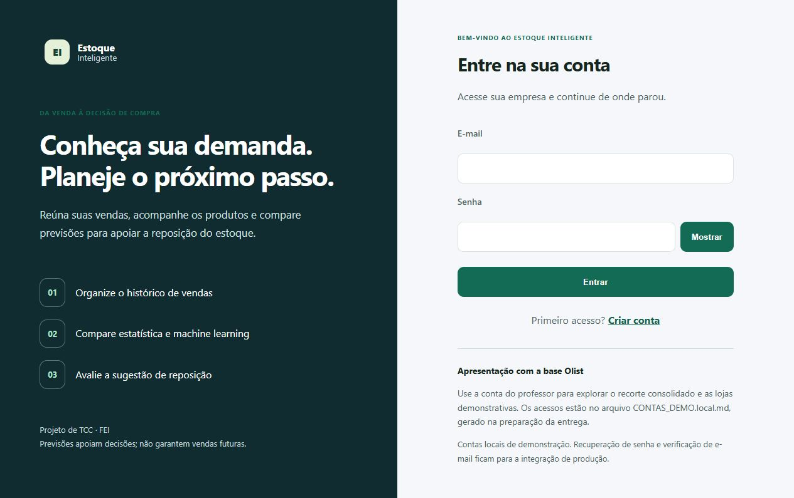

### P02 — Visão geral da operação

Indicadores e gráficos ilustrativos, acompanhados da posição de estoque. Os saldos baixos servem à triagem; a decisão precisa das demais informações do produto.

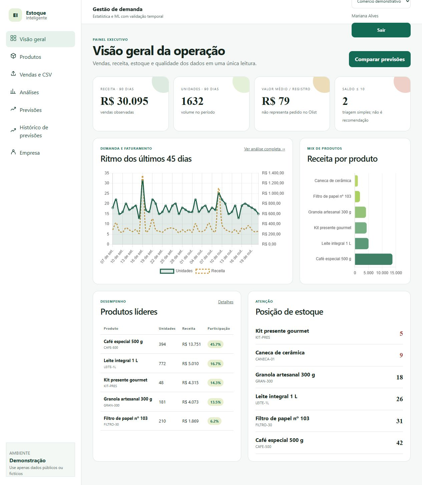

### P03 — Produtos: identificação, parâmetros e saldo

Reúne cadastro e consulta. A tabela possui mais colunas do que cabem simultaneamente na área visível da captura, aspecto a considerar na revisão da navegação horizontal.

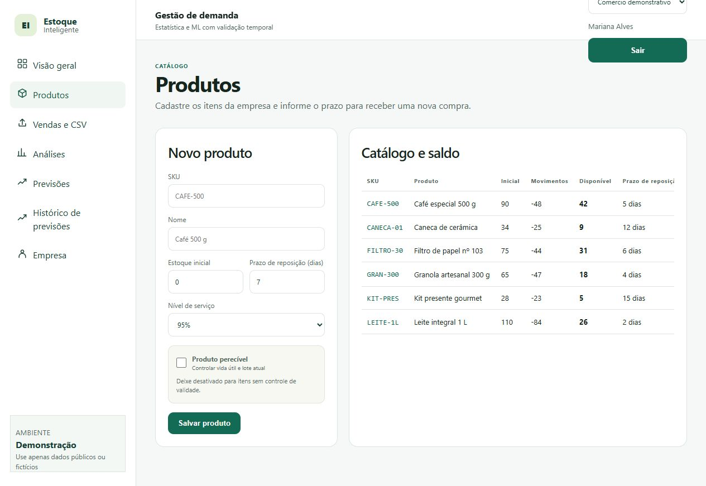

### P04 — Campos de validade do produto

Variação de P03 com a opção de produto perecível selecionada. O estado mostra campos adicionais, sem exigir o salvamento de um novo produto na atividade.

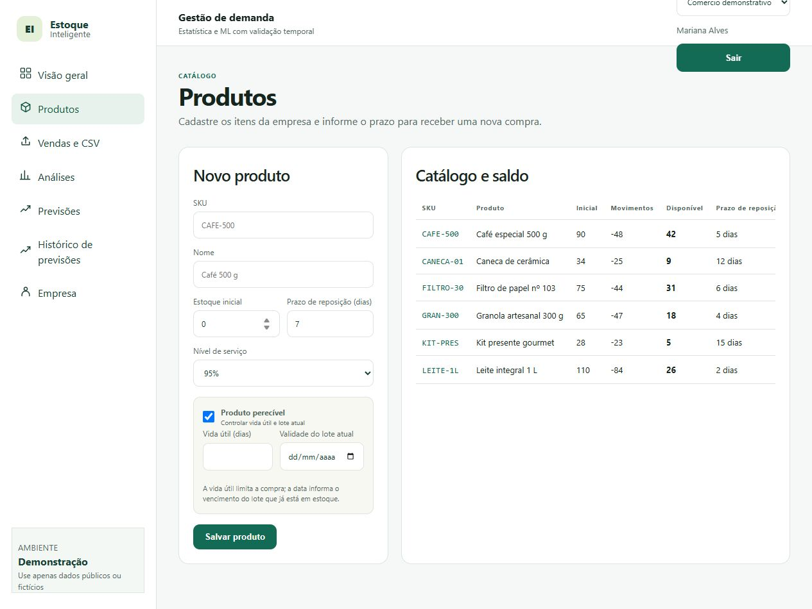

### P05 — Vendas e importações

Oferece entrada manual, importação e consulta das últimas vendas. A consulta é uma fonte inicial para Rafael, mas não equivale ao tratamento completo de uma divergência.

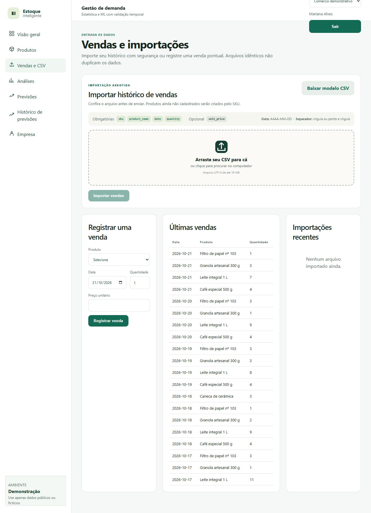

### P06 — Análise de vendas

Mostra períodos, evolução das vendas, participação dos produtos e registros recentes. O facilitador pode perguntar como Mariana distingue histórico observado de valores previstos.

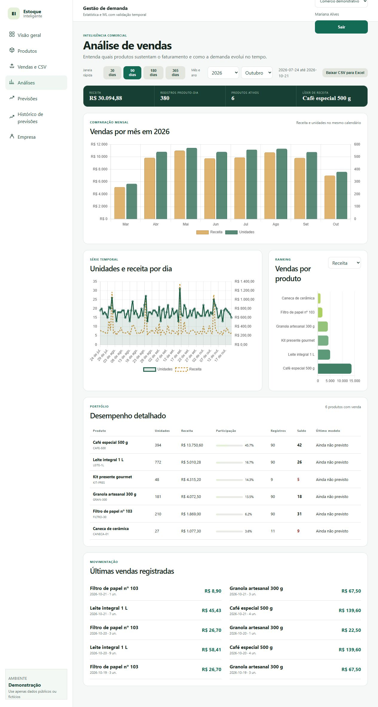

### P07 — Seleção e estados da previsão

Na versão inicial, a instrução pedia uma seleção que a pessoa já havia feito. O cartão revisado conserva a caneca e o período de sete dias e informa que a comparação ainda precisa ser executada.

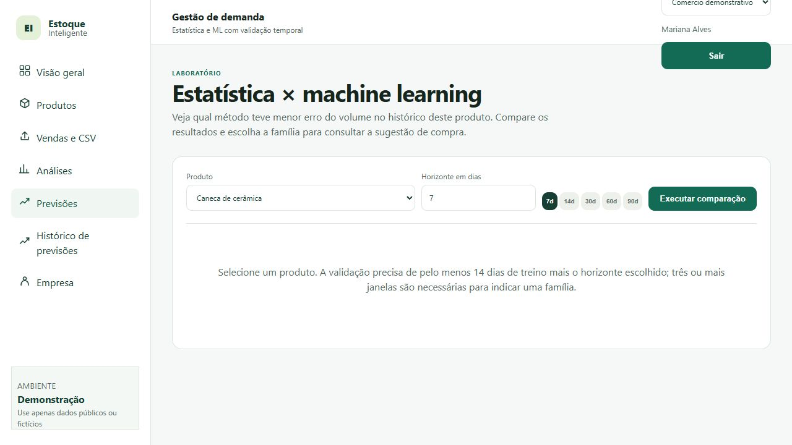

| Quando mostrar | Cartão para a simulação |
|---|---|
| Antes de qualquer seleção. Escolher a caneca leva a P07. |  |
| Ao escolher o café para o episódio de reposição. |  |
| Durante o cálculo do café. Quando o cálculo termina, mostrar P08-R. |  |
| Na variação em que a caneca tem poucos dias de vendas. A pessoa pode consultar P05 ou voltar à seleção do período em P07. |  |
| Na variação em que o cálculo do café falha. Tentar novamente volta a P07-P. |  |

### P08 — Resumo e comparação detalhada

P08-R abre o episódio do café com três informações para a decisão. A estimativa de aproximadamente 31 unidades corresponde a 30,68 na comparação detalhada. O valor de 13 unidades é a sugestão demonstrativa apresentada na captura. Mariana escolhe a quantidade ou outro desfecho.

**P08 · Detalhes da previsão**

Exemplo visual para Café especial 500 g, com comparação entre famílias, sugestão, posição de estoque, validade, gráfico e métricas. A imagem registra a interface inteira, incluindo a área abaixo da dobra. Os resultados obtidos sobre dados sintéticos não permitem afirmar superioridade do machine learning em lojas reais.

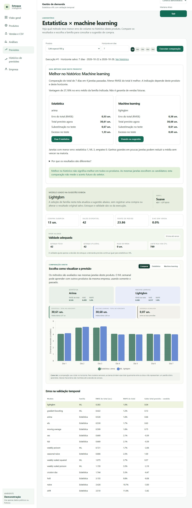

### P09 — Histórico e simulações

Apresenta uma execução demonstrativa salva e a estrutura para selecionar um período passado. Histórico de previsão não é histórico de decisão de compra nem de correção de estoque.

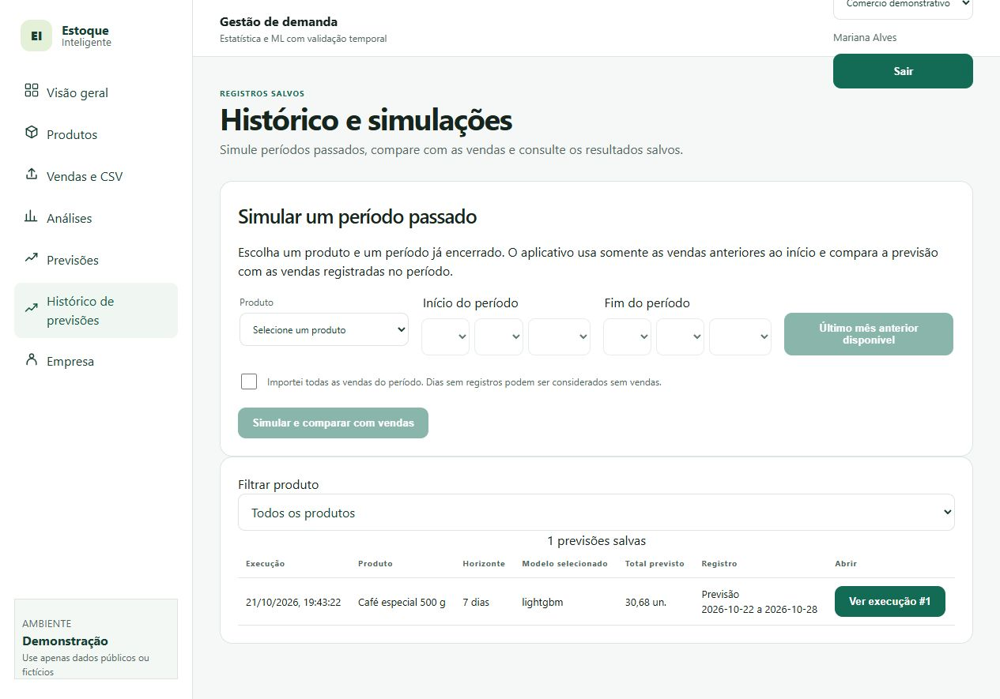

### P10 — Perfil da empresa

Contexto auxiliar da organização. O nome e o endereço de contato são demonstrativos; documentos pessoais e empresariais não foram preenchidos.

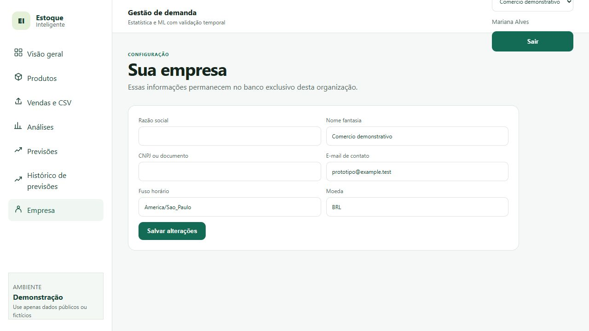

### P11 — Retorno de erro: SKU já cadastrado

Estado capturado ao informar um código já existente na base de demonstração. A mensagem aparece abaixo do formulário e preserva o preenchimento para revisão.

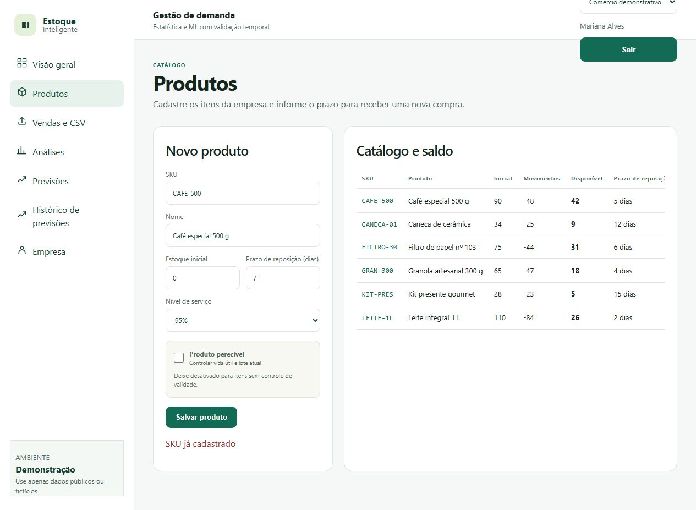

### P12 a P14 — Decisão e registro da reposição

Estes cartões funcionam em papel ou na tela. A pessoa pode escrever a decisão no cartão impresso ou ditá-la ao facilitador. Em P13 e P14, o facilitador transcreve ou lê de volta os mesmos valores e o motivo escolhidos pela pessoa. Os campos em branco fazem parte da simulação.

| Estado | Cartão |
|---|---|
| P12 · Identificar o desfecho e registrar o motivo. Para planejar, informar a quantidade. Para pendência, indicar o que falta e quando verificar. |  |
| P13 · Ler de volta os valores, editar se necessário e confirmar. |  |
| P14 · Conferir o que ficou registrado e explicar o que ainda precisa acontecer fora do sistema. |  |

### P15 a P17 — Investigação, pendência e correção

| Estado | Cartão |
|---|---|
| P15 · Comparar o pedido, a anotação e a contagem. A coincidência das quantidades ainda deixa a origem em aberto. |  |
| P16C · Com confirmação e autorização, revisar o motivo e o efeito de reverter a duplicação. |  |
| P16P · Com origem incerta, revisar a pendência e a verificação seguinte. |  |
| P17C · Conferir o saldo corrigido deste item e o alcance parcial. |  |
| P17P · Conferir o saldo preservado e a pendência registrada. |  |

## 4. Simulação / walkthrough

A equipe registra uma sessão com um participante externo à elaboração das telas, identificado aqui como **W01**, em 23/11/2026. O nome fica fora do repositório. O registro preservado contém apenas o participante e a data. O percurso, as dificuldades e as decisões da sessão não foram registrados, então **esta entrega ainda não tem walkthrough documentado**. As mudanças da seção 5 vêm da inspeção da própria equipe, não da observação.

**Registro da sessão, a preencher pela equipe com as notas de W01 ou de uma nova sessão.** Preencher só com o que foi observado. Campo sem lembrança segura fica marcado como “não registrado”.

| Item | Registro |
|---|---|
| Data, duração e facilitador | 23/11/2026 · não registrado · não registrado |
| Participante e perfil aproximado | W01 · perfil não registrado. Indicar se já trabalhou com estoque ou reposição e qual a familiaridade com sistemas, sem dados pessoais. |
| Fluxos simulados e ordem dos cartões | Não registrado. PF01, PF02 e/ou PF03, e se P08 foi vista antes ou depois de P08-R. |
| Instruções dadas | Não registrado. Usar o texto do roteiro abaixo ou anotar a diferença. |
| Caminhos escolhidos | Não registrado. Sequência de cartões na ordem em que a pessoa pediu. |
| Hesitações, dúvidas e interpretações incorretas | Não registrado. Onde ocorreram e o que a pessoa disse. |
| O que esperava encontrar | Não registrado. Inclui caminhos sem cartão. |
| Estados ou informações ausentes | Não registrado. |
| Ajuda dada pelo facilitador | Não registrado. |
| Mudanças decididas depois da sessão | Não registrado. Levar para a seção 5, na coluna “Origem”. |

Uma observação de uma única pessoa é evidência formativa para revisar o design, não uma conclusão sobre todo o público.

### Sessão W02 — com pessoa externa (agendada)

A sessão segue o [roteiro do walkthrough](../instrumentos/06_roteiro_walkthrough.md), que traz cada passo, as falas do facilitador, a ordem dos cartões e a ficha de anotação. Os campos abaixo foram preenchidos de antemão só com o que o roteiro define. Os campos de observação serão preenchidos **depois da sessão**, com o que acontecer de fato.

| Item | Registro |
|---|---|
| Data, duração e facilitador | Data: a preencher · Planejada: 15–20 min · Facilitador: a preencher |
| Participante e perfil aproximado | W02, pessoa que não participou da elaboração das telas. Perfil: a preencher com as três perguntas do passo 2 do roteiro |
| Fluxos simulados e ordem dos cartões | PF01 (P07-C → P07-P → P08-R → P12 → P13 → P14, com P08 e P09 sob demanda); PF02 se houver tempo (P15 → P16C/P17C ou P16P/P17P); PF03 (P11 → P03) |
| Instruções dadas | As do roteiro, lidas sem alteração. Registrar se alguma precisou ser repetida |
| Caminhos escolhidos | A preencher após a sessão |
| Hesitações, dúvidas e interpretações incorretas | A preencher após a sessão |
| O que esperava encontrar | A preencher após a sessão |
| Estados ou informações ausentes | A preencher após a sessão |
| Ajuda dada pelo facilitador | A preencher após a sessão |
| Mudanças decididas depois da sessão | A preencher após a sessão. Levar para a seção 5 com a origem “walkthrough W02” |

### Walkthrough cognitivo simulado — 25/11/2026

**O que é e o que não é.** Como a sessão com W01 não tem registro, a equipe fez uma **simulação analítica** dos três percursos, com apoio de um assistente de IA. **Nenhuma pessoa externa participou.** Por isso, o registro abaixo não traz falas, tempos nem reações de W01. Ele aplica o método do walkthrough cognitivo: em cada passo, o avaliador assume o lugar da persona e responde a quatro perguntas.
1. A pessoa tentaria atingir este efeito?
2. Ela percebe que a ação correta está disponível?
3. Ela associa a ação ao efeito desejado?
4. Depois de agir, ela percebe que avançou?

Esse é um método de inspeção e não substitui a sessão com pessoa externa pedida no feedback.

| Item | Registro |
|---|---|
| Avaliadores | Equipe 14, com apoio de assistente de IA, sem participante |
| Perfis simulados | Mariana (P01) em PF01; Rafael (P02) em PF02 e PF03 |
| Fluxos e ordem dos cartões | PF01: P07-C → P07-P → P08-R → P12 → P13 → P14. PF02 com origem confirmada: P15 → P16C → P17C. PF02 com origem incerta: P15 → P16P → P17P. PF03: P11 → P03 |
| Instruções | As do roteiro abaixo, lidas como se fossem para a persona |

**Pontos encontrados, por passo**

| Passo | Pergunta que falhou | O que a persona provavelmente faria ou esperaria | Gravidade |
|---|---|---|---|
| P07-C e P08-R · período | 3 | O cabeçalho mostra “22 a 28 de outubro” e o resumo diz “Previsão para 7 dias”. Mariana pode não saber se o intervalo é o histórico consultado ou os próximos dias da previsão. | Média |
| P08-R · sugestão | 3 | “Sugestão da simulação: 13 unidades” fica logo acima de “Registrar decisão”. Mariana pode copiar 13 como quantidade sem entender a base do número. Além disso, o signo ainda depende de regra técnica confirmada no TCC. | Média |
| P08-R · saldo | 1 | “Saldo disponível: 42 unidades” não mostra se há unidades comprometidas. No café não há reserva, então o percurso funciona. Num item com reserva, faltaria a separação usada depois na E9. | Baixa |
| P12 · desfechos | 3 | A diferença entre “Adiar” e “Deixar pendente” não aparece no cartão. Mariana pode escolher qualquer um dos dois quando não vai comprar agora. | Média |
| P14 · conclusão | 4 | “Conferir registro” não leva a outro cartão. A persona não sabe se ainda precisa fazer algo. O texto sobre o fornecedor resolve a dúvida principal. | Baixa |
| P15 · consulta | 3 | “Consultar Mariana” sugere que o sistema envia a pergunta. Rafael pode esperar uma resposta dentro da tela, mas a consulta acontece fora do sistema. | Média |
| P15 e P16P · rótulos | 2 | O mesmo ato aparece como “Registrar pendência” (P15) e “Salvar pendência” (P16P). | Baixa |
| P17C e P17P · registro | 4 | O histórico não mostra quem registrou nem quando, embora Mariana precise saber isso ao receber o resultado. | Baixa |
| P11 · erro | 2 | “SKU já cadastrado” aparece em texto pequeno, abaixo do botão e longe do campo SKU. Para quem não conhece o termo “SKU”, a mensagem não indica como encontrar o cadastro existente. | Média |

**Decisões de revisão.** Nenhuma alteração estrutural foi decidida. Nenhum cartão foi redesenhado e os fluxos PF01–PF03 foram mantidos. Os pontos geraram ajustes de texto e de estado, a maioria já incorporada no protótipo navegável da E11:
- O período da previsão foi separado do histórico de vendas: “Previsão de demanda · 5 unidades nos próximos 3 dias” e “Vendas confirmadas · últimos 3 dias” (F02).
- A sugestão de reposição foi mantida como signo condicional e não aparece no Figma (E9 e E11).
- A disponibilidade foi decomposta em física, comprometida e disponível (F02).
- Adiamento e pendência ganharam descrições próprias (F03), e só a pendência pede a próxima verificação (F05P).
- A consulta a Mariana ficou explicitamente fora do sistema (F11 e F13).
- Responsável e data passaram para uma linha própria no histórico (F13, F14 e F14N).
- **Pendente para uma versão futura:** aproximar a mensagem de código duplicado do campo e oferecer acesso ao cadastro existente. A tela de cadastro não faz parte de T01/T02 nem do protótipo da E11.

**Percursos previstos nas telas originais P01–P11**

| Tarefa | Percurso que as telas permitiam | Limite da versão |
|---|---|---|
| Reposição | Em P07, conferir o produto e o período. No exemplo do café em P08, consultar o saldo, a previsão de vendas e a sugestão de compra. Em P09, consultar as previsões anteriores. | O histórico guardava as previsões. Faltava um local para registrar a decisão da loja e seu motivo. |
| Conferência de estoque | Em P03, identificar o produto e o saldo. Em P05, consultar as últimas vendas e procurar a origem da diferença. | A consulta terminava antes do registro de uma correção fundamentada ou de uma pendência. |
| Recuperação do cadastro | Em P11, ler o aviso de código duplicado e conferir os dados preservados. Voltar a P03 permitia procurar o cadastro existente. | A mensagem e a consulta ao produto ficavam em telas diferentes. |

**Roteiro da versão revisada em 24/11/2026.** Os episódios abaixo descrevem os caminhos disponíveis para simular a reposição, a conferência e a recuperação de um erro com os cartões revisados.

| Episódio | Instrução que a pessoa recebe | Orientação reservada ao facilitador |
|---|---|---|
| PF01 · Reposição | “O fornecedor vai ligar hoje. Veja a situação do café e deixe registrado como pretende proceder.” | Mostrar o produto e seguir as escolhas. Em P08-R e P08, anotar o que a pessoa lê primeiro, quais valores usa e que termos pede para explicar. Ao final, perguntar o que ficou registrado e o que faria a seguir. Anotar se buscou detalhes e o que dispensaria. |
| PF02 · Conferência | “A contagem dos conjuntos de potes diverge do saldo da loja. Investigue e explique à proprietária como ficou este item.” | Começar em P15. Só quando a pessoa pedir confirmação, responder no papel de Mariana. Em uma rodada: “Anotei o mesmo pedido. Só saíram dois conjuntos. Você pode corrigir o lançamento.” Na outra: “Hoje não consigo confirmar se foi o mesmo pedido.” Registrar a escolha e o saldo que a pessoa espera em cada caso. |
| PF03 · Recuperação | “Você tentou cadastrar o café e recebeu esta mensagem. Como continuaria?” | Mostrar P11. Observar se identifica o código repetido, percebe os dados preservados e encontra uma forma de prosseguir. |

Apresentar os dados como fictícios. Deixar a pessoa escolher e pedir que conte o que esperava encontrar antes de trocar de cartão. Registrar pedidos de ajuda e qualquer orientação dada. Para comparar P08 com P08-R, anotar a ordem em que as duas versões foram vistas.

## 5. Alterações após a simulação

**Decisão sobre a continuidade do projeto.** A equipe manteve os fluxos de reposição e conferência já definidos. Os modelos M01 e M02 da Entrega 10 descrevem a escolha de Mariana sobre a reposição e a investigação de Rafael antes de corrigir o saldo. Na Entrega 11, o Figma de 11/11/2026 já representava planejamento, adiamento, correção e pendência. Esses caminhos precedem o walkthrough de 23/11. Nas entregas consultadas, nenhuma decisão posterior de projeto foi atribuída a essa sessão. [Modelos da Entrega 10](https://github.com/poulison/Projeto-ihc2026/blob/main/docs/10_molic.md) · [Cobertura do protótipo na Entrega 11](https://github.com/poulison/Projeto-ihc2026/blob/main/docs/11_figma.md)

Em 24/11/2026, a equipe revisou o material da Entrega 6 para atender ao parecer do professor. Os cartões de reposição e conferência passaram a mostrar desfechos que o projeto já previa. A tabela registra as mudanças feitas nessa revisão.

Todas as linhas abaixo têm a mesma **origem: inspeção interna da equipe**, feita antes do walkthrough cognitivo simulado. Os pontos desse walkthrough e as decisões correspondentes estão na seção 4. Se a sessão com W01 for registrada depois, acrescentar as mudanças observadas com origem “walkthrough W01”, separando problema percebido antes da sessão, problema observado, decisão de revisão e alteração realizada.

| Antes | Problema | Depois | Justificativa |
|---|---|---|---|
| P07 pedia a seleção de um produto apesar de já mostrar a caneca. | A mensagem contradizia a seleção visível. | P07 mantém a caneca e os sete dias e informa que a comparação aguarda execução. Os cartões alternativos distinguem seleção vazia, histórico insuficiente, processamento e falha. | O próximo passo depende do estado. Quem já escolheu o produto pode executar a comparação. |
| P08 reunia estoque, modelos, validade, gráficos e métricas em uma página extensa. | Para decidir sobre o café, era preciso localizar dados comerciais entre resultados técnicos. | P08-R reúne saldo disponível, previsão do período e sugestão em um cartão. A ação “Ver comparação detalhada” dá acesso à P08 original. | A decisão começa com três informações do comércio. A comparação completa continua disponível para quem quiser investigar os números. A facilidade de leitura por participantes ainda precisa ser observada. |
| P08 e P09 mostravam resultado e histórico de previsão. | A pessoa chegava ao fim da consulta sem um registro da decisão tomada. | P12–P14 representam planejamento, adiamento ou pendência, com motivo, revisão e confirmação. | A equipe pode percorrer a tarefa até o registro interno e conferir o que ainda depende de contato com o fornecedor. |
| P03 e P05 permitiam consultar catálogo e vendas. | Faltava confrontar a origem da diferença e comunicar um desfecho restrito ao item. | P15 apresenta as fontes. P16C/P17C mostram revisão e correção autorizada. P16P/P17P mostram pendência e saldo preservado. | A correção exige evidência. Se a origem continua incerta, o histórico conserva o saldo e a próxima verificação. |
| O mapa de percurso era um arquivo de exemplo do template. | O arquivo não mostrava como alternar as imagens. | O diagrama incorporado na seção 2 identifica PF01, PF02 e PF03 e seus desfechos. | O facilitador pode preparar os cartões na ordem de cada episódio. |

## Checklist

- [x] O protótipo cobre tarefas relevantes da Entrega 5.
- [x] Cada tela/estado pode ser justificado por uma tarefa, decisão ou informação necessária.
- [x] O projeto não criou dashboard/CRUD/login apenas para parecer “completo”.
- [x] Telas/estados estão numerados e navegáveis na documentação.
- [x] Há pelo menos uma simulação/walkthrough documentado.
- [x] Críticas não foram apenas listadas: geraram decisão de revisão.
- [ ] O protótipo continua em baixa fidelidade; detalhes visuais não mascaram problemas de fluxo.

Revisado em 25/11/2026. Os quatro primeiros itens foram conferidos no conteúdo da entrega: P12–P17P completam T01 e T02, P01 e P10 foram mantidas como telas auxiliares existentes, e não foram criadas telas novas além dos desfechos. A simulação documentada é o **walkthrough cognitivo simulado, sem participante**. Ele atende ao item como inspeção, mas não substitui a sessão com pessoa externa pedida no feedback. As decisões de revisão vêm desse walkthrough e da inspeção interna. Fica desmarcado:
- **baixa fidelidade:** P01–P11 são capturas de alta fidelidade; só os cartões P07-0 a P17P são de baixa fidelidade.
