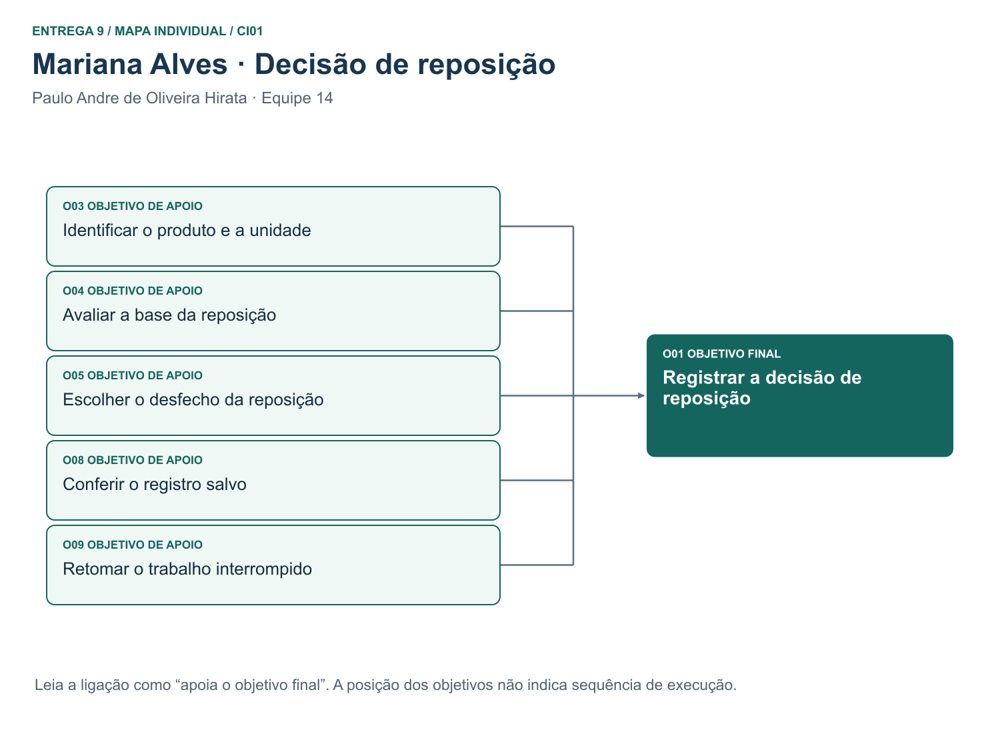
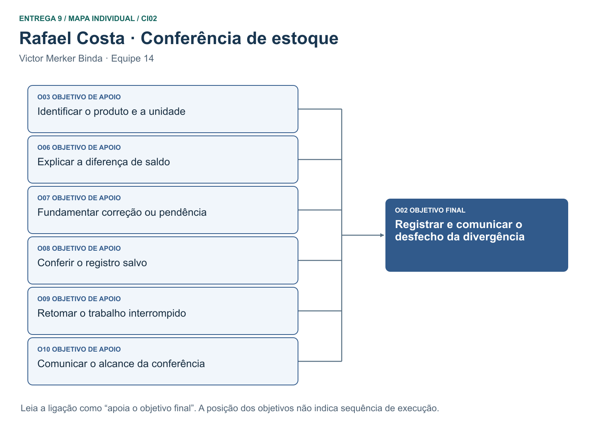
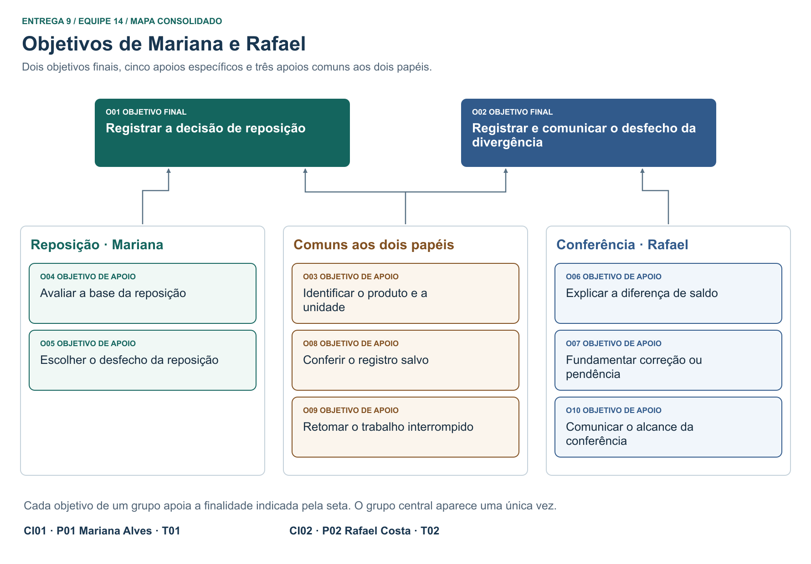

# Entrega 9 — Modelo conceitual e design centrado na comunicação

**Data:** 06/11/2026    
**Status:** 🟩 concluída.  
**Responsabilidade:** Paulo Andre de Oliveira Hirata — CI01; Victor Merker Binda — CI02. O mapa consolidado, o dicionário de objetivos e o esquema de signos abrangem as duas soluções.

## Objetivo da atividade

Passar do cenário de problema para uma concepção da interação, explicitando objetivos, tópicos de conversa, falas e signos que a interface deverá comunicar/manipular.

## Transformando resultados técnicos em conceitos compreensíveis

Em TCCs algorítmicos ou orientados a dados, esta entrega deve evitar que a interface exponha apenas estruturas internas do código. Identifique os **conceitos e signos que fazem sentido para o usuário**.

Exemplos:

- `query plan`, custo estimado, recomendação e impacto para um DBA;
- modelo, dataset, versão, execução e métrica para engenheiro de IA;
- período, indicador, grupo, tendência e filtro para gestor/analista;
- alerta, severidade, evidência, responsável e status para analista de segurança.

Se um termo técnico for necessário, modele como será comunicado, explicado e relacionado à tarefa.

Dashboards, relatórios, filtros e CRUDs devem aparecer no modelo conceitual por meio dos **objetivos, signos e conversas** que justificam sua existência.

## 1. Cenários de interação

O texto regular conserva o contexto e os fatos dos episódios hipotéticos da E4, aqui resumidos. **Em negrito estão as intervenções que substituem ou acrescentam ações e respostas em relação ao cenário de problema.** Os cenários descrevem o que as pessoas fazem e o que recebem de volta; escolhas de controles ou de layout ficam para o protótipo.

### CI01 — Decidir a reposição da garrafa antes do prazo do fornecedor

**Autor(a):** Paulo Andre de Oliveira Hirata — 22.125.072-3  
**Origem:** E4-C01 · R04-01 · T01 · P01 — Mariana Alves.

É segunda-feira. O fornecedor recebe pedidos até as 12h para entrega na quinta-feira. Mariana atende o balcão e precisa decidir se prioriza a garrafa térmica azul de 500 ml, sem comprometer o dinheiro destinado a outros produtos. Conta seis garrafas; duas já estão separadas para um pedido pago. Parte do caderno menciona apenas “garrafa”, e perguntas por mensagem não equivalem a vendas.

**Mariana identifica a variação antes de consultar a análise. Ao confrontar a contagem e o compromisso do mesmo item, obtém a explicação: seis presentes, duas comprometidas, quatro disponíveis para outra venda. O sistema distingue as vendas confirmadas das consultas e informa a atualização da base. Se houver previsão para aquele produto, informa a unidade e o horizonte; se não houver resultado, deixa a ausência explícita.** Rafael está ocupado, e sua lembrança das vendas continua sem período confirmado.

Um cliente interrompe Mariana. **Ao voltar, ela recupera o produto, os dados que já conferiu e a decisão ainda não salva. Se a base mudou durante a pausa, revê os valores antes de confirmar.** Considerando o prazo, os recursos e sua experiência com a última compra, **Mariana planeja seis unidades por escolha própria. Revisa o produto, a quantidade e o motivo. Só depois de confirmar recebe o registro do planejamento salvo e a indicação de que o fornecedor não foi contatado.** O contato com o fornecedor permanece uma ação separada; a adequação da compra só poderá ser avaliada após entrega e vendas posteriores.

**Alternativas:** **se decidir não comprar neste ciclo, Mariana registra adiamento e motivo. Se faltar um dado indispensável, registra pendência e o que precisa verificar; não é obrigada a preencher uma quantidade. Se o salvamento não for confirmado, consulta o estado do registro antes de tentar de novo.**

### Diferenças relevantes

| Alteração | Por que foi necessária | Evidência/artefato que justifica |
|---|---|---|
| Da anotação genérica à identificação da variação e da quantidade disponível | Evitar planejar com a garrafa errada ou contar as duas unidades já comprometidas | E4-C01-Q3/Q7; E5-T01, HTA 1–2; E6-P03; E8-MU02 |
| Da memória sem período à distinção entre vendas, previsão e ausência de resultado | Um número só ajuda quando se sabe a que produto, unidade e intervalo se refere | E3-DP03/DP05/DP07; E6-P06/P07/P08; E8, caso T01-B |
| Da releitura após pausa à retomada de um registro identificável | Mariana precisa reconhecer o que falta e se já houve gravação | E4-C01-Q6; E5-T01, plano de interrupção; E8-MU07 |
| Do pedido direto a um planejamento, adiamento ou pendência revisável | A responsabilidade comercial é de Mariana; registro salvo não comprova compra enviada | E4-C01-Q5/Q8; E3-DP06; E6-PF01, lacuna final; E8-MU02 |

### CI02 — Explicar a diferença no saldo dos conjuntos de potes

**Autor(a):** Victor Merker Binda — 22.125.075-6  
**Origem:** E4-C02 · R04-02 · T02 · P02 — Rafael Costa; P01 — Mariana, fonte e destinatária.

No fim da tarde, Mariana pede a Rafael a conferência das movimentações para a compra da manhã seguinte. Há quatorze registros de origem, que podem incluir transcrições da mesma venda. O produto é um conjunto de três potes: um conjunto corresponde a uma unidade comercial, não a três saídas. O saldo registrado é oito; a contagem física, dez.

**Rafael delimita o episódio por produto e unidade. Localiza o pedido identificado e confronta data, quantidade e situação com a anotação de “2 conjuntos de potes” e as duas transcrições. O sistema mantém os registros candidatos visíveis como suspeita, sem escolher automaticamente uma causa.** Rafael precisa se afastar para separar uma encomenda. **Ao retornar, recupera as linhas já comparadas e a próxima verificação: confirmar com Mariana a origem da anotação. O saldo ainda não foi alterado.**

Mariana confirma que anotou a mesma venda online de dois conjuntos. O pedido foi enviado, não foi cancelado e não há outra saída correspondente à segunda linha. **Com a origem confirmada e dentro da autorização prevista para o episódio, Rafael vincula o motivo à transcrição duplicada. Antes de confirmar, verifica o efeito esperado: retirar apenas o segundo desconto muda o saldo de oito para dez; não houve entrada de dois conjuntos. Confere o registro salvo, o saldo e a contagem. Informa Mariana de que este produto foi reconciliado e indica quais registros ainda aguardam verificação.**

**Alternativas:** **se Mariana não puder confirmar a origem, houver evidências contraditórias ou faltar autorização, Rafael registra a pendência e a próxima verificação. O saldo permanece oito, sinalizado como não confirmado. Se outro registro mudou durante a pausa, Rafael reconfere a base; uma solicitação de gravação sem resposta não autoriza repetir a correção.**

### Diferenças relevantes

| Alteração | Por que foi necessária | Evidência/artefato que justifica |
|---|---|---|
| Do confronto disperso ao vínculo entre episódio e registros de origem | Duas linhas iguais podem representar duas vendas ou duas cópias da mesma venda | E4-C02-Q3/Q5/Q7; E5-T02, HTA 1–2; E6-P03/P05, cobertura parcial |
| Da retomada por memória à indicação das linhas verificadas e da pendência | Evitar omissão ou segunda correção depois da embalagem | E4-C02-Q6; E3-DP12; E8-MU07 |
| Da substituição possível do saldo à revisão de uma correção fundamentada | Igualdade com a contagem não basta para explicar o movimento | E4-C02-Q4/Q7; E5-T02, HTA 3–4; E7-I02; E8-MU04 |
| Do aviso genérico a um resultado por item com pendências explícitas | Resolver o item não encerra os quatorze registros | E4-C02-Q8; E6-PF02, lacuna final; E8, casos T02-A/B |

## 2. Design centrado na comunicação

`U` é o usuário no papel indicado; `D` é o preposto do designer, isto é, a voz do projeto por meio do sistema. As falas são propostas para examinar a conversa, não transcrições de participantes. A mensagem do projeto é: *você pode conferir a origem dos dados, decidir com sua experiência e verificar o que ficou registrado; quando algo for desconhecido, isso continuará visível.*

**Nome do cenário:** CI01 — Decidir a reposição da garrafa antes do prazo do fornecedor.

| Tópico > subtópico | Falas e signos envolvidos | Intenção/efeito esperado |
|---|---|---|
| O01 Registrar a decisão de reposição | **U:** “Preciso decidir sobre a garrafa antes do meio-dia.” **D:** “Vamos conferir o item e a base da decisão.” | Iniciar T01 com a decisão sob controle de Mariana. |
| > O03 Identificar o produto e a unidade | **U:** “É a garrafa azul de 500 ml, vendida por unidade.” **D:** “A análise é dessa variação.” **Signos:** produto, unidade de venda. | Evitar a associação com outra garrafa. |
| > O04 Avaliar a base da reposição | **D:** “Há seis garrafas na loja, duas comprometidas e quatro livres. Neste exemplo, a estimativa é vender cinco unidades nos próximos três dias.” **U:** “Cinco é uma previsão de vendas, não a quantidade que preciso comprar.” **Signos:** contagem física, quantidade comprometida, quantidade disponível, vendas confirmadas, horizonte, previsão de demanda, atualização da base. | Distinguir disponibilidade e demanda futura. Cinco unidades e três dias são valores fictícios deste diálogo, não um resultado medido nem horizonte fixo do TCC. |
| > O04 Entender a ausência de resultado | **D:** “Para este horizonte não há previsão disponível. Posso mostrar as vendas confirmadas e seu período.” **U:** “Então não sei quanto vou vender; não significa que a previsão seja zero.” | Corrigir a ambiguidade observada em E6-P07 sem responsabilizar Mariana por uma seleção já feita. |
| > O09 Retomar o trabalho interrompido | **U:** “Em que ponto parei?” **D:** “Você conferiu a garrafa; ainda não confirmou a decisão. Se a base mudou, confira os novos valores.” **Signos:** ponto de retomada, estado do registro. | Voltar ao mesmo item e não repetir um salvamento. |
| > O05 Escolher o desfecho da reposição | **U:** “Ainda dá tempo de pedir. Pelo meu caixa e pela compra anterior, planejo seis.” **D:** “Sua decisão é planejar seis unidades. Quer revisar?” **Signos:** prazo do fornecedor, desfecho da reposição, quantidade planejada, motivo. | Separar quantidade escolhida de eventual sugestão de reposição. |
| > O05 Adiar ou deixar pendente | **U:** “Se eu decidir não comprar, adio. Se precisar confirmar a reserva, deixo a análise pendente.” **D:** “No adiamento, registre o motivo; na pendência, indique também a próxima verificação.” | Não obrigar a informar quantidade em alternativas que não são compra planejada. |
| > O08 Conferir o registro salvo | **U:** “Confirmo este planejamento.” **D:** “Planejamento salvo para a garrafa: seis unidades. Nenhum pedido foi enviado.” Se a gravação for incerta: **D:** “Ainda não há confirmação. Consulte o registro antes de reenviar.” | Distinguir confirmação, espera e falha; não prometer envio nem persistência não verificada. |

**Nome do cenário:** CI02 — Explicar a diferença no saldo dos conjuntos de potes.

| Tópico > subtópico | Falas e signos envolvidos | Intenção/efeito esperado |
|---|---|---|
| O02 Registrar e comunicar o desfecho da divergência | **U:** “Preciso explicar por que o saldo não bate.” **D:** “Qual item e quais registros você está conferindo?” | Delimitar um episódio, sem iniciar compra nem ajuste automático. |
| > O03 Identificar o produto e a unidade | **U:** “Conjunto de três potes, vendido por conjunto.” **D:** “Saldo registrado: oito conjuntos. Contagem: dez conjuntos.” | Comparar quantidades na mesma unidade comercial. |
| > O06 Explicar a diferença de saldo | **U:** “Quais linhas podem corresponder a este pedido?” **D:** “Há duas transcrições de uma saída de dois conjuntos. A anotação não tem identificador; a coincidência é um indício.” **Signos:** evidência de origem, situação da evidência. | Separar a suspeita de duplicidade da comprovação de que foi uma única venda. |
| > O09 Retomar o trabalho interrompido | **U:** “Voltei da embalagem. Já corrigi algo?” **D:** “Ainda não. Você comparou estas linhas; falta confirmar a anotação com Mariana.” | Distinguir investigação em andamento de correção efetivada. |
| > O07 Fundamentar correção ou pendência | **U:** “Mariana confirmou: a anotação é do mesmo pedido enviado. A segunda linha repete a saída.” **D:** “Será desfeito apenas o desconto duplicado: de oito para dez. Revise a origem e o motivo antes de confirmar.” **Signos:** correção da transcrição, motivo, saldo registrado. | Prevenir alteração arbitrária e manter explicação recuperável. |
| > O07 Registrar falta de confirmação | **U:** “Não consegui verificar se é a mesma venda.” **D:** “Registre a próxima verificação como pendente. O saldo registrado continua oito e não foi confirmado.” | Dar saída útil sem inventar movimentação; se faltar autorização, encaminhar a quem possa verificar. |
| > O08 Conferir o registro salvo | **U:** “Confirmo a correção. O que ficou registrado?” **D:** “A correção deste item foi salva com a justificativa, o responsável e a data. Saldo: dez.” **Signos:** estado do registro, desfecho da conferência, responsável e data. | Comunicar sucesso só após gravação confirmada. |
| > O10 Comunicar o alcance da conferência | **U:** “O que já posso informar à Mariana?” **D:** “Este produto foi conferido; estes outros registros seguem pendentes.” Rafael comunica o resultado à proprietária fora do sistema. **Signo:** alcance da conferência. | Distinguir resumo disponível de mensagem enviada e de fechamento do lote inteiro. |

## 3. Mapa de objetivos

Os mapas representam **para quê** uma pessoa usa o sistema. A ligação indica que um objetivo instrumental apoia um objetivo final; não indica ordem de execução, navegação entre telas ou operador temporal. Os IDs permanecem os mesmos nos mapas individuais e no consolidado.

**Paulo — P01 / CI01 / T01.** Identificar o item, avaliar a base, escolher o desfecho, retomar e conferir o que foi salvo apoiam a decisão de Mariana.

**Victor — P02 / CI02 / T02.** Identificar o item, explicar a diferença, fundamentar o tratamento, retomar, conferir o registro e comunicar seu alcance apoiam a conferência de Rafael.

**Consolidação.** “Localizar a garrafa” e “localizar o conjunto” foram reunidos em **O03**: o critério é reconhecer o produto correto na sua unidade. “Ver se a decisão ficou salva” e “ver se a correção foi gravada” compartilham **O08**, mas cada registro mantém seu desfecho próprio. A recuperação após uma pausa é **O09** nos dois casos. Já **O04** e **O06** ficam separados: interpretar uma estimativa não prova a origem de uma divergência. O resultado de uma conferência pode apoiar uma reposição futura do mesmo item; não há dependência obrigatória entre os dois episódios fictícios.

[Versões vetoriais dos três mapas](../assets/09_modelo_conceitual/README.md).

### Dicionário de objetivos

| ID | Objetivo | Persona(s) | Cenário(s) | Prioridade |
|---|---|---|---|---|
| O01 | Registrar a decisão de reposição — final: planejamento, adiamento ou pendência conferido para um item | P01 | CI01 | Essencial — resultado de T01 |
| O02 | Registrar e comunicar o desfecho da divergência — final: correção ou pendência explicada, com alcance definido | P02; P01 recebe o resultado | CI02 | Essencial — resultado de T02 |
| O03 | Identificar o produto e a unidade | P01, P02 | CI01, CI02 | Essencial — evita trabalhar sobre o item errado |
| O04 | Avaliar a base da reposição | P01 | CI01 | Essencial — disponibilidade, procura, prazo e limites |
| O05 | Escolher o desfecho da reposição | P01 | CI01 | Essencial — preserva a decisão comercial |
| O06 | Explicar a diferença de saldo | P02 | CI02 | Essencial — identificar causa ou reconhecer lacuna |
| O07 | Fundamentar correção ou pendência | P02 | CI02 | Essencial — impede ajuste sem causa e autorização |
| O08 | Conferir o registro salvo | P01, P02 | CI01, CI02 | Essencial — condição de término |
| O09 | Retomar o trabalho interrompido | P01, P02 | CI01, CI02 | Essencial quando houver pausa — E8-MU07 |
| O10 | Comunicar o alcance da conferência | P02 comunica; P01 recebe | CI02 | Essencial — evita anunciar fechamento global |

## 4. Esquema conceitual de signos

A tabela é única para os dois cenários. **Origem** distingue o conceito do **domínio** daquele introduzido pela **aplicação**; após o ponto e vírgula, consta quem fornece, calcula ou comunica o valor. “—” significa que não há padrão ou mecanismo específico; nunca significa zero. Os mecanismos entre parênteses são explicados após a tabela.

| Grupo | Signo | Origem | Observações/semântica | Tipo de conteúdo | Restrição | Valor padrão | Prevenção | Recuperação |
|---|---|---|---|---|---|---|---|---|
| Item | Produto | Domínio; cadastro identificado por U | Identidade do item, incluindo variação: garrafa **azul de 500 ml** | Referência: código, nome e variação | Um item inequívoco por episódio | — | PP: mostrar variação; PA: impedir registro sem identificação | RA: refinar a busca sem perder a análise |
| Item | Unidade de venda | Domínio; cadastro | Unidade em que se compra, vende ou conta: um conjunto de três potes é **um conjunto** | Unidade de medida | Comparar a mesma unidade do mesmo produto | Do item identificado | PP: exibir unidade junto às quantidades | RA: voltar ao item e revisar unidade |
| Estoque | Contagem física | Domínio; informada ou confirmada por U | Quantidade presente no momento da conferência; pode incluir mercadoria reservada | Inteiro nos casos modelados | Não negativa; mesma unidade e momento de referência | — | PP: indicar que reservas podem estar incluídas | RA: recontar e corrigir a informação de origem |
| Estoque | Quantidade comprometida | Domínio; fonte confirmada por U | Parte da contagem física já destinada a pedido pago/separado | Inteiro | De 0 até a contagem vinculada; desconhecida é diferente de 0 | — | PP: identificar a reserva; AL: avisar de bases incompatíveis | RA: conferir a reserva ou registrar pendência |
| Estoque | Quantidade disponível | Domínio; derivada pelo sistema | No caso CI01, contagem física menos quantidade comprometida: 6 − 2 = 4 livres | Inteiro calculado ou indisponível | Calcular apenas se as bases forem compatíveis e conhecidas | Sem cálculo até haver base | PP: exibir parcelas e unidade | RA: indicar a parcela a verificar |
| Estoque | Saldo registrado | Domínio; obtido do registro | Posição segundo as movimentações; em CI02 é 8 antes da correção, não a contagem de 10 | Inteiro na unidade do item | Alterar apenas por evento comprovado; pendência não modifica o valor | Último registro identificado | PP: distinguir de contagem e disponibilidade | RA: recuperar histórico; investigar a divergência |
| Análise | Vendas confirmadas | Domínio; fontes de venda | Saídas efetivas do item no período histórico informado; perguntas não são vendas | Quantidade e período | Respeitar produto, unidade e situação; duas transcrições não duplicam a venda | — | PP: identificar período e fonte | RA: revisar período ou fonte |
| Análise | Atualização da base | Aplicação; sistema | Momento de referência da informação consultada | Data/hora ou desconhecida | Não atribuir data sem fonte | Não informada se ausente | PP: indicar data ou ausência; AL: avisar de alteração na retomada | RA: reapresentar a base antes de confirmar |
| Análise | Horizonte | Aplicação; escolhido por U dentre períodos suportados | Intervalo **futuro** da estimativa, distinto do período histórico das vendas | Período | Início e fim válidos para o resultado; sem prazo fixo presumido | — | PP: exibir datas e unidade de tempo | RA: ajustar período ou consultar ausência de resultado |
| Análise | Previsão de demanda | Aplicação; estimativa produzida pelo sistema | Unidades estimadas do produto no horizonte; não é garantia nem quantidade de compra | Quantidade estimada ou indisponível | Vinculada a produto, unidade e horizonte; zero exige resultado válido | Indisponível sem resultado | PP: indicar estimativa, horizonte e limitação | RA: consultar base ou prosseguir com pendência |
| Análise | Sugestão de reposição | Aplicação; sistema, se houver regra confirmada | Referência ilustrada em E6-P08; é distinta da demanda prevista e da escolha humana | Quantidade indicativa opcional | Exibir só com regra, base e unidade conhecidas; nunca autoriza compra | Ausente sem regra aplicável | PP: identificar como sugestão e explicar a base | RA: revisar fontes ou decidir sem a sugestão |
| Reposição | Prazo do fornecedor | Domínio; informado pelo fornecedor e considerado por U | No exemplo, limite de pedido às 12h e entrega prevista na quinta | Limite e previsão de entrega | Não tratar entrega prevista como realizada | — | PP: distinguir limite e entrega | RA: verificar prazo com fornecedor se desconhecido |
| Reposição | Desfecho da reposição | Domínio; decisão de Mariana | Planejar compra, adiar ou deixar pendente; escolha para **este** item/ciclo | Seleção única | Adiamento é escolha de não comprar agora; pendência indica base insuficiente | Sem escolha | PA: exigir uma alternativa antes de concluir; PP: esclarecer significados | RA: revisar a alternativa antes de confirmar |
| Reposição | Quantidade planejada | Domínio; informada por Mariana | Quanto ela decidiu comprar; no exemplo, 6 por julgamento comercial | Inteiro positivo na unidade do item | Obrigatória só para planejar compra; não copiar sugestão por padrão | Sem valor | PA: recusar quantidade inválida ou incompatível com o desfecho | RA: indicar unidade e preservar o restante do rascunho |
| Registro | Motivo | Domínio; informado por U | Justificativa da escolha, da correção ou da pendência | Texto | Vinculado ao produto e ao desfecho correspondente | — | PP: solicitar razão concreta, sem dados pessoais desnecessários | RA: permitir complementar a justificativa |
| Registro | Próxima verificação | Domínio; definida por U | Ação que falta para resolver a pendência, como confirmar reserva ou origem da anotação | Texto curto | Obrigatória na pendência | — | PP: explicar qual informação falta | RA: retomar o item para complementar a verificação |
| Conferência | Evidência de origem | Domínio; registros confrontados por Rafael | Pedido, anotação e transcrição; inclui identificador quando houver, data, item, unidade, quantidade e situação | Conjunto de referências | Coincidência de atributos não prova duplicidade; não inventar ID ausente | Nenhuma vinculada | PP: distinguir fonte e cópia; PA: não corrigir sem evidência suficiente | RA: refinar a busca; CE: se a fonte externa estiver ilegível, obter cópia válida na origem e retomar |
| Conferência | Situação da evidência | Domínio; avaliada por Rafael | Suspeita, confirmada ou inconclusiva quanto à causa | Seleção única | Confirmar só com verificação da origem; diferente do estado de gravação | — até a primeira avaliação | PP: explicitar o que falta; PA: bloquear correção sem confirmação | RA: complementar fontes ou manter pendência |
| Conferência | Correção da transcrição | Domínio; proposta por Rafael, aplicada pelo sistema | Desfaz o desconto duplicado mantendo vínculo ao original e sua história; não cria entrada física | Referência e efeito sobre o saldo | Exige causa confirmada e autorização; uma só aplicação à mesma transcrição | Nenhuma alteração | AL: mostrar 8 → 10, motivo e efeito antes de confirmar; PA: impedir repetição | RA: consultar histórico se a resposta à gravação for incerta |
| Conferência | Desfecho da conferência | Domínio; confirmado por Rafael | Correção fundamentada ou pendência para o episódio; não descreve os demais itens | Seleção única | Pendência preserva saldo e exige motivo/próxima verificação | Sem escolha | PA: impedir correção sem autorização; manter caminho pendente | RA: encaminhar à pessoa responsável ou revisar a evidência |
| Conferência | Alcance da conferência | Domínio; sistema resume o que Rafael verificou | Identifica o item conferido e quais registros ainda não foram verificados | Item e conjunto de referências | Um único item resolvido não encerra o conjunto de 14 registros | Somente o que se verificou | PP: explicitar o alcance no resumo antes da comunicação | RA: reabrir o episódio e esclarecer as pendências |
| Registro | Estado do registro | Aplicação; comunicado pelo sistema | Rascunho, aguardando confirmação, salvo ou falha confirmada; não substitui o desfecho comercial/operacional | Estado | “Salvo” só após confirmação; ausência de resposta não prova falha | Rascunho ao iniciar | PP: tornar estado visível; PA: não repetir enquanto aguarda | RA: consultar registro existente, preservar dados e repetir somente se necessário |
| Registro | Ponto de retomada | Aplicação; sistema preserva contexto de U | Produto, última verificação e ação que falta após uma pausa | Referências ao episódio e à etapa | Não reaplicar operação salva; reconferir base alterada | Do episódio em andamento | PP: distinguir o feito do que falta | RA: recuperar rascunho ou mostrar confirmação existente |
| Registro | Responsável e data | Aplicação; sistema associa à confirmação | Quem confirmou e quando; permite explicar a alteração posteriormente | Identificação e data/hora | Só atribuir confirmação efetiva; acesso conforme papel | — | PP: exibir no histórico do item | RA: localizar registro e justificativa originais |

### Regras para os signos

- **PP — prevenção passiva:** explicar antes da ação, como exibir “conjuntos” ao lado do saldo. **PA — prevenção ativa:** impedir uma ação inválida, explicando o que falta. **AL — prevenção apoiada (alerta):** mostrar o risco e pedir uma decisão informada, como na revisão do efeito 8 → 10.
- **RA — recuperação apoiada:** depois de um problema, explicar o ocorrido e oferecer uma ação possível na própria conversa. **CE — captura de erro:** quando a interface não consegue resolver a causa, explicar a ação externa necessária e como retomar. Um dado ausente não é automaticamente erro.
- Manter o mesmo nome para o mesmo conceito em CI01, CI02 e MoLIC. **Saldo registrado, contagem física e quantidade disponível** são diferentes. **Estado do registro** informa se houve gravação; **desfecho** informa o que foi decidido. O resumo de conferência não pressupõe envio de mensagem.

## Checklist

- [ ] Cenários de interação mostram alterações em relação aos cenários de problema.
- [ ] Cada solução individual identifica autor e cenário de origem.
- [ ] Tópicos/falas/signos são coerentes com objetivos do usuário.
- [ ] Mapas individuais foram consolidados.
- [ ] O esquema de signos está em uma tabela única e sem duplicações conceituais.
- [ ] Nomes de objetivos/signos serão reutilizados na Entrega 10.
- [ ] Em TCC técnico, signos representam conceitos do domínio compreensíveis ao usuário, não apenas variáveis/estruturas internas.
- [ ] Padrões como dashboard, relatório, filtros, administração e CRUD possuem objetivos e signos correspondentes.
- [ ] A interface comunica não só o resultado técnico, mas também seu significado para a tarefa.
