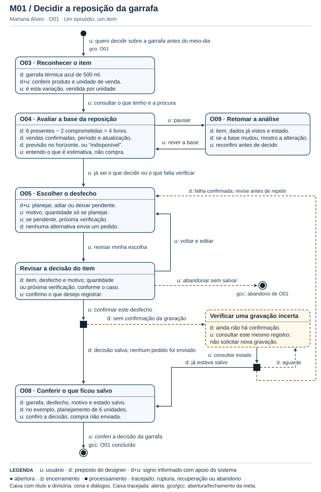
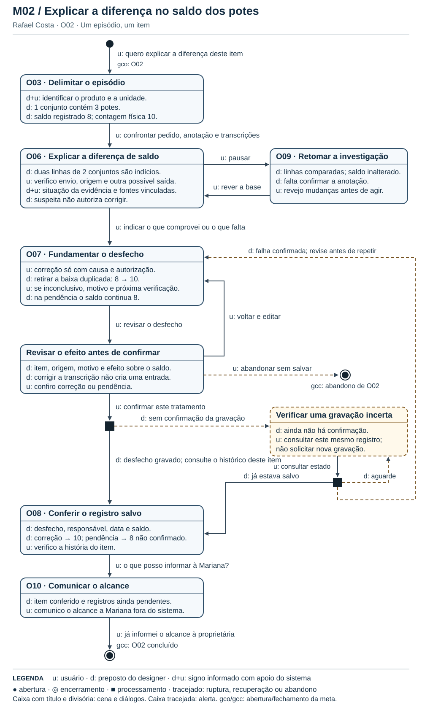

# Entrega 10 — MoLIC

**Data:** 09/11/2026  
**Status:** ⬜ não iniciada  
**Responsabilidade:** 1 solução completa por integrante

## Objetivo da atividade

Modelar a interação como uma **conversa entre usuário e preposto do designer**, oferecendo visão global dos caminhos que permitem ao usuário atingir seus objetivos — incluindo alternativas e rupturas relevantes. MoLIC não deve ser reduzida a um fluxograma de telas.

> Use a **notação MoLIC ensinada na disciplina**. Este template foca critérios de qualidade e não substitui a legenda/notação apresentada em aula.

## Atenção a TCCs sem interface original

O MoLIC não modela o algoritmo por dentro. Ele modela a **conversa de interação necessária para que uma pessoa use a contribuição**.

Exemplos de conversas:

- usuário escolhe dados/parâmetros → sistema valida → usuário inicia análise → sistema comunica processamento → usuário interpreta resultado;
- usuário consulta histórico → refina filtros → abre execução → compara com outra;
- administrador seleciona perfil → altera permissão → sistema comunica consequências → administrador confirma/cancela;
- analista recebe alerta → examina evidências → classifica ocorrência → registra decisão.

Modele também rupturas plausíveis: entrada inválida, falha de processamento, ausência de resultado, permissão insuficiente, filtro sem resultados, conflito de alteração, cancelamento ou necessidade de recuperação.

## M01 — Registrar a decisão de reposição de um item

**Autor(a):** Paulo Andre de Oliveira Hirata — 22.125.072-3.  
**Cenário de interação de origem:** CI01 — Decidir a reposição da garrafa antes do prazo do fornecedor (E4-C01 / R04-01).  
**Objetivo(s):** O01 — Registrar a decisão de reposição. Objetivos de apoio: O03 — Identificar o produto e a unidade; O04 — Avaliar a base da reposição; O05 — Escolher o desfecho da reposição; O08 — Conferir o registro salvo; O09 — Retomar o trabalho interrompido.  
**Tarefa(s) relacionada(s):** Mariana Alves, proprietária; T01 — analisar um produto e registrar uma decisão de reposição.  
**Signos relevantes:** produto, unidade de venda, contagem física, quantidade comprometida, quantidade disponível, vendas confirmadas, atualização da base, horizonte, previsão de demanda, sugestão de reposição, prazo do fornecedor, desfecho da reposição, quantidade planejada, motivo, próxima verificação, ponto de retomada e estado do registro.

### Diagrama

**Fonte editável:** [M01 em SVG — texto, cenas e setas editáveis](../assets/10_molic/molic_m01.svg).

### Leitura do diagrama

A conversa começa quando Mariana identifica a garrafa e termina quando confere o desfecho salvo ou abandona a análise sem salvar. A legenda do diagrama distingue as falas de Mariana (`u:`) das respostas do preposto (`d:`).

#### Caminho principal

1. **Abrir O01 e reconhecer o item (O03).** Antes do meio-dia, Mariana quer decidir sobre a **garrafa térmica azul de 500 ml**. O fornecedor só recebe o pedido até esse horário; a entrega de quinta-feira é prevista, não garantida. Mariana confirma a variação e a unidade. Uma anotação genérica de “garrafa” não basta.
2. **Avaliar a base (O04).** O preposto explica: há seis garrafas presentes, duas separadas para um pedido pago; **seis menos duas deixam quatro disponíveis**. Identifica vendas confirmadas, período e atualização da base. Perguntas recebidas por mensagem não contam como vendas. Uma estimativa de demanda informa unidades e horizonte; não determina a compra.
3. **Escolher o desfecho (O05).** Mariana considera caixa, prazo e experiência comercial. No episódio da E9, ela escolhe **planejar seis unidades** e informa o motivo. Se houvesse previsão de cinco vendas em três dias, esse seria outro número, com outro significado. O sistema não copia uma previsão ou sugestão para a quantidade planejada.
4. **Revisar e confirmar.** O preposto reúne item, desfecho, motivo e quantidade. Mariana pode voltar e editar; só a fala de confirmação inicia a gravação. A revisão é proposta para todos os desfechos, não apenas para a compra planejada.
5. **Conferir O08 e encerrar O01.** Após confirmação do processamento, o preposto mostra o planejamento salvo para aquele item. Mariana confere o que ficou registrado. **Nenhum pedido foi enviado ao fornecedor.**

#### Alternativas e rupturas

| Situação | Onde ocorre | Como o usuário percebe | Caminho de recuperação/saída |
|---|---|---|---|
| Variação ambígua ou reserva desconhecida | O03 / O04 | Não é possível afirmar a disponibilidade para esse item. Ausência de informação não aparece como zero. | Refinar a identificação ou conferir a reserva; se faltar dado indispensável, registrar pendência com a próxima verificação. |
| Não há previsão no horizonte | O04 | “Não há previsão para este produto neste período.” O histórico continua distinto da estimativa. | Consultar vendas confirmadas e período. Se a base bastar, prosseguir; caso contrário, escolher pendência. Não exigir nova seleção de um item já identificado. |
| Decide não comprar neste ciclo | O05 | O preposto distingue **adiamento**, decisão tomada, de **pendência**, decisão que depende de informação. | Adiar com motivo ou registrar pendência com motivo e próxima verificação. Nenhuma das duas alternativas exige quantidade. Ambas passam por revisão e confirmação. |
| Quantidade inválida no planejamento | O05 | O preposto informa que planejar exige quantidade positiva na unidade do item. | Corrigir a quantidade sem perder o motivo nem a identificação; revisar antes de confirmar. |
| Cliente interrompe o atendimento | O04 ↔ O09 | Ao voltar, Mariana reconhece o produto, o último ponto conferido e que a decisão ainda não foi salva. | Retomar sem reiniciar. Se a base mudou, rever os novos valores antes de decidir. Pausar não equivale a abandonar. |
| Desiste antes de confirmar | Revisão | A saída indica que não haverá novo registro. | Voltar à escolha para editar ou abandonar sem salvar; o encerramento por abandono não satisfaz O01. |
| Falta resposta à gravação | Processamento → alerta | “Ainda não há confirmação.” O preposto não presume sucesso nem falha. | Consultar **o mesmo registro**: se salvo, conferir em O08; se ainda aguardando, continuar consultando sem reenviar; só com falha confirmada voltar ao rascunho e confirmar novamente. |

### Checklist específico de modelagem

- [ ] Existe **ponto de abertura** coerente com o início do objetivo.
- [ ] As **cenas de conversa** representam tópicos/assuntos, não nomes de páginas apenas.
- [ ] As transições/falas deixam claro o que o usuário ou o sistema comunica.
- [ ] Há **ponto(s) de encerramento** para objetivos concluídos/abandonados quando aplicável.
- [ ] Processamentos do sistema estão representados conforme a notação adotada em aula, sem “inventar” fala do usuário.
- [ ] Rupturas (breakdowns) relevantes têm feedback e caminho de recuperação, não becos sem saída.
- [ ] Acessos ubíquos/atalhos só aparecem quando semanticamente justificáveis.
- [ ] O diagrama cobre caminhos alternativos importantes, e não apenas o “happy path”.
- [ ] Nomes de objetivos, tópicos e signos são coerentes com a Entrega 9.
- [ ] O diagrama é legível em tamanho normal no GitHub.
- [ ] O MoLIC representa a conversa usuário–sistema, não o fluxo interno do algoritmo.
- [ ] Processamento, filtros, administração, relatórios e históricos incluem retornos/rupturas quando relevantes.

## M02 — Registrar e comunicar o desfecho de uma divergência

**Autor(a):** Victor Merker Binda — 22.125.075-6.  
**Cenário de interação de origem:** CI02 — Explicar a diferença no saldo dos conjuntos de potes (E4-C02 / R04-02).  
**Objetivo(s):** O02 — Registrar e comunicar o desfecho da divergência. Objetivos de apoio: O03 — Identificar o produto e a unidade; O06 — Explicar a diferença de saldo; O07 — Fundamentar correção ou pendência; O08 — Conferir o registro salvo; O09 — Retomar o trabalho interrompido; O10 — Comunicar o alcance da conferência.  
**Tarefa(s) relacionada(s):** Rafael Costa, auxiliar operacional; T02 — investigar a divergência de um item e registrar seu desfecho. Mariana é fonte externa e destinatária do resultado, não uma segunda voz do sistema.  
**Signos relevantes:** produto, unidade de venda, saldo registrado, contagem física, evidência de origem, situação da evidência, correção da transcrição, desfecho da conferência, motivo, próxima verificação, ponto de retomada, estado do registro, responsável e data, alcance da conferência.

### Diagrama

**Fonte editável:** [M02 em SVG — texto, cenas e setas editáveis](../assets/10_molic/molic_m02.svg).

### Leitura do diagrama

O diagrama acompanha um único episódio: Rafael investiga a diferença, registra o que conseguiu comprovar e informa a Mariana o alcance da conferência. Uma pendência registrada não significa que a divergência foi resolvida.

#### Caminho principal

1. **Abrir O02 e delimitar o episódio (O03).** Rafael confere **um conjunto de três potes**, vendido como um conjunto. O saldo registrado é oito conjuntos; a contagem física, dez. Esses valores descrevem fontes diferentes. A diferença de dois, por si só, não prova a causa.
2. **Explicar a diferença (O06).** Rafael localiza o pedido pelo identificador ou, se a anotação não tiver ID, por produto, data e quantidade. O preposto mantém as linhas candidatas visíveis, sem declará-las duplicadas. Rafael confronta a situação do pedido, reconta e consulta Mariana fora do sistema. No caminho principal, ela confirma que anotou a mesma venda online de dois conjuntos; o pedido foi enviado e não há segunda saída correspondente.
3. **Fundamentar o desfecho (O07).** Com a origem confirmada **e autorização para corrigir**, Rafael vincula a transcrição indevida ao registro original e explica o motivo. O preposto antecipa o efeito: retirar apenas o segundo desconto leva o saldo de oito para dez. **Não houve entrada de mercadoria.**
4. **Revisar, confirmar e conferir (O08).** Rafael verifica item, fontes, justificativa e efeito antes de autorizar a gravação. Depois, confere desfecho, responsável, data e saldo no histórico do episódio. Uma indicação de processamento em curso não serve como confirmação.
5. **Comunicar o alcance (O10) e encerrar O02.** O preposto identifica o item conferido e os registros que continuam pendentes. Rafael comunica o resultado a Mariana **fora do sistema**. O resumo não significa que uma mensagem foi enviada nem que os quatorze registros foram reconciliados.

#### Alternativas e rupturas

| Situação | Onde ocorre | Como o usuário percebe | Caminho de recuperação/saída |
|---|---|---|---|
| Não há ID na anotação ou há várias linhas semelhantes | O03 / O06 | As linhas aparecem como candidatas; não há diagnóstico automático de duplicidade. | Refinar por item, unidade, data e quantidade; confrontar situação e fonte. Não inventar um identificador nem alterar o saldo por semelhança. |
| Fonte ilegível, confirmação indisponível ou evidências contraditórias | O06 → O07 | A causa permanece inconclusiva. Se o documento não puder ser lido, o preposto indica qual fonte externa obter. | Retomar após consultar a origem ou registrar pendência, motivo e próxima verificação. **O saldo permanece oito, não confirmado.** |
| Origem conhecida, mas falta autorização para corrigir | O07 | Correção indisponível; a justificativa informa que o papel atual não autoriza a mudança. | Registrar pendência e encaminhar a verificação à pessoa autorizada. Não conceder permissão nem simular recebimento. |
| Precisa separar uma encomenda | O06 ↔ O09 | Ao retomar, Rafael vê as linhas já comparadas, o que falta verificar e que não houve alteração do saldo. | Reexaminar a fonte caso tenha mudado; continuar a investigação sem aplicar uma operação anterior. |
| Prévia da correção não corresponde à evidência | Revisão | Item, motivo e efeito aparecem juntos antes da confirmação. | Voltar a O07 e revisar; optar por pendência se a causa não estiver comprovada, ou abandonar sem salvar. |
| A confirmação não chega | Processamento → alerta | O registro está aguardando; a interface não anuncia “corrigido”. | Consultar o registro. Se salvo, ir a O08 sem aplicar nova correção. Se aguardando, não repetir. Só com falha confirmada, revisar e tentar de novo. |
| O item termina pendente | O08 → O10 | O resumo distingue pendência registrada de divergência resolvida. | Informar a Mariana que o saldo segue não confirmado e o que falta verificar. Conclui-se **o relato do episódio**, não a reconciliação dos demais registros. |

### Checklist específico de modelagem

- [ ] Existe **ponto de abertura** coerente com o início do objetivo.
- [ ] As **cenas de conversa** representam tópicos/assuntos, não nomes de páginas apenas.
- [ ] As transições/falas deixam claro o que o usuário ou o sistema comunica.
- [ ] Há **ponto(s) de encerramento** para objetivos concluídos/abandonados quando aplicável.
- [ ] Processamentos do sistema estão representados conforme a notação adotada em aula, sem “inventar” fala do usuário.
- [ ] Rupturas (breakdowns) relevantes têm feedback e caminho de recuperação, não becos sem saída.
- [ ] Acessos ubíquos/atalhos só aparecem quando semanticamente justificáveis.
- [ ] O diagrama cobre caminhos alternativos importantes, e não apenas o “happy path”.
- [ ] Nomes de objetivos, tópicos e signos são coerentes com a Entrega 9.
- [ ] O diagrama é legível em tamanho normal no GitHub.
- [ ] O MoLIC representa a conversa usuário–sistema, não o fluxo interno do algoritmo.
- [ ] Processamento, filtros, administração, relatórios e históricos incluem retornos/rupturas quando relevantes.

## Consolidação da equipe

### Cobertura dos objetivos

| Objetivo | MoLIC que cobre | Lacunas/duplicidades | Decisão |
|---|---|---|---|
| O01 · Registrar a decisão de reposição | M01 | Previsão salva não é decisão salva. | Encerrar após Mariana conferir o desfecho do item; não enviar pedido. |
| O02 · Registrar e comunicar o desfecho da divergência | M02 | Saldo igual à contagem não explica a causa. | Exigir justificativa, estado salvo e alcance antes de comunicar. |
| O03 · Identificar o produto e a unidade | Ambos | Mesmo conceito; itens e unidades diferentes. | Reutilizar o padrão de identificação, sem ligar os episódios entre si. |
| O04 · Avaliar a base da reposição | M01 | Confundir ausência, zero, demanda e sugestão mudaria a decisão. | Explicitar parcelas, período, horizonte e limitações. |
| O05 · Escolher o desfecho da reposição | M01 | Quantidade obrigatória em todos os casos induziria uma compra. | Pedir quantidade apenas para planejar; pedir próxima verificação quando pendente. |
| O06 · Explicar a diferença de saldo | M02 | Coincidência entre linhas não comprova duplicidade. | Manter vínculo com fontes, hipóteses e lacunas. |
| O07 · Fundamentar correção ou pendência | M02 | Sem causa ou autorização, corrigir seria indevido. | Oferecer pendência sem alteração de saldo. |
| O08 · Conferir o registro salvo | Ambos | Compartilham os estados de gravação, não o significado do registro. | Usar o mesmo padrão de consulta antes de repetir. |
| O09 · Retomar o trabalho interrompido | Ambos | Ambos exigem continuidade; o dado a recuperar difere. | Mostrar item, ponto de retomada e base alterada. Não reaplicar operação. |
| O10 · Comunicar o alcance da conferência | M02 | Resumo disponível não significa mensagem enviada. | Separar a resposta do preposto da comunicação humana de Rafael. |

### Preparação para o Figma

Os identificadores Pxx abaixo são **telas da E6**, não objetivos nem IDs de personas. Uma cena pode ocupar parte de uma tela ou aparecer em mais de um estado; não é necessário criar uma tela por seta.

| Conversa | Reaproveitamento visual da E6 | Estado a representar na próxima iteração |
|---|---|---|
| Reconhecer item e unidade · O03 | P03 — Produtos | Item inequívoco; candidatos semelhantes; possibilidade de refinar sem perder contexto. |
| Avaliar disponibilidade, histórico e previsão · O04 | P03, P06 — Análises, P07/P08 — Previsões | Quantidades presente, comprometida e disponível com unidade; previsão com horizonte; ausência de resultado sem confundi-la com zero. |
| Escolher e revisar a reposição · O05 | P08 é referência para consulta, não para salvar decisões. | Planejamento com quantidade; adiamento com motivo; pendência com próxima verificação; entrada inválida; revisão, retorno e abandono. |
| Investigar origem e autorizar tratamento · O06/O07 | P03 e P05 — Vendas e importações | Comparação de fontes; evidência suspeita/confirmada/inconclusiva; correção permitida com prévia 8 → 10 ou pendência sem alterar saldo. |
| Retomar após pausa · O09 | Proposta para os dois percursos | Resumo do rascunho, última verificação e estado do registro; aviso de alteração da base com retorno à conferência. |
| Salvar e verificar · O08 | P09 mostra histórico de **previsões**, não desses desfechos. | Revisão, confirmação em andamento, estado desconhecido, consulta, falha confirmada com rascunho preservado e sucesso verificável. |
| Comunicar alcance · O10 | Novo resumo do episódio | Item resolvido ou pendente, responsável, data, saldo resultante e o que resta verificar; nenhuma confirmação fictícia de envio. |

## Erros frequentes a evitar

- desenhar apenas caixas com nomes de telas e setas de navegação;
- não modelar falhas, cancelamento, volta ou recuperação;
- usar rótulos genéricos (“Tela 1”, “Processo 2”) sem tópico de conversa;
- criar no Figma fluxos que não existem no MoLIC;
- diagrama sem legenda/fonte editável e com texto ilegível.
