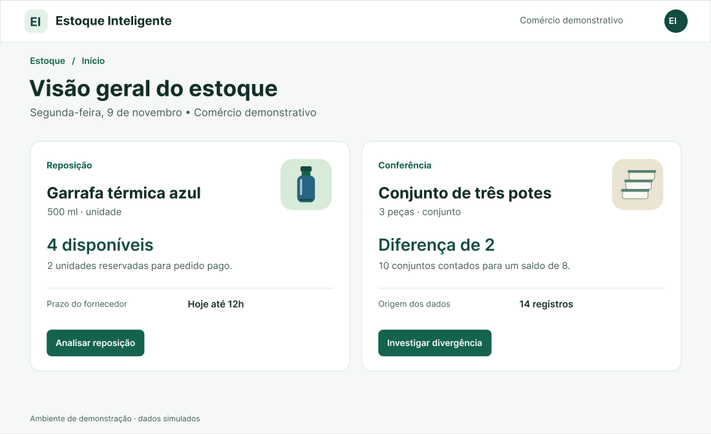
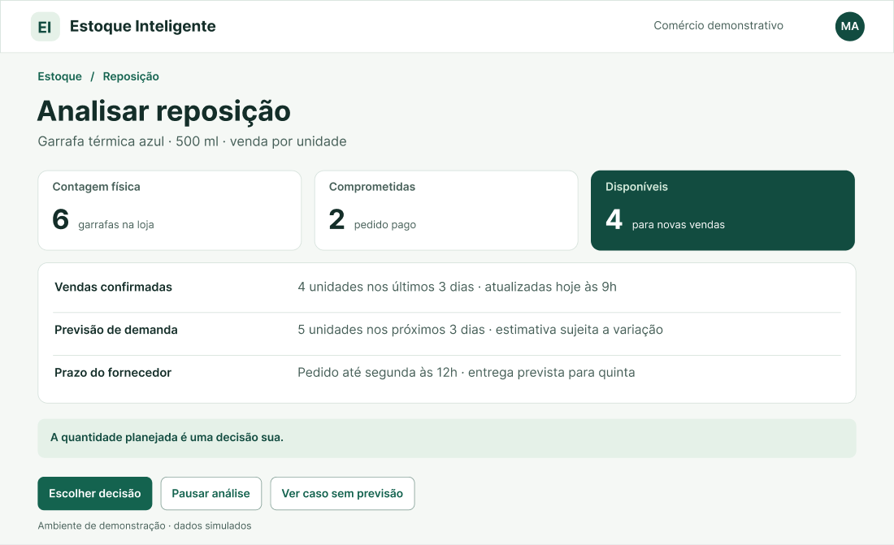
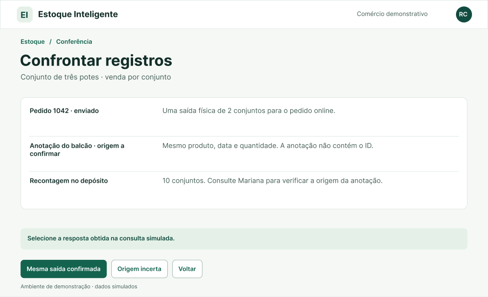
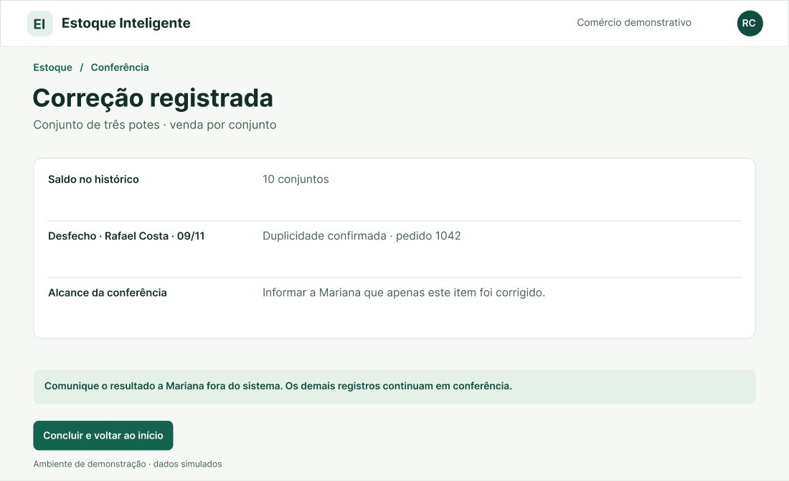

# Entrega 11 — Protótipo no Figma

**Data:** 11/11/2026
**Status:** ⬜ não iniciada  
**Responsabilidade:** 1 protótipo integrado por equipe cobrindo os fluxos MoLIC. Se a turma exigir divisão individual, identifique o responsável por cada fluxo/tela.

## Objetivo da atividade

Materializar o modelo de interação em um protótipo navegável, preservando a lógica dos objetivos, tópicos, signos, feedbacks, alternativas e recuperações definidos anteriormente.

## Biblioteca de possibilidades para projetos técnicos

O protótipo deve materializar os fluxos definidos nas entregas anteriores. Dependendo do escopo, podem fazer sentido:

1. **Dashboard:** indicadores, alertas, estado, tendências e atalhos para tarefas frequentes.
2. **Configuração/parametrização:** escolhas, presets, validação e explicação de opções técnicas.
3. **Entrada de dados:** upload, conexão, seleção, pré-visualização e validação.
4. **Processamento:** fila, status, progresso, cancelamento, falha e reexecução.
5. **Relatório/resultados:** síntese, métricas, gráficos, explicação, exportação e compartilhamento.
6. **Histórico:** busca, filtros, ordenação, paginação, detalhes e repetição de execução.
7. **Comparação:** antes/depois, modelo A/B, execução A/B, baseline ou períodos.
8. **Explicabilidade:** confiança, fatores, evidências, limitações e correção/contestação.
9. **Administração:** usuários, grupos, perfis, permissões, integrações e políticas.
10. **CRUDs de domínio:** somente quando criar/consultar/editar/excluir representa tarefa real.
11. **Auditoria/logs:** histórico de alterações e eventos em linguagem adequada.
12. **Alertas/ocorrências:** severidade, impacto, ação, responsável e resolução.
13. **Ajuda/documentação:** apoio contextual a tarefas complexas.

### Estados que não podem ser esquecidos

Quando aplicável, considere: vazio/sem dados; carregamento/processamento; sucesso; erro de entrada; erro de processamento; filtro sem resultados; permissão insuficiente; confirmação de ação destrutiva; cancelamento/desfazer/recuperação; dados desatualizados/conflito.

> Esta lista é repertório de design, **não uma exigência de quantidade de telas**. A rastreabilidade deve explicar por que cada tela existe.

## Link do Figma

**Protótipo:** [Iniciar apresentação](https://www.figma.com/proto/jgB0Bk5BLQ3XM2W9tgZDmd/Estoque-Inteligente?page-id=0%3A1&node-id=2-2&starting-point-node-id=2%3A2&scaling=scale-down)  
**Arquivo editável:** [Abrir o arquivo de design da equipe](https://www.figma.com/design/jgB0Bk5BLQ3XM2W9tgZDmd)  
**Última verificação de permissão:** 11/11/2026. A apresentação abriu em navegador sem login e o botão “Analisar reposição” levou à tela do produto. As 57 ligações foram conferidas pelos destinos gravados no arquivo.

## Cobertura MoLIC → Figma

| MoLIC | Objetivo | Fluxo/telas no Figma | Estados de erro/recuperação | Responsável |
|---|---|---|---|---|
| M01 · Mariana | O01, com apoio de O03, O04, O05, O08 e O09 | F01 → F02 → F03 → F04 → F05 → F05S. A decisão sobre a quantidade pertence a Mariana. A confirmação salva o planejamento interno. | F02P retoma a análise. F02B trata falta de previsão. F04E permite corrigir a quantidade. F05A e F05P abrem revisão de adiamento e pendência. F06E e F06R tratam a gravação incerta ou malsucedida. | Paulo Andre de Oliveira Hirata |
| M02 · Rafael | O02, com apoio de O03, O06, O07, O08, O09 e O10 | F01 → F10 → F11 → F12 → F13. Rafael compara duas fontes, confirma a duplicidade e confere o saldo corrigido de 10 conjuntos. O resumo apoia a comunicação presencial com Mariana. | F10P guarda o ponto de retomada. F12P e F12N preservam o saldo 8 quando faltam evidência ou autorização. F12E e F12F permitem consultar o resultado ou recuperar a correção. | Victor Merker Binda |

## Catálogo de telas/estados

### F01 — Visão geral do estoque

**Objetivo do usuário:** identificar o item e iniciar o trabalho.  
**Signos principais:** variação, unidade de venda, disponibilidade, diferença e prazo.  
**Origem no MoLIC:** abertura de M01 e M02, identificação do item em O03.

### F02 — Analisar reposição

**Objetivo do usuário:** avaliar os dados antes de decidir quanto planejar, se deve adiar ou se precisa de mais informações.  
**Signos principais:** vendas confirmadas, disponibilidade, horizonte de previsão e prazo do fornecedor.  
**Origem no MoLIC:** M01, avaliação da base em O04 e escolha do desfecho em O05.

### F11 — Confrontar registros

**Objetivo do usuário:** verificar se a anotação representa uma segunda saída ou uma transcrição do mesmo pedido.  
**Signos principais:** identificador do pedido, origem da anotação, contagem física e confirmação externa.  
**Origem no MoLIC:** M02, investigação da diferença em O06.

### F13 — Correção registrada

**Objetivo do usuário:** conferir o saldo corrigido e explicar à proprietária qual item foi resolvido.  
**Signos principais:** saldo após a correção, responsável, data, justificativa e alcance parcial.  
**Origem no MoLIC:** M02, conferência do resultado em O08 e comunicação em O10.

**Índice dos 28 estados editáveis.** Cada identificação abre o quadro correspondente no arquivo da equipe.

| Quadro | Tela ou estado | Ações disponíveis |
|---|---|---|
| [F01](https://www.figma.com/design/jgB0Bk5BLQ3XM2W9tgZDmd?node-id=2-2) | Visão geral do estoque | Analisar reposição · Investigar divergência |
| [F02](https://www.figma.com/design/jgB0Bk5BLQ3XM2W9tgZDmd?node-id=2-49) | Analisar reposição | Escolher decisão · Pausar análise · Ver caso sem previsão |
| [F02P](https://www.figma.com/design/jgB0Bk5BLQ3XM2W9tgZDmd?node-id=2-90) | Análise pausada | Retomar análise |
| [F02B](https://www.figma.com/design/jgB0Bk5BLQ3XM2W9tgZDmd?node-id=2-112) | Previsão indisponível | Preparar pendência · Voltar à análise |
| [F03](https://www.figma.com/design/jgB0Bk5BLQ3XM2W9tgZDmd?node-id=2-139) | Qual decisão registrar? | Planejar quantidade · Adiar neste ciclo · Registrar pendência |
| [F04](https://www.figma.com/design/jgB0Bk5BLQ3XM2W9tgZDmd?node-id=2-168) | Quantidade planejada | Revisar 6 unidades · Usar 4 unidades · Zerar quantidade · Voltar |
| [F04E](https://www.figma.com/design/jgB0Bk5BLQ3XM2W9tgZDmd?node-id=2-199) | Confira a quantidade | Corrigir quantidade |
| [F05](https://www.figma.com/design/jgB0Bk5BLQ3XM2W9tgZDmd?node-id=2-221) | Revisar decisão | Confirmar decisão · Editar · Descartar rascunho · Testar falta de resposta |
| [F05S](https://www.figma.com/design/jgB0Bk5BLQ3XM2W9tgZDmd?node-id=2-252) | Decisão salva | Concluir e voltar ao início |
| [F05Q](https://www.figma.com/design/jgB0Bk5BLQ3XM2W9tgZDmd?node-id=2-277) | Revisar decisão | Confirmar decisão · Editar · Descartar rascunho |
| [F05QS](https://www.figma.com/design/jgB0Bk5BLQ3XM2W9tgZDmd?node-id=2-306) | Decisão salva | Concluir e voltar ao início |
| [F05A](https://www.figma.com/design/jgB0Bk5BLQ3XM2W9tgZDmd?node-id=2-331) | Revisar decisão | Confirmar decisão · Editar · Descartar rascunho |
| [F05AS](https://www.figma.com/design/jgB0Bk5BLQ3XM2W9tgZDmd?node-id=2-360) | Decisão salva | Concluir e voltar ao início |
| [F05P](https://www.figma.com/design/jgB0Bk5BLQ3XM2W9tgZDmd?node-id=2-385) | Revisar decisão | Confirmar decisão · Editar · Descartar rascunho |
| [F05PS](https://www.figma.com/design/jgB0Bk5BLQ3XM2W9tgZDmd?node-id=2-414) | Decisão salva | Concluir e voltar ao início |
| [F06E](https://www.figma.com/design/jgB0Bk5BLQ3XM2W9tgZDmd?node-id=2-439) | Aguardando confirmação | Consultar registro · Ver falha confirmada |
| [F06R](https://www.figma.com/design/jgB0Bk5BLQ3XM2W9tgZDmd?node-id=2-463) | Gravação não concluída | Reabrir rascunho |
| [F10](https://www.figma.com/design/jgB0Bk5BLQ3XM2W9tgZDmd?node-id=2-485) | Investigar divergência | Confrontar registros · Pausar conferência |
| [F10P](https://www.figma.com/design/jgB0Bk5BLQ3XM2W9tgZDmd?node-id=2-524) | Conferência pausada | Retomar conferência |
| [F11](https://www.figma.com/design/jgB0Bk5BLQ3XM2W9tgZDmd?node-id=2-549) | Confrontar registros | Mesma saída confirmada · Origem incerta · Voltar |
| [F12](https://www.figma.com/design/jgB0Bk5BLQ3XM2W9tgZDmd?node-id=2-578) | Revisar correção | Confirmar correção · Sem autorização · Editar · Testar falha |
| [F12E](https://www.figma.com/design/jgB0Bk5BLQ3XM2W9tgZDmd?node-id=2-621) | Consultar gravação | Consultar resultado · Falha confirmada |
| [F12F](https://www.figma.com/design/jgB0Bk5BLQ3XM2W9tgZDmd?node-id=2-645) | Correção não salva | Revisar correção |
| [F12N](https://www.figma.com/design/jgB0Bk5BLQ3XM2W9tgZDmd?node-id=2-667) | Autorização necessária | Confirmar pendência · Voltar |
| [F12P](https://www.figma.com/design/jgB0Bk5BLQ3XM2W9tgZDmd?node-id=2-694) | Revisar pendência | Confirmar pendência · Rever evidências · Descartar rascunho |
| [F13](https://www.figma.com/design/jgB0Bk5BLQ3XM2W9tgZDmd?node-id=2-723) | Correção registrada | Concluir e voltar ao início |
| [F14](https://www.figma.com/design/jgB0Bk5BLQ3XM2W9tgZDmd?node-id=2-748) | Pendência registrada | Concluir e voltar ao início |
| [F14N](https://www.figma.com/design/jgB0Bk5BLQ3XM2W9tgZDmd?node-id=2-773) | Pendência registrada | Concluir e voltar ao início |

## Sistema visual e consistência

| Elemento | Regra adotada | Justificativa |
|---|---|---|
| Tipografia | Inter, com títulos de 40 px e texto principal de 16–19 px. Valores de estoque em destaque com a unidade ao lado. | Facilita distinguir quantidade, descrição e ação durante a leitura. |
| Cores | Verde-escuro para a ação principal, fundo claro e texto escuro. Mensagens descrevem o estado por escrito. | Mantém continuidade com o projeto e permite interpretar o resultado sem depender da cor. |
| Componentes | Cabeçalho, identidade do produto, blocos de evidência e botões em posições recorrentes. | O mesmo padrão acompanha análise, revisão e confirmação. |
| Feedback | Cada clique muda para um quadro identificável. A revisão antecede a gravação. Pausa, erro e pendência mostram a situação e a próxima ação. | Ajuda a retomar uma tarefa e evita confundir tentativa de salvar com confirmação. |

A organização em quadros, a repetição dos controles e as transições curtas por clique seguem as demonstrações de design e prototipação dos materiais da atividade. [Visão geral](https://youtu.be/Cx2dkpBxst8) · [Exploração](https://youtu.be/dXQ7IHkTiMM) · [Criação de telas](https://youtu.be/wvFd-z7jSaA) · [Prototipação](https://youtu.be/lTIeZ2ahEkQ) · [Introdução ao editor](https://youtu.be/oGD4ixajvs8) · [Interações](https://youtu.be/CNU7miqEYXg)

## Verificação de acessibilidade básica

Os botões têm 48 px de altura no quadro original e usam rótulos com verbos. A disponibilidade, os erros e a confirmação aparecem em texto. As capturas acima têm descrição alternativa. A navegação completa por teclado, a ordem de foco e a leitura por tecnologia assistiva precisam de verificação específica. As sessões com participantes estão previstas no planejamento da Entrega 12.

## Checklist

- [ ] Link do Figma está acessível.
- [ ] Há screenshots representativos no repositório.
- [ ] Todos os MoLIC relevantes estão cobertos.
- [ ] Estados de erro, feedback e recuperação foram prototipados.
- [ ] Terminologia/signos são consistentes com Entrega 9.
- [ ] Componentes equivalentes se comportam de forma consistente.
- [ ] Fluxos críticos são clicáveis do início ao fim.
- [ ] O protótipo está pronto para inspeção e testes, sem “links mortos” nas tarefas avaliadas.
- [ ] Dashboards, relatórios, históricos, filtros, administração e CRUDs presentes possuem justificativa rastreável.
- [ ] Estados de vazio, processamento, erro e recuperação foram considerados quando pertinentes.
- [ ] Resultados técnicos são apresentados de forma interpretável para o perfil de usuário.
- [ ] A equipe distingue no protótipo o que é interação simulada e o que é funcionalidade técnica realmente integrada, quando necessário.
