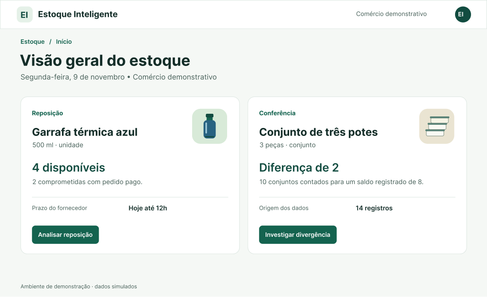
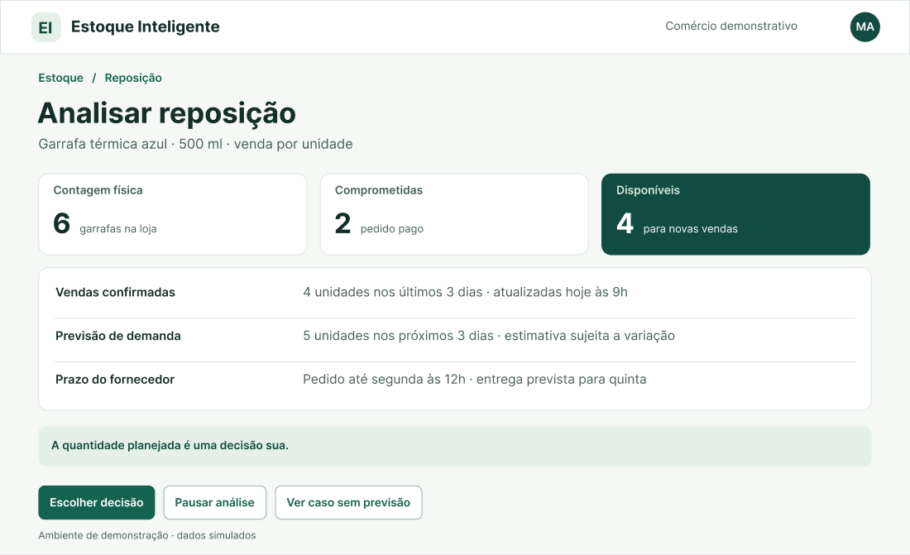
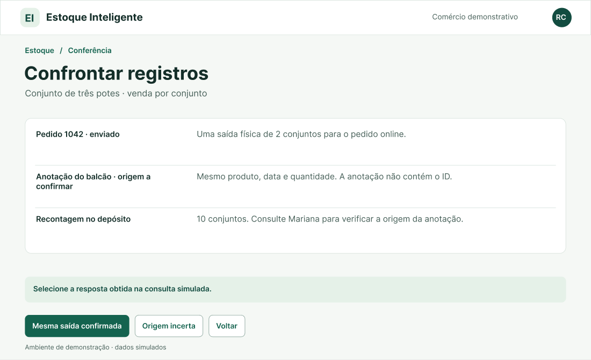
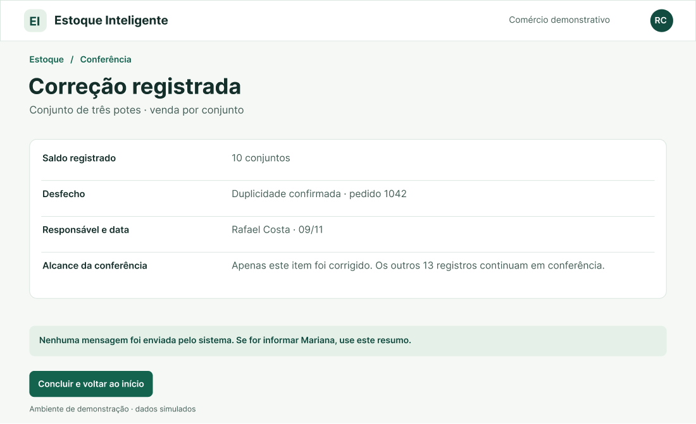

# Entrega 11 — Protótipo no Figma

**Data:** 11/11/2026  
**Revisão:** 25/11/2026  
**Status:** 🟦 revisada após feedback  
**Responsabilidade:** 1 protótipo integrado por equipe cobrindo os fluxos MoLIC. Se a turma exigir divisão individual, identifique o responsável por cada fluxo/tela.

## Objetivo da atividade

Materializar o modelo de interação em um protótipo navegável, preservando a lógica dos objetivos, tópicos, signos, feedbacks, alternativas e recuperações definidos anteriormente.

## Biblioteca de possibilidades para projetos técnicos

O protótipo deve materializar os fluxos definidos nas entregas anteriores. Dependendo do escopo, podem fazer sentido:

1. **Dashboard:** indicadores, alertas, estado, tendências e atalhos para tarefas frequentes.
2. **Configuração/parametrização:** escolhas, presets, validação e explicação de opções técnicas.
3. **Entrada de dados:** upload, conexão, seleção, pré-visualização e validação.
4. **Processamento:** fila, status, progresso, cancelamento, falha e reexecução.
5. **Relatório/resultados:** síntese, métricas, gráficos, explicação, exportação e compartilhamento.
6. **Histórico:** busca, filtros, ordenação, paginação, detalhes e repetição de execução.
7. **Comparação:** antes/depois, modelo A/B, execução A/B, baseline ou períodos.
8. **Explicabilidade:** confiança, fatores, evidências, limitações e correção/contestação.
9. **Administração:** usuários, grupos, perfis, permissões, integrações e políticas.
10. **CRUDs de domínio:** somente quando criar/consultar/editar/excluir representa tarefa real.
11. **Auditoria/logs:** histórico de alterações e eventos em linguagem adequada.
12. **Alertas/ocorrências:** severidade, impacto, ação, responsável e resolução.
13. **Ajuda/documentação:** apoio contextual a tarefas complexas.

### Estados que não podem ser esquecidos

Quando aplicável, considere: vazio/sem dados; carregamento/processamento; sucesso; erro de entrada; erro de processamento; filtro sem resultados; permissão insuficiente; confirmação de ação destrutiva; cancelamento/desfazer/recuperação; dados desatualizados/conflito.

> Esta lista é repertório de design, **não uma exigência de quantidade de telas**. A rastreabilidade deve explicar por que cada tela existe.

## Link do Figma

**Protótipo:** [Iniciar apresentação](https://www.figma.com/proto/jgB0Bk5BLQ3XM2W9tgZDmd/Estoque-Inteligente?page-id=0%3A1&node-id=2-2&starting-point-node-id=2%3A2&scaling=scale-down)  
**Arquivo editável:** [Abrir o arquivo de design da equipe](https://www.figma.com/design/jgB0Bk5BLQ3XM2W9tgZDmd)  
**Última verificação de permissão:** 11/11/2026. A apresentação abriu em navegador sem login e o botão “Analisar reposição” levou à tela do produto. As 57 ligações foram conferidas pelos destinos gravados no arquivo.

## Cobertura MoLIC → Figma

| MoLIC | Objetivo | Fluxo/telas no Figma | Estados de erro/recuperação | Responsável |
|---|---|---|---|---|
| M01 · Mariana | O01 (final); instrumentais diretos O03, O04, O05, O08 e O09 | F01 → F02 → F03 → F04 → F05 → F05S. A decisão sobre a quantidade pertence a Mariana. A confirmação salva o planejamento interno. | F02P retoma a análise. F02B trata falta de previsão. F04E permite corrigir a quantidade. F05A e F05P abrem revisão de adiamento e pendência. F06E e F06R tratam a gravação incerta ou malsucedida. | Paulo Andre de Oliveira Hirata |
| M02 · Rafael | O02 (final); instrumentais diretos O03, O06, O07, O08 e O09; O10, instrumental indireto de O01 | F01 → F10 → F11 → F12 → F13. Rafael compara duas fontes, confirma a duplicidade e confere o saldo corrigido de 10 conjuntos. O resumo apoia a comunicação presencial com Mariana. | F10P guarda o ponto de retomada. F12P e F12N preservam o saldo 8 quando faltam evidência ou autorização. F12E e F12F permitem consultar o resultado ou recuperar a correção. | Victor Merker Binda |

## Catálogo de telas/estados

### F01 — Visão geral do estoque

**Objetivo do usuário:** identificar o item e iniciar o trabalho.  
**Signos principais:** variação, unidade de venda, disponibilidade, diferença e prazo.  
**Origem no MoLIC:** abertura de M01 e M02, identificação do item em O03.

### F02 — Analisar reposição

**Objetivo do usuário:** avaliar os dados antes de decidir quanto planejar, se deve adiar ou se precisa de mais informações.  
**Signos principais:** vendas confirmadas, disponibilidade, horizonte de previsão e prazo do fornecedor.  
**Origem no MoLIC:** M01, avaliação da base em O04 e escolha do desfecho em O05.  
**Dados demonstrativos:** “5 unidades nos próximos 3 dias” e as demais quantidades são valores simulados do episódio, como indica o rodapé. Nas avaliações, a tela permite verificar se o participante entende a mensagem: que a previsão é uma estimativa e não uma ordem de compra. Ela não valida a qualidade científica da previsão do TCC. A sugestão de reposição não aparece porque continua condicional à confirmação de uma regra técnica.

### F11 — Confrontar registros

**Objetivo do usuário:** verificar se a anotação representa uma segunda saída ou uma transcrição do mesmo pedido.  
**Signos principais:** identificador do pedido, origem da anotação, contagem física e confirmação externa.  
**Origem no MoLIC:** M02, investigação da diferença em O06.  
**Incerteza preservada:** nesta etapa, a interface mostra apenas evidências e “origem a confirmar”. A duplicidade só aparece como fato depois da escolha “Mesma saída confirmada”. Versões futuras não devem destacar “duplicidade encontrada” antes dessa confirmação. A interface deve continuar distinguindo indício, evidência suficiente, origem incerta, correção autorizada e pendência.

### F13 — Correção registrada

**Objetivo do usuário:** conferir o saldo corrigido e explicar à proprietária qual item foi resolvido.  
**Signos principais:** saldo após a correção, responsável, data, justificativa e alcance parcial.  
**Origem no MoLIC:** M02, conferência do resultado em O08 (fim de O02) e consulta opcional do alcance em O10.  
**Redação revisada, aplicada no Figma em 25/11/2026.** O texto anterior soava como uma ordem do sistema: “Informe a Mariana…” e “Comunique o resultado a Mariana fora do sistema.” A nova redação comunica o alcance e a fronteira sem dar ordens. Responsável e data passaram a ocupar uma linha própria:

| Elemento | Texto anterior | Texto atual |
|---|---|---|
| Alcance da conferência | Informar a Mariana que apenas este item foi corrigido. | Apenas este item foi corrigido. Os outros 13 registros continuam em conferência. |
| Mensagem de rodapé | Comunique o resultado a Mariana fora do sistema. Os demais registros continuam em conferência. | Nenhuma mensagem foi enviada pelo sistema. Se for informar Mariana, use este resumo. |

A observação com usuários (E14) vai confirmar se a redação deixa claro o alcance parcial, como sugere o feedback. F14 e F14N, que tratam de pendências, receberam a mesma estrutura: saldo registrado, desfecho, responsável e data e próxima verificação, com o aviso de que nenhuma mensagem é enviada.

**Índice dos 30 quadros editáveis.** Cada identificação abre o quadro correspondente no arquivo da equipe. F04Q e F11P foram criados em 25/11/2026 para corrigir C01 e C03 da E13. Os quadros marcados com *moderador* abrem pelos pontos de início do moderador, não por um botão nas telas do participante.

| Quadro | Tela ou estado | Ações disponíveis |
|---|---|---|
| [F01](https://www.figma.com/design/jgB0Bk5BLQ3XM2W9tgZDmd?node-id=2-2) | Visão geral do estoque | Analisar reposição · Investigar divergência |
| [F02](https://www.figma.com/design/jgB0Bk5BLQ3XM2W9tgZDmd?node-id=2-49) | Analisar reposição | Escolher decisão · Pausar análise |
| [F02P](https://www.figma.com/design/jgB0Bk5BLQ3XM2W9tgZDmd?node-id=2-90) | Análise pausada | Retomar análise |
| [F02B](https://www.figma.com/design/jgB0Bk5BLQ3XM2W9tgZDmd?node-id=2-112) | Previsão indisponível *(moderador)* | Preparar pendência · Voltar à análise |
| [F03](https://www.figma.com/design/jgB0Bk5BLQ3XM2W9tgZDmd?node-id=2-139) | Qual decisão registrar? | Planejar quantidade · Adiar neste ciclo · Registrar pendência |
| [F04](https://www.figma.com/design/jgB0Bk5BLQ3XM2W9tgZDmd?node-id=2-168) | Quantidade planejada | Revisar 6 unidades · Usar 4 unidades · Zerar quantidade · Voltar |
| [F04Q](https://www.figma.com/design/jgB0Bk5BLQ3XM2W9tgZDmd?node-id=54-2) | Quantidade planejada (rascunho de 4 unidades) | Revisar 4 unidades · Usar 6 unidades · Zerar quantidade · Voltar |
| [F04E](https://www.figma.com/design/jgB0Bk5BLQ3XM2W9tgZDmd?node-id=2-199) | Confira a quantidade | Corrigir quantidade |
| [F05](https://www.figma.com/design/jgB0Bk5BLQ3XM2W9tgZDmd?node-id=2-221) | Revisar decisão | Confirmar decisão · Editar · Descartar rascunho |
| [F05S](https://www.figma.com/design/jgB0Bk5BLQ3XM2W9tgZDmd?node-id=2-252) | Decisão salva | Concluir e voltar ao início |
| [F05Q](https://www.figma.com/design/jgB0Bk5BLQ3XM2W9tgZDmd?node-id=2-277) | Revisar decisão | Confirmar decisão · Editar · Descartar rascunho |
| [F05QS](https://www.figma.com/design/jgB0Bk5BLQ3XM2W9tgZDmd?node-id=2-306) | Decisão salva | Concluir e voltar ao início |
| [F05A](https://www.figma.com/design/jgB0Bk5BLQ3XM2W9tgZDmd?node-id=2-331) | Revisar decisão | Confirmar decisão · Editar · Descartar rascunho |
| [F05AS](https://www.figma.com/design/jgB0Bk5BLQ3XM2W9tgZDmd?node-id=2-360) | Decisão salva | Concluir e voltar ao início |
| [F05P](https://www.figma.com/design/jgB0Bk5BLQ3XM2W9tgZDmd?node-id=2-385) | Revisar decisão | Confirmar decisão · Editar · Descartar rascunho |
| [F05PS](https://www.figma.com/design/jgB0Bk5BLQ3XM2W9tgZDmd?node-id=2-414) | Decisão salva | Concluir e voltar ao início |
| [F06E](https://www.figma.com/design/jgB0Bk5BLQ3XM2W9tgZDmd?node-id=2-439) | Aguardando confirmação *(moderador)* | Consultar registro |
| [F06R](https://www.figma.com/design/jgB0Bk5BLQ3XM2W9tgZDmd?node-id=2-463) | Gravação não concluída *(moderador)* | Reabrir rascunho |
| [F10](https://www.figma.com/design/jgB0Bk5BLQ3XM2W9tgZDmd?node-id=2-485) | Investigar divergência | Confrontar registros · Pausar conferência |
| [F10P](https://www.figma.com/design/jgB0Bk5BLQ3XM2W9tgZDmd?node-id=2-524) | Conferência pausada | Retomar conferência |
| [F11](https://www.figma.com/design/jgB0Bk5BLQ3XM2W9tgZDmd?node-id=2-549) | Confrontar registros | Mesma saída confirmada · Origem incerta · Voltar · Pausar conferência |
| [F11P](https://www.figma.com/design/jgB0Bk5BLQ3XM2W9tgZDmd?node-id=54-36) | Conferência pausada durante a comparação | Retomar conferência (volta a F11) |
| [F12](https://www.figma.com/design/jgB0Bk5BLQ3XM2W9tgZDmd?node-id=2-578) | Revisar correção | Confirmar correção · Editar |
| [F12E](https://www.figma.com/design/jgB0Bk5BLQ3XM2W9tgZDmd?node-id=2-621) | Consultar gravação *(moderador)* | Consultar resultado |
| [F12F](https://www.figma.com/design/jgB0Bk5BLQ3XM2W9tgZDmd?node-id=2-645) | Correção não salva *(moderador)* | Revisar correção |
| [F12N](https://www.figma.com/design/jgB0Bk5BLQ3XM2W9tgZDmd?node-id=2-667) | Autorização necessária *(moderador)* | Confirmar pendência · Voltar |
| [F12P](https://www.figma.com/design/jgB0Bk5BLQ3XM2W9tgZDmd?node-id=2-694) | Revisar pendência | Confirmar pendência · Rever evidências · Descartar rascunho |
| [F13](https://www.figma.com/design/jgB0Bk5BLQ3XM2W9tgZDmd?node-id=2-723) | Correção registrada | Concluir e voltar ao início |
| [F14](https://www.figma.com/design/jgB0Bk5BLQ3XM2W9tgZDmd?node-id=2-748) | Pendência registrada | Concluir e voltar ao início |
| [F14N](https://www.figma.com/design/jgB0Bk5BLQ3XM2W9tgZDmd?node-id=2-773) | Pendência registrada | Concluir e voltar ao início |

## Revisão após o feedback (25/11/2026)

### Vocabulário: signos da E9 e rótulos do protótipo

O feedback pediu que os termos do esquema conceitual mantivessem o mesmo significado no Figma. A conferência das capturas encontrou os pares abaixo. Os ajustes foram aplicados no arquivo da equipe em 25/11/2026. Quando o rótulo foi mantido, a coluna de decisão registra a justificativa. As capturas da [E13](13_avaliacao_heuristica.md) continuam mostrando a versão de 11/11/2026, que foi a versão inspecionada.

| Signo da E9 | Rótulo no protótipo | Onde | Decisão |
|---|---|---|---|
| Contagem física | Contagem física | F02 | Igual. |
| Quantidade comprometida | Comprometidas | F02 | Mantido: forma curta em cartão, sem ambiguidade com o signo. |
| Quantidade disponível | Disponíveis | F02 | Mantido: forma curta em cartão, sem ambiguidade com o signo. |
| Saldo registrado | Antes: Saldo atual (F12); Saldo no histórico (F13, F14, F14N); Saldo preservado (F12F, F12P) | F12, F12F, F12P, F13, F14, F14N | **Ajustado** para “Saldo registrado” em todos os quadros. “Atual” podia ser lido como contagem física. |
| Próxima verificação | Antes: Próxima etapa | F10P; também F14 e F14N | **Ajustado** para “Próxima verificação”. |
| Ponto de retomada | Último ponto conferido | F10P | Mantido: descreve o mesmo conceito na linguagem de Rafael. |
| Estado do registro | Antes: Estado | F10P | **Ajustado** para “Estado do registro” (valor: “Rascunho · saldo registrado inalterado”), distinguindo-o do desfecho. |
| Correção da transcrição | Correção proposta; Desconto indevido | F12 | Mantido: “proposta” marca que a correção ainda não foi gravada. |
| Responsável e data | Antes: Desfecho · Rafael Costa · 09/11 | F13, F14, F14N | **Separado** em linha própria, “Responsável e data”. |
| Previsão de demanda; horizonte | Previsão de demanda · próximos 3 dias | F02 | Igual. |
| Previsão de demanda (ausente) | Antes: “Previsão para os próximos 3 dias · Indisponível · a demanda permanece desconhecida” | F02B | **Ajustado** para “Previsão de demanda · Indisponível para os próximos 3 dias · não significa demanda zero”. |
| Vendas confirmadas | Antes: Base de procura | F02B | **Ajustado** para “Vendas confirmadas · ainda não confirmadas para este período”. |
| Quantidade disponível; quantidade comprometida | Antes: “4 garrafas livres” (F02B); “2 unidades reservadas” (F01) | F01, F02B | **Ajustado** para “disponíveis” e “comprometidas”. |
| Atualização da base | Não aparecia na pausa | F02P | **Acrescentado**: “Atualização da base · sem alteração desde a pausa”, para que Mariana perceba se a base mudou. |
| Desfecho da reposição: pendência | Antes: Aguardar informação | F03 | **Ajustado** para “Registrar pendência”, igual ao botão e à revisão F05P. |
| Próxima verificação | Antes: Próxima ação | F05P, F05PS, F12N | **Ajustado** nos desfechos de pendência. Em planejamento e adiamento, “Próxima ação” foi mantida porque não se trata de pendência. |
| Estado do registro | Antes: Situação; Resultado da consulta | F06E, F06R, F12E | **Ajustado**, com os valores “Aguardando confirmação” e “Falha confirmada”. |
| Situação da evidência | Antes: Origem | F12N, F12P | **Ajustado**, com os valores “Confirmada” e “Inconclusiva”. |

### Estados que devem ser preservados na implementação

Os estados abaixo não são telas extras arbitrárias. Cada um materializa uma ruptura ou alternativa do MoLIC. Se algum for retirado na implementação, a mudança precisa ser registrada aqui e em `RASTREABILIDADE.md`, com a justificativa.

| Estado | Ruptura ou alternativa no MoLIC |
|---|---|
| F02B · Previsão indisponível | M01 · O04, ausência de resultado diferente de zero |
| F02P / F10P · Análise e conferência pausadas | M01/M02 · O09, retomada |
| F04E · Confira a quantidade | M01 · O05, quantidade inválida |
| F06E / F12E · Aguardando confirmação | M01/M02 · gravação incerta |
| F06R / F12F · Gravação não concluída | M01/M02 · falha confirmada |
| F11 · Origem incerta → F12P | M02 · O06/O07, evidência insuficiente |
| F12N · Autorização necessária | M02 · O07, falta de autorização |
| F14 / F14N · Pendência registrada | M02 · O08, pendência sem alteração de saldo |

### Estados semelhantes: complexidade necessária ou variação de componente

Os 30 quadros existem porque o Figma precisa de um quadro por destino clicável. Para a implementação, vários são **variações de um mesmo componente**, e não telas distintas:

| Quadros | Diferença real | Implementação sugerida |
|---|---|---|
| F05, F05Q, F05A, F05P · Revisar decisão | Desfecho e campos: quantidade, adiamento ou próxima verificação | Um componente de revisão com quatro variações de conteúdo |
| F05S, F05QS, F05AS, F05PS · Decisão salva | Desfecho registrado | Um componente de confirmação com quatro variações |
| F14, F14N · Pendência registrada | Motivo: evidência insuficiente ou falta de autorização | Um componente com motivo variável |
| F06E e F12E; F06R e F12F | Fluxo de origem | Um mesmo padrão de gravação incerta e de falha nos dois fluxos |
| F04 e F04Q · Quantidade planejada | Quantidade e motivo do rascunho | O mesmo formulário, preenchido com a escolha atual |
| F10P e F11P · Conferência pausada | Ponto em que a pausa ocorreu | Um componente de pausa que guarda a etapa da investigação |

Assim, os 30 quadros correspondem a **21 estados distintos**. As avaliações devem verificar se outros pares podem virar mensagens dentro da mesma tela. Um exemplo é F02B como variação de F02. Também devem verificar se algum estado é redundante ou difícil de distinguir.

### Verificação dos fluxos clicáveis (25/11/2026)

Os fluxos foram verificados de duas formas, na versão do arquivo com os ajustes de vocabulário.

1. **Inspeção das ligações no arquivo.** As interações de protótipo dos 28 quadros foram lidas no Figma. O arquivo tem **57 ligações**, todas do tipo clique e navegação, e **nenhuma aponta para um quadro inexistente**. Todo botão tem destino, e todos os 28 quadros têm pelo menos uma saída. A partir de F01, os 28 quadros são alcançáveis. A partir de qualquer quadro, é possível voltar a F01. Os pontos de início configurados são “Início · Estoque Inteligente” (F01), “Mariana · Reposição” (F02) e “Rafael · Conferência” (F10).
2. **Execução no modo de apresentação.** As **57 ligações foram clicadas uma a uma** no link de apresentação, em seis percursos que começam e terminam em F01. Depois de cada clique, o quadro exibido foi conferido pelo identificador na URL do protótipo. Todos os destinos corresponderam ao esperado.

| Percurso | Ligações exercitadas |
|---|---|
| M01 · pausa, previsão indisponível e alternativas | F01 → F02 ⇄ F02P; F02 ⇄ F02B; F02B → F05P → F03 → F04 → F04E → F04 → F03 → F05A → F03 → F05P → F05PS → F01 |
| M01 · planejamento, edição e adiamento | F02 → F03 → F04 → F05 → F04 → F05Q → F04 → F05Q → F05QS → F01; F03 → F05A → F05AS → F01 |
| M01 · gravação incerta | F05 → F06E → F06R → F05 → F06E → F05S → F01; F05 → F05S → F01 |
| M01 · descartes | F05, F05Q, F05A e F05P → F01 (“Descartar rascunho”) |
| M02 · pausa, retorno, autorização e falha | F01 → F10 ⇄ F10P; F10 ⇄ F11; F11 → F12P → F11 → F12 → F11 → F12 → F12N → F11 → F12 → F12E → F12F → F12 → F12E → F13 → F01 |
| M02 · desfechos | F12 → F13 → F01; F12 → F12N → F14N → F01; F11 → F12P → F14 → F01; F12P → F01 (“Descartar rascunho”) |

**Limites.** A verificação foi feita com uma conta logada no Figma e numa janela estreita, com o protótipo reduzido. O acesso sem login foi conferido em 11/11/2026 e deve ser repetido em janela anônima antes de cada sessão, como prevê a E12. Essa verificação confirma a navegação, não a usabilidade. Esta verificação é anterior às correções da E13 descritas abaixo.

### Correções após a avaliação heurística (25/11/2026)

A consolidação da [E13](13_avaliacao_heuristica.md#7-consolidação-da-equipe) indicou C01–C05 como correções necessárias antes da E14. Elas foram aplicadas no arquivo da equipe em 25/11/2026. C06 foi aplicada em parte, só com texto.

**Versões do arquivo.** O link do Figma é o mesmo antes e depois das correções. A E13 inspecionou o estado anterior, com 28 quadros. A E14 usou o estado corrigido, com 30 quadros, salvo no histórico de versões como “E14 · estado das sessões de 25/11/2026” (ID 2425846899978638270). Para abrir essa versão, use o histórico de versões do arquivo (menu do arquivo → Mostrar histórico de versões).

| ID | Mudança no Figma | Verificação no modo de apresentação |
|---|---|---|
| C01 | Novo quadro F04Q, com 4 unidades e o motivo de limitar a compra ao caixa. **Editar** em F05Q leva a F04Q, que oferece **Revisar 4 unidades** (→ F05Q) e **Usar 6 unidades** (→ F05). | F04 → Usar 4 unidades → F05Q → Editar → F04Q mostra 4 unidades e o motivo do caixa → Revisar 4 unidades → F05Q com “Planejar 4 unidades”. |
| C02 | Os controles da simulação foram ocultados das telas do participante: **Ver caso sem previsão** (F02), **Testar falta de resposta** (F05), **Ver falha confirmada** (F06E), **Sem autorização** e **Testar falha** (F12) e **Falha confirmada** (F12E). Em F12, **Editar** ocupou o lugar livre. Os casos passaram a abrir por seis pontos de início do moderador: F02B, F06E, F06R, F12N, F12E e F12F. | F02 mostra só Escolher decisão e Pausar análise. F12 mostra só Confirmar correção e Editar. |
| C03 | **Pausar conferência** em F11 leva ao novo F11P, que registra que pedido, anotação e recontagem já foram comparados e indica a próxima verificação. **Retomar conferência** volta a F11. | F11 → Pausar conferência → F11P → Retomar conferência → F11, com as três fontes visíveis. |
| C04 | F12P: “contagem física: 10 conjuntos”. F10: “conjuntos · 24 potes” no saldo e “conjuntos · 30 potes” na contagem. | Leitura de F12P e F10 no modo de apresentação. |
| C05 | Áreas de clique transparentes, 6 px maiores em cada lado, atrás dos três botões de F03, com o mesmo destino. | Clique na borda esquerda e fora do canto inferior esquerdo de **Adiar neste ciclo**: os dois abriram F05A. |
| C06 (parcial) | Subtítulos com a referência da decisão: F11 mostra saldo 8, contagem 10 e diferença +2; F04, F04Q e F05Q mostram 4 disponíveis e a previsão de 5 unidades em 3 dias. | Leitura de F11 e F05Q no modo de apresentação. |

**Estrutura após as correções.** Leitura das interações no arquivo: 30 quadros, **60 ligações visíveis**, nenhuma para quadro inexistente e nenhum quadro sem saída. Todo quadro volta a F01. Sete quadros (F02B, F06E, F06R, F12E, F12F, F12N e F14N) só são alcançados pelos pontos de início do moderador. Os outros 23 continuam alcançáveis a partir de F01. Foram clicados no modo de apresentação apenas os percursos da tabela acima, não as 60 ligações. C07–C13 continuam abertos, conforme a E13.

## Sistema visual e consistência

| Elemento | Regra adotada | Justificativa |
|---|---|---|
| Tipografia | Inter, com títulos de 40 px e texto principal de 16–19 px. Valores de estoque em destaque com a unidade ao lado. | Facilita distinguir quantidade, descrição e ação durante a leitura. |
| Cores | Verde-escuro para a ação principal, fundo claro e texto escuro. Mensagens descrevem o estado por escrito. | Mantém continuidade com o projeto e permite interpretar o resultado sem depender da cor. |
| Componentes | Cabeçalho, identidade do produto, blocos de evidência e botões em posições recorrentes. | O mesmo padrão acompanha análise, revisão e confirmação. |
| Feedback | Cada clique muda para um quadro identificável. A revisão antecede a gravação. Pausa, erro e pendência mostram a situação e a próxima ação. | Ajuda a retomar uma tarefa e evita confundir tentativa de salvar com confirmação. |

## Verificação de acessibilidade básica

**Esta seção registra intenções de projeto, não comprovação de acessibilidade.**

| Já adotado no projeto visual | Ainda precisa ser verificado |
|---|---|
| Botões com 48 px de altura e rótulos com verbos | Contraste efetivo, medido em cada combinação de cor |
| Disponibilidade, erros e confirmações em texto, sem depender só da cor | Ordem de foco e foco visível |
| Descrição alternativa nas capturas do repositório | Navegação completa por teclado |
| | Leitura por tecnologia assistiva |
| | Comportamento com zoom de 200% e em larguras menores (responsividade) |

As verificações da direita ainda não foram feitas. Elas serão registradas com data, ferramenta e resultado antes de qualquer afirmação de conformidade. As sessões com participantes estão previstas na Entrega 12.

## Checklist

Revisado em 25/11/2026. Os itens marcados foram conferidos nas capturas, na cobertura MoLIC e no índice de estados. O link foi aberto sem login em 11/11/2026 e deve ser conferido de novo em janela anônima antes de cada avaliação. A terminologia foi conferida após os ajustes de 25/11/2026. Os fluxos clicáveis e a ausência de links mortos foram verificados no modo de apresentação, clicando nas 57 ligações (ver “Verificação dos fluxos clicáveis”). A E14 não terá piloto; o link e os pontos de início serão conferidos antes da primeira sessão.

- [x] Link do Figma está acessível.
- [x] Há screenshots representativos no repositório.
- [x] Todos os MoLIC relevantes estão cobertos.
- [x] Estados de erro, feedback e recuperação foram prototipados.
- [x] Terminologia/signos são consistentes com Entrega 9.
- [x] Componentes equivalentes se comportam de forma consistente.
- [x] Fluxos críticos são clicáveis do início ao fim.
- [x] O protótipo está pronto para inspeção e testes, sem “links mortos” nas tarefas avaliadas.
- [x] Dashboards, relatórios, históricos, filtros, administração e CRUDs presentes possuem justificativa rastreável.
- [x] Estados de vazio, processamento, erro e recuperação foram considerados quando pertinentes.
- [x] Resultados técnicos são apresentados de forma interpretável para o perfil de usuário.
- [x] A equipe distingue no protótipo o que é interação simulada e o que é funcionalidade técnica realmente integrada, quando necessário.
