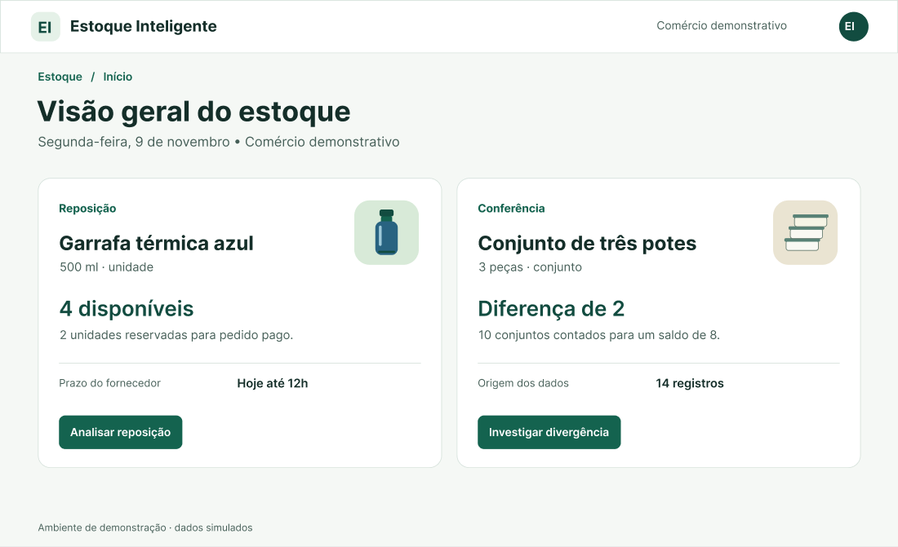
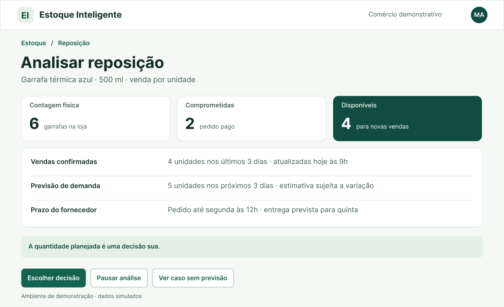
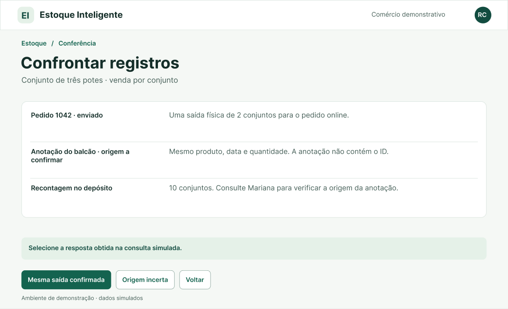
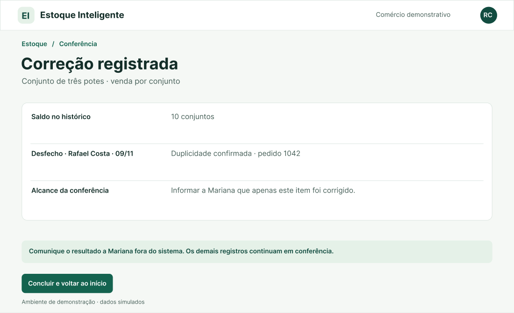
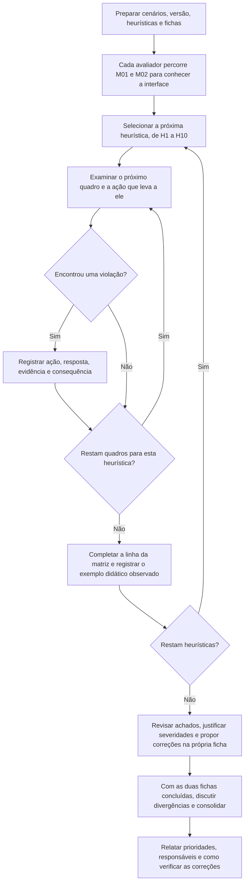
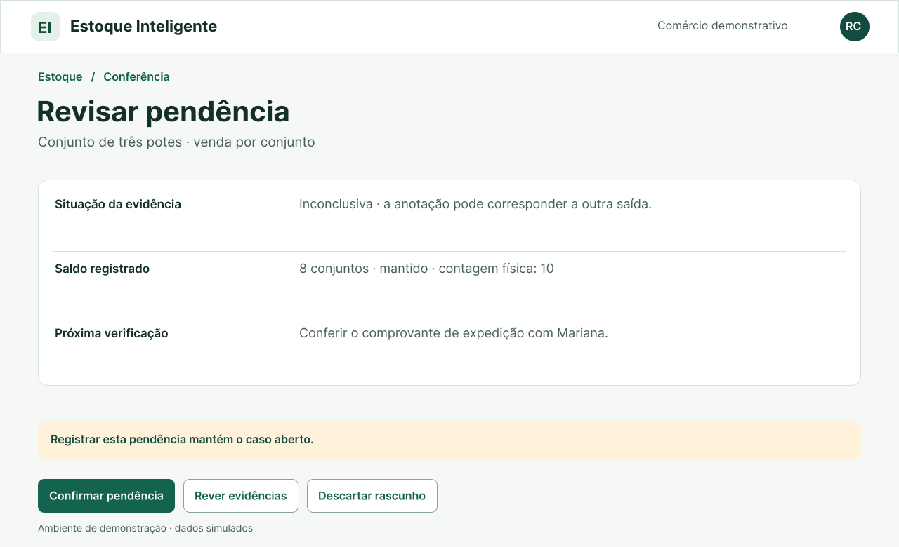
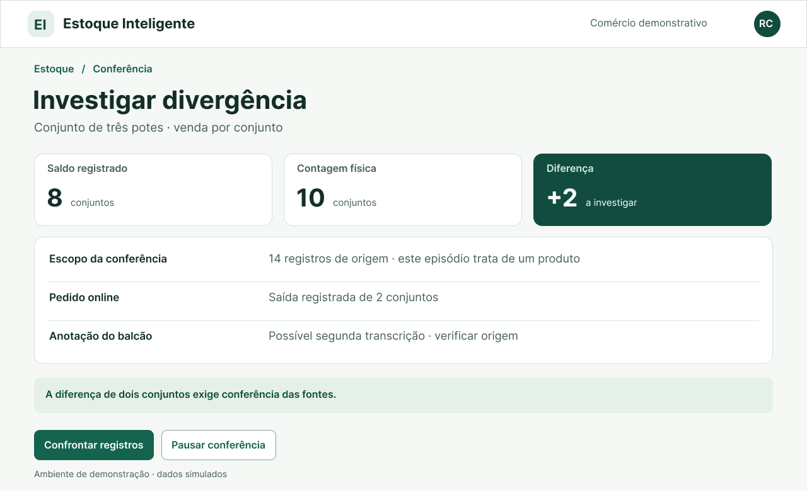
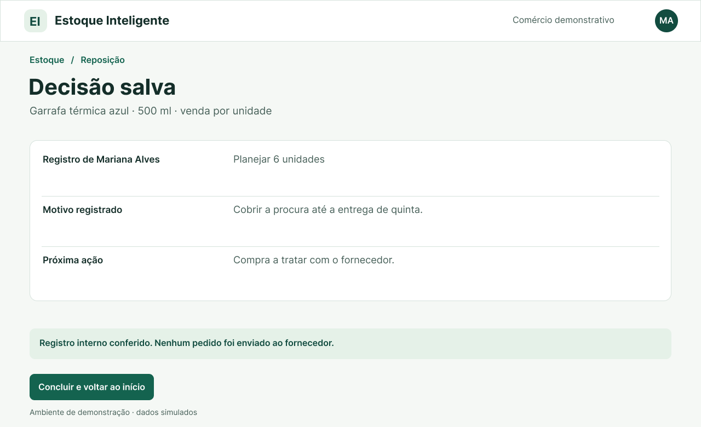

# Entrega 13 — Avaliação de IHC por inspeção heurística

**Data:** 12/11/2026  
**Status:** 🟨 iniciada  
**Responsabilidade:** 1 avaliação completa por integrante, sobre todas as telas/estados relevantes do projeto.

## Objetivo da atividade

Encontrar problemas de usabilidade por inspeção sistemática da interface com as **10 heurísticas de Nielsen**. Cada avaliador trabalha individualmente primeiro; depois a equipe consolida problemas duplicados e prioridades.

> **Parte de violações:** registre somente problemas reais. Não invente uma violação para “preencher” cada heurística. Para provar que todas foram exercitadas, use a **matriz de cobertura H1–H10**. Para heurísticas sem violação, a disciplina solicita um exemplo didático de boa prática.

## 1. Heurísticas adotadas

| Heurística | Pergunta para orientar a inspeção |
|---|---|
| H1 · Visibilidade do status do sistema | Como a pessoa percebe se a decisão está em rascunho, aguardando confirmação ou salva? |
| H2 · Compatibilidade entre o sistema e o mundo real | Quem separa pedidos reconhece o sentido de “comprometidas” e a diferença entre uma garrafa, um pote e um conjunto comercial? |
| H3 · Controle e liberdade do usuário | Ao rever uma decisão, é possível voltar, editar ou sair entendendo o que acontecerá com o rascunho? |
| H4 · Consistência e padrões | Rever, confirmar e concluir têm significados previsíveis nos dois fluxos? |
| H5 · Prevenção de erros | Antes da confirmação, a pessoa consegue identificar o item, a quantidade e o efeito de corrigir o segundo desconto? |
| H6 · Reconhecimento em vez de memorização | Na revisão ou após uma pausa, quais informações continuam à vista para reconhecer o item e a próxima ação? |
| H7 · Flexibilidade e eficiência de uso | Mariana consegue prosseguir no próprio ritmo? Quantas etapas Rafael precisa repetir para retomar a conferência? |
| H8 · Estética e design minimalista | Na decisão de reposição, é fácil localizar a disponibilidade, a previsão e o prazo em meio às outras informações? |
| H9 · Ajudar usuários a reconhecer, diagnosticar e recuperar-se de erros | Diante de quantidade inválida ou gravação incerta, a mensagem explica o ocorrido e indica um próximo passo seguro? |
| H10 · Ajuda e documentação | No ponto de dúvida, a pessoa encontra orientação suficiente para distinguir adiar uma compra, registrar pendência e refazer uma gravação? |

## Cobertura especial para interfaces administrativas e analíticas

A visão geral abre dois episódios de trabalho. Na reposição, examinar como a interface distingue **6 garrafas físicas**, **2 comprometidas** e **4 disponíveis** da previsão de **5 unidades em três dias**. No caso sem previsão, verificar o que a tela permite concluir sobre a demanda e como orienta a próxima verificação.

Na conferência, examinar a comparação entre **8 conjuntos registrados** e **10 contados**, a confirmação da origem da saída e a autorização para corrigir. Conferir o histórico do item, a comunicação do alcance parcial e os caminhos em que o saldo deve permanecer em 8. Nos dois fluxos, incluir pausa, revisão, confirmação, ausência de resposta e recuperação após falha.

O escopo é a navegação simulada do Figma. Filtros combinados, exportações, administração de contas, cadastro completo de produtos e processamento real do modelo ficam fora dos dois percursos. A restrição de permissão de Rafael, por outro lado, possui um estado próprio e integra a inspeção.

## 2. Escopo da inspeção

| Item | Definição |
|---|---|
| Versão avaliada | Versão de referência da Entrega 11, de 11/11/2026. Usar a mesma versão nas duas fichas. [Abrir apresentação](https://www.figma.com/proto/jgB0Bk5BLQ3XM2W9tgZDmd/Estoque-Inteligente?page-id=0%3A1&node-id=2-2&starting-point-node-id=2%3A2&scaling=scale-down) |
| Telas/estados | 28 quadros no inventário abaixo. Os links abrem cada quadro no arquivo de design para localizar evidências. Percorrer as ações em modo de apresentação. |
| Fluxos | M01/T01/O01 — Mariana toma uma decisão de reposição fundamentada e recuperável. M02/T02/O02 — Rafael investiga a divergência para tornar o saldo do item confiável e explicável. Ambos retomam as personas da Entrega 3, os cenários da Entrega 4, a análise de tarefas da Entrega 5 e os signos e modelos das Entregas 9 e 10. |
| Dispositivo/viewport | Previsto notebook com navegador e mouse. Os quadros têm 1280 × 780 px. No dia da inspeção, registrar na ficha o navegador, a área efetivamente disponível e o zoom usados. |
| Avaliadores | A01 — Paulo Andre de Oliveira Hirata. A02 — Victor Merker Binda. Cada um examinará M01 e M02 individualmente. |

| Parte do percurso | Quadros a inspecionar |
|---|---|
| Entrada comum e análise da garrafa, incluindo pausa e falta de previsão | [F01](https://www.figma.com/design/jgB0Bk5BLQ3XM2W9tgZDmd?node-id=2-2), [F02](https://www.figma.com/design/jgB0Bk5BLQ3XM2W9tgZDmd?node-id=2-49), [F02P](https://www.figma.com/design/jgB0Bk5BLQ3XM2W9tgZDmd?node-id=2-90), [F02B](https://www.figma.com/design/jgB0Bk5BLQ3XM2W9tgZDmd?node-id=2-112) |
| Escolha do desfecho, quantidade planejada e validação | [F03](https://www.figma.com/design/jgB0Bk5BLQ3XM2W9tgZDmd?node-id=2-139), [F04](https://www.figma.com/design/jgB0Bk5BLQ3XM2W9tgZDmd?node-id=2-168), [F04E](https://www.figma.com/design/jgB0Bk5BLQ3XM2W9tgZDmd?node-id=2-199) |
| Revisão e registro do planejamento de 6 ou 4 unidades | [F05](https://www.figma.com/design/jgB0Bk5BLQ3XM2W9tgZDmd?node-id=2-221), [F05S](https://www.figma.com/design/jgB0Bk5BLQ3XM2W9tgZDmd?node-id=2-252), [F05Q](https://www.figma.com/design/jgB0Bk5BLQ3XM2W9tgZDmd?node-id=2-277), [F05QS](https://www.figma.com/design/jgB0Bk5BLQ3XM2W9tgZDmd?node-id=2-306) |
| Revisão e registro de adiamento ou pendência | [F05A](https://www.figma.com/design/jgB0Bk5BLQ3XM2W9tgZDmd?node-id=2-331), [F05AS](https://www.figma.com/design/jgB0Bk5BLQ3XM2W9tgZDmd?node-id=2-360), [F05P](https://www.figma.com/design/jgB0Bk5BLQ3XM2W9tgZDmd?node-id=2-385), [F05PS](https://www.figma.com/design/jgB0Bk5BLQ3XM2W9tgZDmd?node-id=2-414) |
| Gravação da decisão sem confirmação e falha confirmada | [F06E](https://www.figma.com/design/jgB0Bk5BLQ3XM2W9tgZDmd?node-id=2-439), [F06R](https://www.figma.com/design/jgB0Bk5BLQ3XM2W9tgZDmd?node-id=2-463) |
| Investigação dos conjuntos de potes, pausa e confronto das fontes | [F10](https://www.figma.com/design/jgB0Bk5BLQ3XM2W9tgZDmd?node-id=2-485), [F10P](https://www.figma.com/design/jgB0Bk5BLQ3XM2W9tgZDmd?node-id=2-524), [F11](https://www.figma.com/design/jgB0Bk5BLQ3XM2W9tgZDmd?node-id=2-549) |
| Revisão da correção, gravação incerta e recuperação | [F12](https://www.figma.com/design/jgB0Bk5BLQ3XM2W9tgZDmd?node-id=2-578), [F12E](https://www.figma.com/design/jgB0Bk5BLQ3XM2W9tgZDmd?node-id=2-621), [F12F](https://www.figma.com/design/jgB0Bk5BLQ3XM2W9tgZDmd?node-id=2-645) |
| Falta de autorização ou de evidência | [F12N](https://www.figma.com/design/jgB0Bk5BLQ3XM2W9tgZDmd?node-id=2-667), [F12P](https://www.figma.com/design/jgB0Bk5BLQ3XM2W9tgZDmd?node-id=2-694) |
| Histórico da correção ou da pendência e comunicação do alcance | [F13](https://www.figma.com/design/jgB0Bk5BLQ3XM2W9tgZDmd?node-id=2-723), [F14](https://www.figma.com/design/jgB0Bk5BLQ3XM2W9tgZDmd?node-id=2-748), [F14N](https://www.figma.com/design/jgB0Bk5BLQ3XM2W9tgZDmd?node-id=2-773) |

**Telas de referência da Entrega 11.** As capturas abaixo identificam os estados do protótipo para os dois avaliadores. Ao registrar uma observação individual, inserir na própria ficha o print do estado examinado e destacar o elemento relevante.

| Quadro | Captura do protótipo |
|---|---|
| F01 · Visão geral do estoque |  |
| F02 · Analisar reposição |  |
| F11 · Confrontar registros |  |
| F13 · Correção registrada |  |

## 3. Procedimento individual

**Percursos conferidos no Figma em 18/11/2026.** A verificação de apoio seguiu os destinos configurados nos botões a partir da visão geral (F01) e leu as mensagens nos quadros de chegada. Os 28 quadros são alcançáveis pela entrada e contêm, ao todo, 57 ligações. A tabela descreve seis percursos. As fichas de Paulo e Victor registram separadamente a inspeção individual de cada integrante.

| Percurso | Ações no protótipo | Resultado conferido |
|---|---|---|
| Mariana · planejar reposição | Analisar reposição → Escolher decisão → Planejar quantidade → Revisar 6 unidades → Confirmar decisão | Em F02, das 6 garrafas físicas, 2 estão comprometidas e 4 disponíveis. Em F05S, o planejamento de 6 unidades fica salvo. O contato com o fornecedor é a próxima ação. |
| Mariana · informação insuficiente | Analisar reposição → Ver caso sem previsão → Preparar pendência → Confirmar decisão | F05PS registra a pendência e orienta conferir os pedidos pagos antes do meio-dia. |
| Mariana · pausa | Analisar reposição → Pausar análise → Retomar análise | F02P retorna à análise da mesma garrafa em F02. |
| Rafael · corrigir duplicidade | Investigar divergência → Confrontar registros → Mesma saída confirmada → Confirmar correção | Após a confirmação simulada de que a anotação corresponde ao pedido 1042, F12 permite revisar a correção. F13 mostra 10 conjuntos e informa que apenas esse item foi corrigido. |
| Rafael · origem incerta | Investigar divergência → Confrontar registros → Origem incerta → Confirmar pendência | F14 mantém o saldo de 8 conjuntos e indica conferir o comprovante com Mariana. |
| Rafael · pausa | Investigar divergência → Pausar conferência → Retomar conferência | F10P retorna à investigação em F10. A comparação das fontes começa na tela seguinte, F11, onde falta uma ação de pausa (PRE-02). |

O procedimento abaixo se aplica a cada avaliador. A01 e A02 usam a mesma versão, o mesmo escopo e o mesmo modelo de ficha. Cada um percorre os 28 quadros com uma heurística de cada vez, uma das ordens de inspeção demonstradas em aula.

1. **Preparar e conhecer o percurso.** Retomar o objetivo da Entrega 12, as personas e os fluxos MoLIC da Entrega 10. Na primeira passagem, acompanhar Mariana da consulta à garrafa até o registro da decisão de reposição. Em seguida, acompanhar Rafael da diferença de saldo até a comunicação do desfecho do item. Registrar data, versão, dispositivo e condições de visualização na própria ficha.
2. **Inspecionar individualmente.** Começar por H1, percorrer os dois fluxos e suas alternativas e anotar os quadros examinados. Ao concluir H1, repetir com H2 e seguir até H10. Incluir o que acontece entre duas telas, por exemplo, o que Mariana vê ao retomar depois de atender um cliente ou o que Rafael vê depois de confirmar uma correção. Cada integrante termina a própria ficha antes de conhecer os achados do colega.
3. **Declarar e interpretar cada problema.** Na seção 5, usar uma linha por problema e atribuir um ID como `A01-V01`. Descrever quem tentava fazer o quê, em qual quadro, qual resposta apareceu e por que isso contraria a heurística indicada. Inserir o print na célula **Evidência** e destacar o elemento relevante. Se o problema aparecer em vários locais, indicar os quadros afetados. Para um padrão que se repete em toda a interface, usar um print representativo e explicar o alcance. Para um elemento ausente, mostrar a tela em que ele faria falta e explicar em que momento a pessoa precisaria dele. Só então justificar a severidade e propor uma correção ligada à causa. 
4. **Documentar a cobertura e o uso das heurísticas.** Na seção 4, responder “sim” ou “não” com base nas telas efetivamente examinadas e associar todos os IDs pertinentes. A seção 5 recebe todas as violações observadas, inclusive quando várias correspondem à mesma heurística. Na seção 6, cada avaliador busca **um exemplo de bom uso por heurística**, com print e explicação de como a interface favorece a tarefa. Uma mesma heurística pode ser atendida em um quadro e violada em outro. Nesse caso, identificar os dois contextos nas respectivas seções. Se não encontrar um exemplo de bom uso, registrar essa limitação após a inspeção. 
5. **Consolidar e relatar.** Depois das duas inspeções independentes, Paulo e Victor comparam evidências, severidades e sugestões. Na seção 7, reúnem as ocorrências da mesma causa e registram a decisão comum. Na seção 8, indicam a ordem das correções e a ação que deverá ser repetida para verificar cada uma antes da avaliação com usuários.

O material *Avaliação de Usabilidade por Inspeções* (pp. 8–16) complementa o procedimento. O Modelo 02 orienta a declaração individual com print e descrição. Os Modelos 01, 03 e 04 servem de apoio à conferência dos itens.

### Escala de severidade (0–4)

| Grau | Interpretação |
|---:|---|
| 0 | Após análise, a ocorrência não caracteriza problema de usabilidade. Fica fora da declaração de violações. |
| 1 | Problema cosmético. Corrigir se houver tempo. |
| 2 | Problema menor. A pessoa consegue prosseguir com alguma dificuldade. A correção tem baixa prioridade. |
| 3 | Problema maior. Dar alta prioridade à correção pelo impacto na realização da tarefa. |
| 4 | Problema catastrófico. A correção é imprescindível antes da disponibilização. |

Na coluna **Justificativa da severidade**, explicar os três fatores no contexto da tarefa. **Frequência** estima quem encontraria o problema e em quais situações de uso. **Impacto** descreve o esforço ou impedimento para concluir a tarefa e se recuperar. **Persistência** indica se a dificuldade tende a desaparecer após o primeiro contato ou a atrapalhar a mesma pessoa a cada repetição.

A aula demonstra um recurso para comparar ocorrências. O avaliador pode atribuir de 1 a 5 a cada fator e somá-los (3 a 15). Se a dupla usar esse apoio, deve registrar os três valores e o motivo de cada um na justificativa. Na coluna **Severidade**, registrar o grau de 0 a 4 da tabela conforme a consequência para a tarefa. As estimativas poderão ser confrontadas com a observação de usuários na Entrega 14. [Videoaula — frequência, impacto e persistência, 41:20](https://www.youtube.com/watch?v=5c42T_7z1qY&t=2480s)

---

## Avaliador A01 — Paulo Andre de Oliveira Hirata

| Dados da ficha | Registro |
|---|---|
| Protótipo de referência | Estoque Inteligente · Entrega 11, de 11/11/2026. [Abrir apresentação no Figma](https://www.figma.com/proto/jgB0Bk5BLQ3XM2W9tgZDmd/Estoque-Inteligente?page-id=0%3A1&node-id=2-2&starting-point-node-id=2%3A2&scaling=scale-down) |
| Escopo previsto | 28 quadros de 1280 × 780 px. O inventário da seção 2 inclui os percursos principais, as alternativas e os estados de recuperação. |
| M01 / T01 · Mariana Alves | Inspecionar a reposição da garrafa, do início em F01 à confirmação. Incluir adiamento, pendência, edição, pausa e recuperação. |
| M02 / T02 · Rafael Costa | Inspecionar a conferência dos conjuntos de potes, do início em F01 ao desfecho. Incluir origem incerta, falta de autorização, pausa e recuperação. |
| Data e versão do Figma inspecionada | Data e versão da sessão não informadas. |
| Dispositivo, navegador, área visível e zoom | Não informados. |
| Caminhos descritos pelo avaliador | Reposição de garrafas, incluindo a escolha da quantidade e a tentativa com zero. Conferência dos potes, incluindo a comparação dos registros, a tentativa de pausa e a revisão da origem incerta. |

### 4. Matriz de cobertura das 10 heurísticas

| Heurística | Onde verificar | Resultado da inspeção individual |
|---|---|---|
| H1 · Visibilidade do status do sistema | F05Q · Revisar decisão e F05S · Decisão salva | Identifiquei o estado da operação pelas mensagens. A revisão avisa que ainda é preciso confirmar, e a tela final informa que a decisão foi salva. Sem violação relatada. |
| H2 · Correspondência com o mundo real | F02 · Analisar reposição e F12P · Revisar pendência | Entendi as quantidades de garrafas. Na conferência dos potes, tive dúvida se alguns valores representavam potes avulsos ou conjuntos. **Sim · A01-V04.** |
| H3 · Controle e liberdade do usuário | F04 · Quantidade planejada e F05Q · Revisar decisão | A quantidade apresentada na revisão acompanhou a escolha feita. A observação cobre a escolha e a revisão. A preservação da quantidade e do motivo ao voltar por **Editar** ficou sem confirmação. |
| H4 · Consistência e padrões | F05Q · Revisar decisão e F12 · Revisar correção | Os botões me pareceram coerentes nos dois fluxos. Nas duas revisões, reconheci a ação de confirmar pelo rótulo e pela apresentação do botão. Sem violação relatada. |
| H5 · Prevenção de erros | F04 → F04E · Confira a quantidade | Ao selecionar zero garrafas, recebi uma mensagem pedindo para conferir a quantidade. A tela exigiu um valor maior que zero antes de prosseguir. Sem violação relatada. |
| H6 · Reconhecimento em vez de memorização | F11 · Confrontar registros | Consegui ver na mesma tela as informações necessárias à comparação do pedido, da anotação do balcão e da recontagem. Sem violação relatada. |
| H7 · Flexibilidade e eficiência de uso | F10 · Investigar divergência e F11 · Confrontar registros | Quando quis interromper a conferência para retomá-la depois, não consegui pausar diretamente na tela em que estava comparando os registros. **Sim · A01-V02.** |
| H8 · Estética e design minimalista | F05Q · Revisar decisão | A diferença de cor entre o botão de confirmação e as alternativas de edição ou descarte me ajudou a escolher como prosseguir. Sem violação relatada. |
| H9 · Reconhecimento, diagnóstico e recuperação de erros | F04E · Confira a quantidade e F12P · Revisar pendência | Na reposição, consegui voltar para corrigir a quantidade inválida. Na conferência, a escolha era sobre a origem da anotação. Ao indicar **Origem incerta**, consegui rever as evidências antes de decidir o que registrar. Sem violação relatada. |
| H10 · Ajuda e documentação | F04 · Quantidade planejada e F11 · Confrontar registros | Nos dois percursos, encontrei orientação no momento da decisão. Para as garrafas, a tela indicou que eu deveria escolher uma quantidade e revisar o registro. Para os potes, orientou a consulta a Mariana. Sem violação relatada. |

### 5. Declaração de violações

Os graus abaixo são propostas para confirmação por Paulo. A frequência e a persistência são estimativas baseadas nas situações em que cada dificuldade pode reaparecer.

| ID individual | Heurística e quadro | Ação, resposta e consequência | Evidência | Severidade sugerida (0–4) e justificativa | Correção proposta e como verificá-la |
|---|---|---|---|---|---|
| A01-V04 | H2 · F12P | Ao comparar saldo e contagem, tive dúvida sobre a unidade dos potes. A linha começa com **8 conjuntos** e termina com **contagem física: 10**. Para interpretar o último número, precisei recorrer ao contexto. |  | **2 · Menor.** Afeta quem compara os dois valores. O cabeçalho informa a venda por conjunto e permite resolver a dúvida. A ambiguidade reaparece sempre que a linha é lida isoladamente. | Escrever **contagem física: 10 conjuntos**. Conferir se a linha, lida sozinha, permite identificar o que os números 8 e 10 contam. |
| A01-V02 | H7 · F10 e F11 | Ao confrontar os registros, quis pausar a operação. **Pausar conferência** aparece em F10. Em F11, encontrei as opções de indicar a origem ou voltar. Para alcançar a pausa, é preciso sair da comparação. | **F10 · Pausa disponível**  **F11 · Ações durante a comparação**  | **2 · Menor.** Afeta quem sofre uma interrupção durante a comparação. A pausa existe na etapa anterior, mas exige navegação adicional. Esse esforço se repete a cada interrupção nessa etapa. | Disponibilizar **Pausar conferência** em F11. Verificar se, ao interromper a leitura e retomar, Rafael volta à comparação do mesmo pedido. |

### 6. Boas práticas — heurísticas não violadas (atividade didática)

| Heurística | Quadro e elemento | Evidência | Como favorece a tarefa |
|---|---|---|---|
| H1 | F05S · Decisão salva |  | A mensagem de conclusão permite a Mariana saber que o registro terminou. |
| H2 | F02 · Contagem física, comprometidas e disponíveis |  | Os rótulos explicam quais garrafas ainda podem ser vendidas. A dúvida relatada em H2 ocorreu no fluxo dos potes. |
| H3 | F04 e F05Q · Escolha e revisão da quantidade |   | Mariana pode escolher quatro unidades e conferir o resultado antes da confirmação. |
| H4 | F05Q e F12 · Botões de confirmação |   | O mesmo padrão, **Confirmar** seguido do que será registrado, ajuda a prever a ação nos dois fluxos. |
| H5 | F04E · Validação da quantidade |  | A validação bloqueia o planejamento de zero unidades e informa o critério para prosseguir. |
| H6 | F11 · Pedido, anotação e recontagem |  | Rafael pode comparar as fontes enquanto lê, sem memorizar os números de outra tela. |
| H7 | F10 · Pausar conferência |  | A tela inicial da investigação oferece uma pausa antes da comparação. A dificuldade relatada surgiu na etapa seguinte, F11. |
| H8 | F05Q · Destaque da ação principal |  | O preenchimento do botão, junto ao rótulo, ajuda a distinguir a confirmação das alternativas. |
| H9 | F04E · Corrigir quantidade e F12P · Rever evidências |   | Nas garrafas, a mensagem explica como corrigir o valor inválido. Nos potes, a origem incerta abre uma pendência e permite reexaminar as fontes com o saldo mantido. |
| H10 | F04 e F11 · Orientações no ponto da decisão |   | As mensagens indicam uma ação concreta no momento em que a pessoa precisa decidir como continuar. |

---

## Avaliador A02 — Victor Merker Binda

| Dados da ficha | Registro |
|---|---|
| Protótipo de referência | Estoque Inteligente · Entrega 11, de 11/11/2026. [Abrir apresentação no Figma](https://www.figma.com/proto/jgB0Bk5BLQ3XM2W9tgZDmd/Estoque-Inteligente?page-id=0%3A1&node-id=2-2&starting-point-node-id=2%3A2&scaling=scale-down) |
| Escopo previsto | 28 quadros de 1280 × 780 px. O inventário da seção 2 inclui os percursos principais, as alternativas e os estados de recuperação. |
| M01 / T01 · Mariana Alves | Analisar a reposição da garrafa térmica e registrar a decisão. Percurso principal previsto de F01 → F02 → F03 → F04 → F05 → F05S. |
| M02 / T02 · Rafael Costa | Investigar a divergência no estoque de conjuntos de potes e conferir o desfecho. Percurso principal previsto de F01 → F10 → F11 → F12 → F13. |
| Data da inspeção | A registrar pelo integrante no dia da sua avaliação. |
| Dispositivo e navegador utilizados | A registrar durante a inspeção individual. |
| Área de visualização e zoom utilizados | Registrar área e zoom efetivos ao abrir a apresentação. |

**Situação da ficha.** As colunas abaixo contêm referências verificadas para conferência individual. A decisão do avaliador sobre cada linha e seus próprios IDs serão registrados após seu percurso.

### 4. Matriz de cobertura das 10 heurísticas

| Heurística | Quadros de referência | Resultado preliminar | ID preliminar | Boa prática localizada |
|---|---|---|---|---|
| H1 · Visibilidade do status do sistema | F13, F06E e F12E | Indício identificado na pré-análise | PRE-01 | F13 identifica a correção como registrada e mostra o saldo de 10 conjuntos. |
| H2 · Compatibilidade entre o sistema e o mundo real | F02 | Sem violação registrada na pré-análise | — | F02 distingue garrafas na loja, reservadas para pedido pago e disponíveis para novas vendas. |
| H3 · Controle e liberdade do usuário | F12 | Sem violação registrada na pré-análise | — | F12 oferece “Editar” durante a revisão da correção. |
| H4 · Consistência e padrões | F01 | Sem violação registrada na pré-análise | — | F01 usa a mesma estrutura de cartão para reposição e conferência, com identificação, valor principal e ação. |
| H5 · Prevenção de erros | F12 | Sem violação registrada na pré-análise | — | F12 mostra 8 conjuntos atuais, desconto indevido de 2 e saldo previsto de 10. |
| H6 · Reconhecimento em vez de memorização | F11 | Sem violação registrada na pré-análise | — | F11 mantém pedido, anotação e recontagem visíveis ao mesmo tempo. |
| H7 · Flexibilidade e eficiência de uso | F01, F11 e F10P | Indício identificado na pré-análise | PRE-02 | Cada cartão de F01 dá acesso direto à ação daquele item. |
| H8 · Estética e design minimalista | F02, F02 e F12 | Indício identificado na pré-análise | PRE-03 | F02 agrupa físico, comprometido e disponível, com destaque para as quatro garrafas livres. |
| H9 · Ajudar usuários a reconhecer, diagnosticar e recuperar-se de erros | F04E | Sem violação registrada na pré-análise | — | F04E identifica o valor zero, preserva o motivo e oferece “Corrigir quantidade”. |
| H10 · Ajuda e documentação | F11 | Sem violação registrada na pré-análise | — | F11 orienta consultar Mariana para verificar a origem da anotação. |

### 5. Declaração de violações

| ID preliminar | Heurística | Tela/estado | Problema observado | Evidência e elemento a conferir | Severidade proposta | Frequência, impacto e persistência | Recomendação |
|---|---|---|---|---|---|---|---|
| PRE-01 | H1 | F06E e F12E | Ao consultar um salvamento incerto, o caminho de consulta termina sempre em sucesso (F05S ou F13). O MoLIC também prevê que a consulta possa continuar aguardando resposta. O protótipo deixa essa situação sem um caminho para uma nova consulta. | **Consultar registro / Consultar resultado**   | 2 | Ocorre quando a demora persiste após a primeira consulta. Impede ensaiar a espera prolongada e se repete nas duas tarefas. O efeito foi verificado na simulação. | Prever a resposta “Ainda aguardando”, manter visível o mesmo registro e permitir nova consulta sem repetir a operação. |
| PRE-02 | H7 | F11 e F10P | Rafael já comparou as fontes em F11 quando precisa atender no balcão. A pausa está em F10. Voltar e pausar leva a um resumo que ainda manda comparar as fontes, e retomar retorna a F10. Rafael precisa reconstruir o ponto em que parou. | **Ações ao pé de F11 e próxima etapa em F10P**   | 2 | Atinge as interrupções durante a comparação. Acrescenta navegação e exige memória do que já foi conferido. A dificuldade volta a ocorrer se houver nova interrupção nesse ponto. | Oferecer pausa em F11, guardar a última fonte conferida e retornar à comparação com a verificação pendente visível. |
| PRE-03 | H8 | F02 e F12 | “Ver caso sem previsão” aparece ao lado das ações de Mariana. “Testar falha” aparece ao lado da confirmação de Rafael. Os dois controles trocam o cenário de demonstração e competem com ações do trabalho, podendo sugerir caminhos durante a avaliação. | **Ver caso sem previsão / Testar falha**   | 2 | Os controles aparecem toda vez que essas telas são abertas. Um clique muda o cenário e pode desviar a tentativa. O caminho principal continua disponível. | Deixar a seleção de cenários com o moderador e abrir cada tarefa no estado preparado para o participante. |

### 6. Boas práticas — heurísticas não violadas (atividade didática)

| Heurística | Exemplo no sistema | Evidência | Por que atende |
|---|---|---|---|
| H1 · Visibilidade do status do sistema | F13 identifica a correção como registrada e mostra o saldo de 10 conjuntos. |  | O título e o saldo permitem conferir o resultado imediatamente após salvar. |
| H2 · Compatibilidade entre o sistema e o mundo real | F02 distingue garrafas na loja, reservadas para pedido pago e disponíveis para novas vendas. |  | Relaciona os números às operações conhecidas por quem vende e separa pedidos. |
| H3 · Controle e liberdade do usuário | F12 oferece “Editar” durante a revisão da correção. |  | Rafael pode rever a base antes de confirmar uma alteração de saldo. |
| H4 · Consistência e padrões | F01 usa a mesma estrutura de cartão para reposição e conferência, com identificação, valor principal e ação. |  | O mesmo padrão permite escolher entre as duas tarefas. |
| H5 · Prevenção de erros | F12 mostra 8 conjuntos atuais, desconto indevido de 2 e saldo previsto de 10. |  | A pessoa consegue conferir o efeito e a justificativa antes de confirmar. |
| H6 · Reconhecimento em vez de memorização | F11 mantém pedido, anotação e recontagem visíveis ao mesmo tempo. |  | As fontes podem ser comparadas sem memorizar informações de telas sucessivas. |
| H7 · Flexibilidade e eficiência de uso | Cada cartão de F01 dá acesso direto à ação daquele item. |  | A pessoa entra na tarefa de reposição ou de conferência sem refazer a busca pelo produto. |
| H8 · Estética e design minimalista | F02 agrupa físico, comprometido e disponível, com destaque para as quatro garrafas livres. |  | A hierarquia visual facilita localizar a quantidade utilizável mesmo com outras informações na página. |
| H9 · Ajudar usuários a reconhecer, diagnosticar e recuperar-se de erros | F04E identifica o valor zero, preserva o motivo e oferece “Corrigir quantidade”. |  | Indica o que causou o erro e como prosseguir com o trabalho já iniciado. |
| H10 · Ajuda e documentação | F11 orienta consultar Mariana para verificar a origem da anotação. |  | A orientação aparece no ponto de dúvida e indica a fonte que pode esclarecer a causa. |

## 7. Consolidação da equipe

**Síntese provisória.** As três linhas contam causas únicas levantadas na análise compartilhada. A coluna de achados individuais receberá os IDs de Paulo e Victor após suas inspeções.

Depois das duas inspeções, agrupar achados quando a mesma correção resolver a causa observada. Preservar os IDs individuais, inclusive se apenas um avaliador encontrou o problema. Se os graus divergirem, rever os prints e as justificativas, acordar o grau final e explicar a decisão na célula correspondente. Ordenar as correções considerando o efeito sobre as tarefas de Mariana e Rafael.

| ID consolidado | Achados individuais | Heurística | Problema | Severidade final | Prioridade | Responsável pela correção |
|---|---|---|---|---:|---|---|
| | | | | | | |

## 8. Síntese e plano de melhoria

| Resultado a apresentar após a consolidação | Resultado da equipe |
|---|---|
| Quantidade de problemas únicos por heurística e por severidade | Pré-análise com 3 causas distintas, uma em H1, uma em H7 e uma em H8. Grau 2 sugerido para as três. Contagem final depende da dupla. |
| Problemas graves ou críticos e efeito sobre o teste ou a disponibilização | Nenhum dos três achados preliminares recebeu grau 3 ou 4. Revisar a classificação na consolidação individual e conjunta. |
| Padrões recorrentes entre produtos, telas e estados | Nos dois fluxos, a consulta salta para sucesso e os controles da demonstração dividem espaço com ações do participante. |
| Correções priorizadas antes da Entrega 14 e ação a repetir para verificar cada correção | 1. Abrir F02 e F12 como participante e conferir que a seleção de cenário ficou com o moderador. 2. Pausar em F11 depois de comparar uma fonte e verificar a retomada no mesmo ponto. 3. Simular duas consultas ao mesmo registro ainda em espera em cada fluxo e conferir que há uma única operação. |

## Checklist

- [ ] Cada integrante fez uma inspeção completa e identificada.
- [ ] Todas as telas/estados relevantes foram examinados.
- [ ] Estados administrativos, filtros, relatórios, históricos, processamento e erros foram incluídos quando existentes.
- [ ] A inspeção avaliou a interface/protótipo, não o mérito técnico do algoritmo/modelo.
- [ ] H1–H10 aparecem na matriz de cobertura de cada avaliador.
- [ ] Parte de violações contém apenas violações, sem “forçar” exemplos.
- [ ] Todo problema tem print/localização e contexto.
- [ ] Severidade possui justificativa, não apenas número.
- [ ] Recomendação resolve a causa ou reduz o impacto.
- [ ] Achados duplicados foram consolidados ao final.
