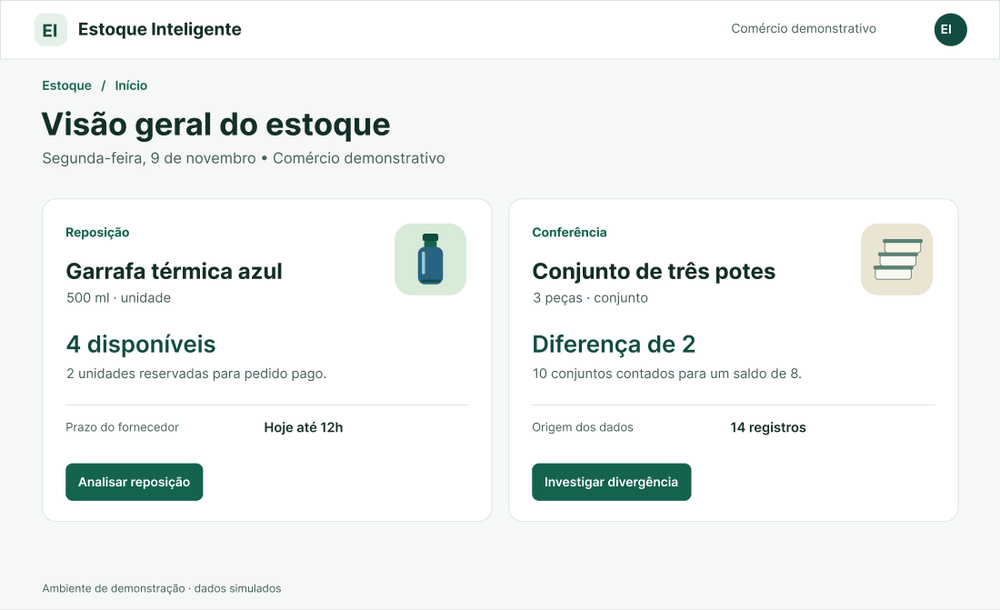
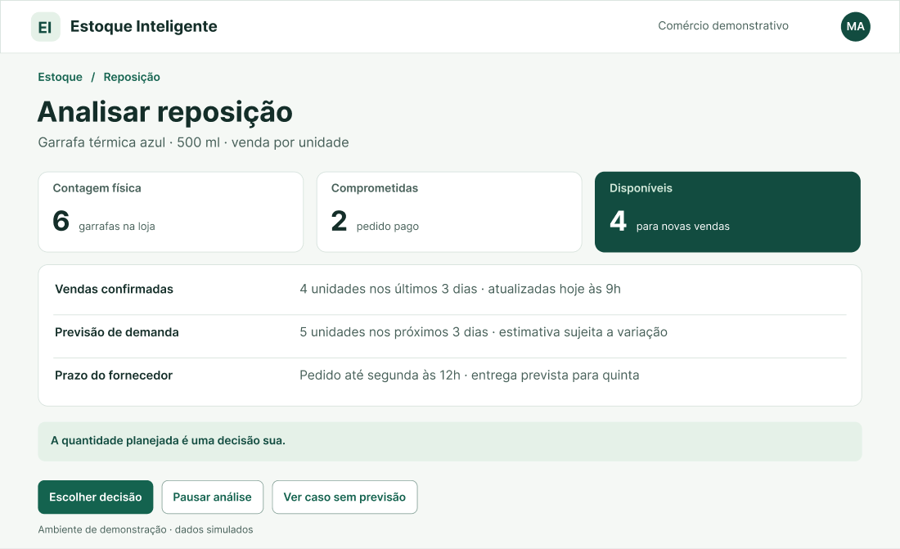
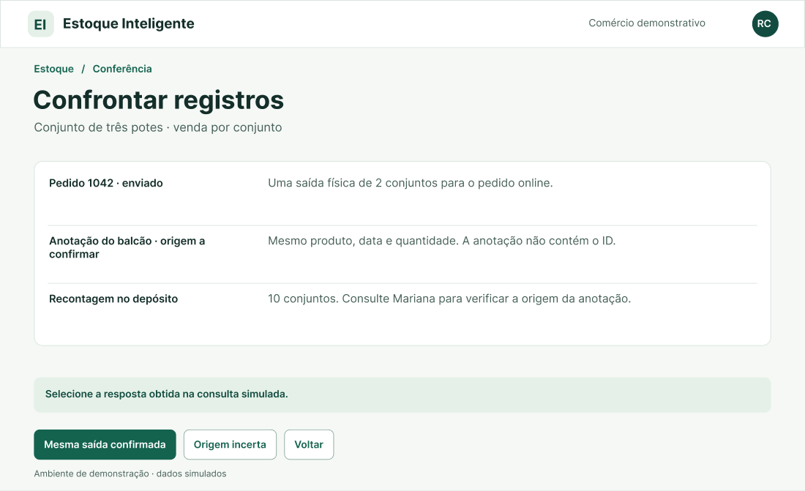
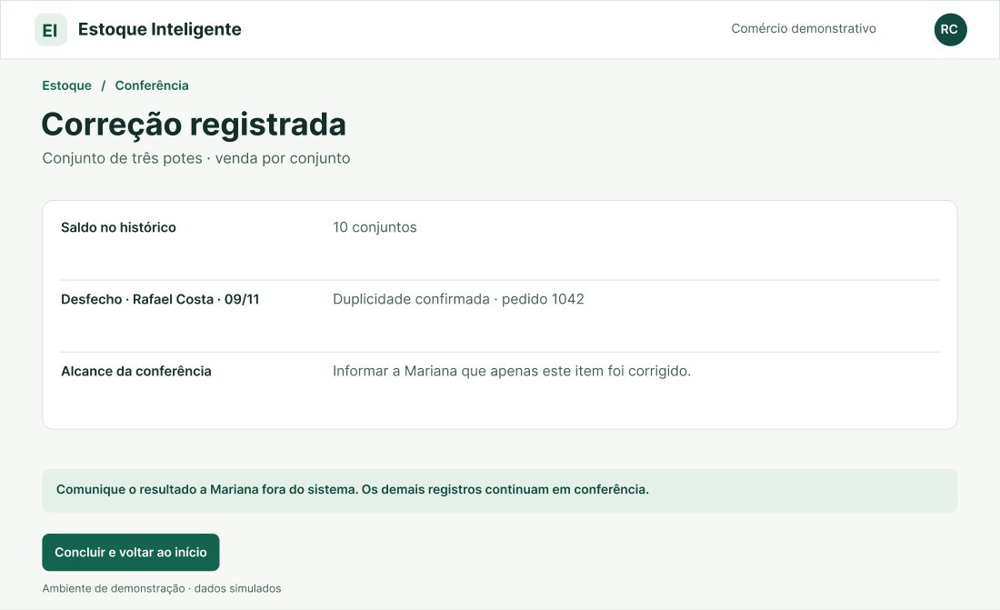
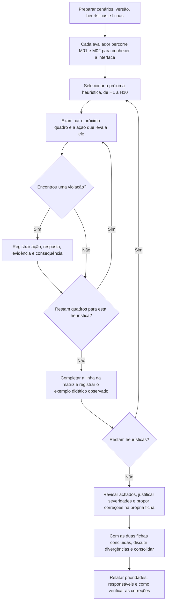

# Entrega 13 — Avaliação de IHC por inspeção heurística

**Data:** 12/11/2026  
**Status:** 🟨 iniciada  
**Responsabilidade:** 1 avaliação completa por integrante, sobre todas as telas/estados relevantes do projeto.

## Objetivo da atividade

Encontrar problemas de usabilidade por inspeção sistemática da interface com as **10 heurísticas de Nielsen**. Cada avaliador trabalha individualmente primeiro; depois a equipe consolida problemas duplicados e prioridades.

> **Parte de violações:** registre somente problemas reais. Não invente uma violação para “preencher” cada heurística. Para provar que todas foram exercitadas, use a **matriz de cobertura H1–H10**. Para heurísticas sem violação, a disciplina solicita um exemplo didático de boa prática.

## 1. Heurísticas adotadas

| Heurística | Pergunta para orientar a inspeção |
|---|---|
| H1 · Visibilidade do status do sistema | Como a pessoa percebe se a decisão está em rascunho, aguardando confirmação ou salva? |
| H2 · Compatibilidade entre o sistema e o mundo real | Quem separa pedidos reconhece o sentido de “comprometidas” e a diferença entre uma garrafa, um pote e um conjunto comercial? |
| H3 · Controle e liberdade do usuário | Ao rever uma decisão, é possível voltar, editar ou sair entendendo o que acontecerá com o rascunho? |
| H4 · Consistência e padrões | Rever, confirmar e concluir têm significados previsíveis nos dois fluxos? |
| H5 · Prevenção de erros | Antes da confirmação, a pessoa consegue identificar o item, a quantidade e o efeito de corrigir o segundo desconto? |
| H6 · Reconhecimento em vez de memorização | Na revisão ou após uma pausa, quais informações continuam à vista para reconhecer o item e a próxima ação? |
| H7 · Flexibilidade e eficiência de uso | Mariana consegue prosseguir no próprio ritmo? Quantas etapas Rafael precisa repetir para retomar a conferência? |
| H8 · Estética e design minimalista | Na decisão de reposição, é fácil localizar a disponibilidade, a previsão e o prazo em meio às outras informações? |
| H9 · Ajudar usuários a reconhecer, diagnosticar e recuperar-se de erros | Diante de quantidade inválida ou gravação incerta, a mensagem explica o ocorrido e indica um próximo passo seguro? |
| H10 · Ajuda e documentação | No ponto de dúvida, a pessoa encontra orientação suficiente para distinguir adiar uma compra, registrar pendência e refazer uma gravação? |

## Cobertura especial para interfaces administrativas e analíticas

A visão geral abre dois episódios de trabalho. Na reposição, examinar como a interface distingue **6 garrafas físicas**, **2 comprometidas** e **4 disponíveis** da previsão de **5 unidades em três dias**. No caso sem previsão, verificar o que a tela permite concluir sobre a demanda e como orienta a próxima verificação.

Na conferência, examinar a comparação entre **8 conjuntos registrados** e **10 contados**, a confirmação da origem da saída e a autorização para corrigir. Conferir o histórico do item, a comunicação do alcance parcial e os caminhos em que o saldo deve permanecer em 8. Nos dois fluxos, incluir pausa, revisão, confirmação, ausência de resposta e recuperação após falha.

O escopo é a navegação simulada do Figma. Filtros combinados, exportações, administração de contas, cadastro completo de produtos e processamento real do modelo ficam fora dos dois percursos. A restrição de permissão de Rafael, por outro lado, possui um estado próprio e integra a inspeção.

## 2. Escopo da inspeção

| Item | Definição |
|---|---|
| Versão avaliada | Versão de referência da Entrega 11, de 11/11/2026. Usar a mesma versão nas duas fichas. [Abrir apresentação](https://www.figma.com/proto/jgB0Bk5BLQ3XM2W9tgZDmd/Estoque-Inteligente?page-id=0%3A1&node-id=2-2&starting-point-node-id=2%3A2&scaling=scale-down) |
| Telas/estados | 28 quadros no inventário abaixo. Os links abrem cada quadro no arquivo de design para localizar evidências. Percorrer as ações em modo de apresentação. |
| Fluxos | M01/T01/O01 — registrar a decisão de reposição de Mariana. M02/T02/O02 — investigar e comunicar o desfecho de uma divergência de Rafael. Ambos retomam as personas da Entrega 3, os cenários da Entrega 4, a análise de tarefas da Entrega 5 e os signos e modelos das Entregas 9 e 10. |
| Dispositivo/viewport | Previsto notebook com navegador e mouse. Os quadros têm 1280 × 780 px. No dia da inspeção, registrar na ficha o navegador, a área efetivamente disponível e o zoom usados. |
| Avaliadores | A01 — Paulo Andre de Oliveira Hirata. A02 — Victor Merker Binda. Cada um examinará M01 e M02 individualmente. |

| Parte do percurso | Quadros a inspecionar |
|---|---|
| Entrada comum e análise da garrafa, incluindo pausa e falta de previsão | [F01](https://www.figma.com/design/jgB0Bk5BLQ3XM2W9tgZDmd?node-id=2-2), [F02](https://www.figma.com/design/jgB0Bk5BLQ3XM2W9tgZDmd?node-id=2-49), [F02P](https://www.figma.com/design/jgB0Bk5BLQ3XM2W9tgZDmd?node-id=2-90), [F02B](https://www.figma.com/design/jgB0Bk5BLQ3XM2W9tgZDmd?node-id=2-112) |
| Escolha do desfecho, quantidade planejada e validação | [F03](https://www.figma.com/design/jgB0Bk5BLQ3XM2W9tgZDmd?node-id=2-139), [F04](https://www.figma.com/design/jgB0Bk5BLQ3XM2W9tgZDmd?node-id=2-168), [F04E](https://www.figma.com/design/jgB0Bk5BLQ3XM2W9tgZDmd?node-id=2-199) |
| Revisão e registro do planejamento de 6 ou 4 unidades | [F05](https://www.figma.com/design/jgB0Bk5BLQ3XM2W9tgZDmd?node-id=2-221), [F05S](https://www.figma.com/design/jgB0Bk5BLQ3XM2W9tgZDmd?node-id=2-252), [F05Q](https://www.figma.com/design/jgB0Bk5BLQ3XM2W9tgZDmd?node-id=2-277), [F05QS](https://www.figma.com/design/jgB0Bk5BLQ3XM2W9tgZDmd?node-id=2-306) |
| Revisão e registro de adiamento ou pendência | [F05A](https://www.figma.com/design/jgB0Bk5BLQ3XM2W9tgZDmd?node-id=2-331), [F05AS](https://www.figma.com/design/jgB0Bk5BLQ3XM2W9tgZDmd?node-id=2-360), [F05P](https://www.figma.com/design/jgB0Bk5BLQ3XM2W9tgZDmd?node-id=2-385), [F05PS](https://www.figma.com/design/jgB0Bk5BLQ3XM2W9tgZDmd?node-id=2-414) |
| Gravação da decisão sem confirmação e falha confirmada | [F06E](https://www.figma.com/design/jgB0Bk5BLQ3XM2W9tgZDmd?node-id=2-439), [F06R](https://www.figma.com/design/jgB0Bk5BLQ3XM2W9tgZDmd?node-id=2-463) |
| Investigação dos conjuntos de potes, pausa e confronto das fontes | [F10](https://www.figma.com/design/jgB0Bk5BLQ3XM2W9tgZDmd?node-id=2-485), [F10P](https://www.figma.com/design/jgB0Bk5BLQ3XM2W9tgZDmd?node-id=2-524), [F11](https://www.figma.com/design/jgB0Bk5BLQ3XM2W9tgZDmd?node-id=2-549) |
| Revisão da correção, gravação incerta e recuperação | [F12](https://www.figma.com/design/jgB0Bk5BLQ3XM2W9tgZDmd?node-id=2-578), [F12E](https://www.figma.com/design/jgB0Bk5BLQ3XM2W9tgZDmd?node-id=2-621), [F12F](https://www.figma.com/design/jgB0Bk5BLQ3XM2W9tgZDmd?node-id=2-645) |
| Falta de autorização ou de evidência | [F12N](https://www.figma.com/design/jgB0Bk5BLQ3XM2W9tgZDmd?node-id=2-667), [F12P](https://www.figma.com/design/jgB0Bk5BLQ3XM2W9tgZDmd?node-id=2-694) |
| Histórico da correção ou da pendência e comunicação do alcance | [F13](https://www.figma.com/design/jgB0Bk5BLQ3XM2W9tgZDmd?node-id=2-723), [F14](https://www.figma.com/design/jgB0Bk5BLQ3XM2W9tgZDmd?node-id=2-748), [F14N](https://www.figma.com/design/jgB0Bk5BLQ3XM2W9tgZDmd?node-id=2-773) |

**Telas de referência da Entrega 11.** As capturas abaixo identificam os estados do protótipo para os dois avaliadores. Ao registrar uma observação individual, inserir na própria ficha o print do estado examinado e destacar o elemento relevante.

| Quadro | Captura do protótipo |
|---|---|
| F01 · Visão geral do estoque |  |
| F02 · Analisar reposição |  |
| F11 · Confrontar registros |  |
| F13 · Correção registrada |  |

## 3. Procedimento individual

O procedimento abaixo se aplica a cada avaliador. A01 e A02 usam a mesma versão, o mesmo escopo e o mesmo modelo de ficha. Cada um percorre os 28 quadros com uma heurística de cada vez, uma das ordens de inspeção demonstradas em aula. [Videoaula — preparação e instrumento comum, 28:00](https://www.youtube.com/watch?v=5c42T_7z1qY&t=1680s) · [Percurso por heurística ou por tela, 35:00](https://www.youtube.com/watch?v=5c42T_7z1qY&t=2100s)

1. **Preparar e conhecer o percurso.** Retomar o objetivo da Entrega 12, as personas e os fluxos MoLIC da Entrega 10. Na primeira passagem, acompanhar Mariana da consulta à garrafa até o registro da decisão de reposição. Em seguida, acompanhar Rafael da diferença de saldo até a comunicação do desfecho do item. Registrar data, versão, dispositivo e condições de visualização na própria ficha.
2. **Inspecionar individualmente.** Começar por H1, percorrer os dois fluxos e suas alternativas e anotar os quadros examinados. Ao concluir H1, repetir com H2 e seguir até H10. Incluir o que acontece entre duas telas, por exemplo, o que Mariana vê ao retomar depois de atender um cliente ou o que Rafael vê depois de confirmar uma correção. Cada integrante termina a própria ficha antes de conhecer os achados do colega.
3. **Declarar e interpretar cada problema.** Na seção 5, usar uma linha por problema e atribuir um ID como `A01-V01`. Descrever quem tentava fazer o quê, em qual quadro, qual resposta apareceu e por que isso contraria a heurística indicada. Inserir o print na célula **Evidência** e destacar o elemento relevante. Se o problema aparecer em vários locais, indicar os quadros afetados. Para um padrão que se repete em toda a interface, usar um print representativo e explicar o alcance. Para um elemento ausente, mostrar a tela em que ele faria falta e explicar em que momento a pessoa precisaria dele. Só então justificar a severidade e propor uma correção ligada à causa. [Videoaula — como localizar e documentar uma violação, 38:00](https://www.youtube.com/watch?v=5c42T_7z1qY&t=2280s)
4. **Documentar a cobertura e o uso das heurísticas.** Na seção 4, responder “sim” ou “não” com base nas telas efetivamente examinadas e associar todos os IDs pertinentes. A seção 5 recebe todas as violações observadas, inclusive quando várias correspondem à mesma heurística. Na seção 6, cada avaliador busca **um exemplo de bom uso por heurística**, com print e explicação de como a interface favorece a tarefa. Uma mesma heurística pode ser atendida em um quadro e violada em outro. Nesse caso, identificar os dois contextos nas respectivas seções. Se não encontrar um exemplo de bom uso, registrar essa limitação após a inspeção. [Videoaula — exercício didático, 52:29](https://www.youtube.com/watch?v=5c42T_7z1qY&t=3149s)
5. **Consolidar e relatar.** Depois das duas inspeções independentes, Paulo e Victor comparam evidências, severidades e sugestões. Na seção 7, reúnem as ocorrências da mesma causa e registram a decisão comum. Na seção 8, indicam a ordem das correções e a ação que deverá ser repetida para verificar cada uma antes da avaliação com usuários.

O material *Avaliação de Usabilidade por Inspeções* (pp. 8–16) complementa o procedimento. O Modelo 02 orienta a declaração individual com print e descrição. Os Modelos 01, 03 e 04 servem de apoio à conferência dos itens.

### Escala de severidade (0–4)

| Grau | Interpretação |
|---:|---|
| 0 | Após análise, a ocorrência não caracteriza problema de usabilidade. Fica fora da declaração de violações. |
| 1 | Problema cosmético. Corrigir se houver tempo. |
| 2 | Problema menor. A pessoa consegue prosseguir com alguma dificuldade. A correção tem baixa prioridade. |
| 3 | Problema maior. Dar alta prioridade à correção pelo impacto na realização da tarefa. |
| 4 | Problema catastrófico. A correção é imprescindível antes da disponibilização. |

Na coluna **Justificativa da severidade**, explicar os três fatores no contexto da tarefa. **Frequência** estima quem encontraria o problema e em quais situações de uso. **Impacto** descreve o esforço ou impedimento para concluir a tarefa e se recuperar. **Persistência** indica se a dificuldade tende a desaparecer após o primeiro contato ou a atrapalhar a mesma pessoa a cada repetição.

A aula demonstra um recurso para comparar ocorrências. O avaliador pode atribuir de 1 a 5 a cada fator e somá-los (3 a 15). Se a dupla usar esse apoio, deve registrar os três valores e o motivo de cada um na justificativa. Na coluna **Severidade**, registrar o grau de 0 a 4 da tabela conforme a consequência para a tarefa. As estimativas poderão ser confrontadas com a observação de usuários na Entrega 14. [Videoaula — frequência, impacto e persistência, 41:20](https://www.youtube.com/watch?v=5c42T_7z1qY&t=2480s)

---

## Avaliador A01 — Paulo Andre de Oliveira Hirata

| Dados da ficha | Registro |
|---|---|
| Protótipo de referência | Estoque Inteligente · Entrega 11, de 11/11/2026. [Abrir apresentação no Figma](https://www.figma.com/proto/jgB0Bk5BLQ3XM2W9tgZDmd/Estoque-Inteligente?page-id=0%3A1&node-id=2-2&starting-point-node-id=2%3A2&scaling=scale-down) |
| Escopo previsto | 28 quadros de 1280 × 780 px. O inventário da seção 2 inclui os percursos principais, as alternativas e os estados de recuperação. |
| M01 / T01 · Mariana Alves | Analisar a reposição da garrafa térmica e registrar a decisão. Percurso principal previsto de F01 → F02 → F03 → F04 → F05 → F05S. |
| M02 / T02 · Rafael Costa | Investigar a divergência no estoque de conjuntos de potes e conferir o desfecho. Percurso principal previsto de F01 → F10 → F11 → F12 → F13. |
| Data da inspeção | |
| Dispositivo e navegador utilizados | |
| Área de visualização e zoom utilizados | |

### 4. Matriz de cobertura das 10 heurísticas

| Heurística | Telas/fluxos examinados | Houve violação? | IDs dos achados | Exemplo de boa prática se não violada |
|---|---|---|---|---|
| H1 · Visibilidade do status do sistema | | | | |
| H2 · Compatibilidade entre o sistema e o mundo real | | | | |
| H3 · Controle e liberdade do usuário | | | | |
| H4 · Consistência e padrões | | | | |
| H5 · Prevenção de erros | | | | |
| H6 · Reconhecimento em vez de memorização | | | | |
| H7 · Flexibilidade e eficiência de uso | | | | |
| H8 · Estética e design minimalista | | | | |
| H9 · Ajudar usuários a reconhecer, diagnosticar e recuperar-se de erros | | | | |
| H10 · Ajuda e documentação | | | | |

### 5. Declaração de violações

| ID | Heurística | Tela/estado | Problema observado | Evidência | Severidade | Justificativa da severidade | Recomendação |
|---|---|---|---|---|---:|---|---|
| | | | | | | | |

### 6. Boas práticas — heurísticas não violadas (atividade didática)

| Heurística atendida no exemplo | Exemplo no sistema | Evidência | Por que atende |
|---|---|---|---|
| H1 · Visibilidade do status do sistema | | | |
| H2 · Compatibilidade entre o sistema e o mundo real | | | |
| H3 · Controle e liberdade do usuário | | | |
| H4 · Consistência e padrões | | | |
| H5 · Prevenção de erros | | | |
| H6 · Reconhecimento em vez de memorização | | | |
| H7 · Flexibilidade e eficiência de uso | | | |
| H8 · Estética e design minimalista | | | |
| H9 · Ajudar usuários a reconhecer, diagnosticar e recuperar-se de erros | | | |
| H10 · Ajuda e documentação | | | |

---

## Avaliador A02 — Victor Merker Binda

| Dados da ficha | Registro |
|---|---|
| Protótipo de referência | Estoque Inteligente · Entrega 11, de 11/11/2026. [Abrir apresentação no Figma](https://www.figma.com/proto/jgB0Bk5BLQ3XM2W9tgZDmd/Estoque-Inteligente?page-id=0%3A1&node-id=2-2&starting-point-node-id=2%3A2&scaling=scale-down) |
| Escopo previsto | 28 quadros de 1280 × 780 px. O inventário da seção 2 inclui os percursos principais, as alternativas e os estados de recuperação. |
| M01 / T01 · Mariana Alves | Analisar a reposição da garrafa térmica e registrar a decisão. Percurso principal previsto de F01 → F02 → F03 → F04 → F05 → F05S. |
| M02 / T02 · Rafael Costa | Investigar a divergência no estoque de conjuntos de potes e conferir o desfecho. Percurso principal previsto de F01 → F10 → F11 → F12 → F13. |
| Data da inspeção | |
| Dispositivo e navegador utilizados | |
| Área de visualização e zoom utilizados | |

### 4. Matriz de cobertura das 10 heurísticas

| Heurística | Telas/fluxos examinados | Houve violação? | IDs dos achados | Exemplo de boa prática se não violada |
|---|---|---|---|---|
| H1 · Visibilidade do status do sistema | | | | |
| H2 · Compatibilidade entre o sistema e o mundo real | | | | |
| H3 · Controle e liberdade do usuário | | | | |
| H4 · Consistência e padrões | | | | |
| H5 · Prevenção de erros | | | | |
| H6 · Reconhecimento em vez de memorização | | | | |
| H7 · Flexibilidade e eficiência de uso | | | | |
| H8 · Estética e design minimalista | | | | |
| H9 · Ajudar usuários a reconhecer, diagnosticar e recuperar-se de erros | | | | |
| H10 · Ajuda e documentação | | | | |

### 5. Declaração de violações

| ID | Heurística | Tela/estado | Problema observado | Evidência | Severidade | Justificativa da severidade | Recomendação |
|---|---|---|---|---|---:|---|---|
| | | | | | | | |

### 6. Boas práticas — heurísticas não violadas (atividade didática)

| Heurística atendida no exemplo | Exemplo no sistema | Evidência | Por que atende |
|---|---|---|---|
| H1 · Visibilidade do status do sistema | | | |
| H2 · Compatibilidade entre o sistema e o mundo real | | | |
| H3 · Controle e liberdade do usuário | | | |
| H4 · Consistência e padrões | | | |
| H5 · Prevenção de erros | | | |
| H6 · Reconhecimento em vez de memorização | | | |
| H7 · Flexibilidade e eficiência de uso | | | |
| H8 · Estética e design minimalista | | | |
| H9 · Ajudar usuários a reconhecer, diagnosticar e recuperar-se de erros | | | |
| H10 · Ajuda e documentação | | | |

## 7. Consolidação da equipe

Depois das duas inspeções, agrupar achados quando a mesma correção resolver a causa observada. Preservar os IDs individuais, inclusive se apenas um avaliador encontrou o problema. Se os graus divergirem, rever os prints e as justificativas, acordar o grau final e explicar a decisão na célula correspondente. Ordenar as correções considerando o efeito sobre as tarefas de Mariana e Rafael.

| ID consolidado | Achados individuais | Heurística | Problema | Severidade final | Prioridade | Responsável pela correção |
|---|---|---|---|---:|---|---|
| | | | | | | |

## 8. Síntese e plano de melhoria

| Resultado a apresentar após a consolidação | Resultado da equipe |
|---|---|
| Quantidade de problemas únicos por heurística e por severidade | |
| Problemas graves ou críticos e efeito sobre o teste ou a disponibilização | |
| Padrões recorrentes entre produtos, telas e estados | |
| Correções priorizadas antes da Entrega 14 e ação a repetir para verificar cada correção | |

## Checklist

- [ ] Cada integrante fez uma inspeção completa e identificada.
- [ ] Todas as telas/estados relevantes foram examinados.
- [ ] Estados administrativos, filtros, relatórios, históricos, processamento e erros foram incluídos quando existentes.
- [ ] A inspeção avaliou a interface/protótipo, não o mérito técnico do algoritmo/modelo.
- [ ] H1–H10 aparecem na matriz de cobertura de cada avaliador.
- [ ] Parte de violações contém apenas violações, sem “forçar” exemplos.
- [ ] Todo problema tem print/localização e contexto.
- [ ] Severidade possui justificativa, não apenas número.
- [ ] Recomendação resolve a causa ou reduz o impacto.
- [ ] Achados duplicados foram consolidados ao final.
