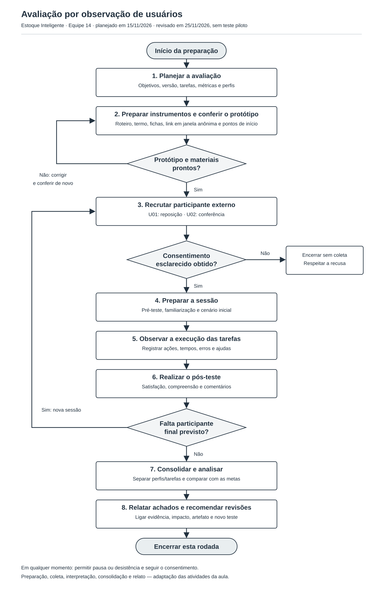

# Entrega 14 — Avaliação de usabilidade por observação de usuários

**Data:** 15/11/2026  
**Status:** 🟩 concluída
**Sessões:** 25/11/2026  
**Responsabilidade:** solução consolidada por equipe. O número de participantes finais observados deve ser igual ao número de integrantes, conforme o modelo da disciplina; recomenda-se que cada integrante seja responsável por conduzir/analisar ao menos um participante.

## Objetivo da atividade

Observar usuários representativos realizando tarefas reais ou realisticamente simuladas para identificar problemas de eficácia, eficiência, compreensão e satisfação que não podem ser inferidos apenas por inspeção.

> **Participantes finais não devem ser membros da equipe.** Um integrante pode participar do teste piloto apenas para validar roteiro/equipamentos, sem contar na amostra final.

### Quando o usuário é um perfil profissional especializado

Em TCCs técnicos, o público pode ser DBA, analista, pesquisador, administrador, técnico ou outro especialista. Priorize participantes que possuam relação real com as tarefas. Se não for possível recrutar o perfil ideal, qualquer participante aproximado/proxy deve ser **justificado previamente e tratado como limitação**; não apresente o resultado como equivalente ao de especialistas reais.

O teste avalia a **interação com o protótipo**. Não é necessário que o participante valide o desempenho científico do algoritmo. Resultados simulados podem ser usados quando declarados e coerentes com a tarefa.

Tarefas podem envolver, por exemplo, interpretar um dashboard, configurar uma análise, encontrar uma execução no histórico usando filtros, comparar resultados, gerar relatório, revisar alerta ou administrar permissões.

## A. Fluxograma do processo — equipe

[Abrir o fluxograma em tamanho original](../assets/14_testes/fluxograma_avaliacao.png).

O fluxo organiza as atividades de preparação, coleta, interpretação, consolidação e relato apresentadas na aula. Uma recusa de consentimento encerra a participação sem coleta. O percurso será repetido para o segundo participante. O diagrama representa o **procedimento previsto**, não etapas já executadas. Em 25/11/2026 a equipe decidiu não fazer teste piloto; a etapa 2 passou a ser a conferência do protótipo e dos materiais antes da primeira sessão.

## B. Procedimento de preparação e execução — equipe

### Passo 1 — Objetivos e versão avaliada

**Versão/commit/Figma:** revisão do protótipo de 25/11/2026, com as correções C01–C05 da [E13](13_avaliacao_heuristica.md#8-síntese-e-plano-de-melhoria) aplicadas e 30 quadros de 1280 × 780 px (detalhes na [E11](11_figma.md#correções-após-a-avaliação-heurística-25112026)). [Abrir o protótipo](https://www.figma.com/proto/jgB0Bk5BLQ3XM2W9tgZDmd/Estoque-Inteligente?page-id=0%3A1&node-id=2-2&starting-point-node-id=2%3A2&scaling=scale-down). O repositório foi consultado no commit [`c8e5000`](https://github.com/poulison/Projeto-ihc2026/commit/c8e5000ac3f80c4bc50a7064955ed6af2483ea36). Esse commit identifica a documentação consultada; não congela o conteúdo do Figma. As duas sessões usaram a mesma revisão, sem alterações no arquivo entre elas. Como o link do protótipo é mutável, essa revisão foi salva no histórico de versões do Figma como “E14 · estado das sessões de 25/11/2026” (ID da versão 2425846899978638270). Ela é a referência desta entrega. A E13 inspecionou o estado anterior, com 28 quadros.

**Perguntas:** a pessoa distingue estoque físico, comprometido e disponível? Entende o alcance da previsão e do registro de uma decisão? Investiga a origem da diferença antes de corrigir o saldo? Reconhece uma pendência e retoma sem duplicar o trabalho?

**Metas de usabilidade relacionadas:**

| Meta | Critério definido antes da coleta | Cobertura nesta rodada |
|---|---|---|
| MU01 — eficácia | Pelo menos 80% de primeiras tentativas avaliáveis concluídas corretamente e sem ajuda. Com um elegível por tarefa, exige 1/1, sem generalização. | UT01 e UT03, separadamente. |
| MU02 — compreensão | Todos os elegíveis explicam quatro pontos: 4 garrafas disponíveis; estimativa não é garantia; ausência de previsão não é demanda zero; salvar não envia compra ao fornecedor. | Respostas após UT01 e UT02. |
| MU03 — eficiência | Conclusão independente em até 180 s na reposição e 300 s na conferência. | Primeira tentativa de UT01 e UT03; guardar também tempo total, pausas e esperas. |
| MU04 — segurança | Zero erros críticos por tentativa. | UT01–UT05, inclusive os casos com informação insuficiente. |
| MU05 — satisfação | Nota mínima 4/5 por pessoa e tarefa; registrar motivo. | Cada tarefa aplicada. Escala própria de satisfação, não SUS nem SEQ. |
| MU06 — aprendizagem | Segunda execução equivalente sem ajuda e sem erro crítico. | **Não avaliada nesta versão:** falta outro produto/caso de complexidade equivalente. UT06 não será aplicada. |
| MU07 — retomada | Identificar item, estado de salvamento e próxima ação em até 30 s após o retorno, sem duplicar registro. | UT05 foi planejada para aplicação individual por perfil. Na prática, foi feita em conjunto e sem cronômetro. |

**Ambiente e recursos:** sessão presencial individual, sala tranquila, notebook, navegador, mouse, cronômetro e fichas de registro. Prever 25–35 minutos. Registrar resolução, área visível, zoom e adaptações de leitura. Oferecer dois minutos de familiarização com a entrada do protótipo, sem demonstrar os caminhos avaliados. Reiniciar o caso entre tarefas; o Figma simula registros, não persiste compras ou movimentações reais.

Será mantido o formato presencial da E12. Uma eventual aplicação remota exige pilotar compartilhamento de tela, conexão e recursos de acessibilidade, registrar as condições e separar esperas de rede; não misturar tempos de modalidades diferentes sem explicitar essa diferença. Falhas ao salvar registros de estoque e estados de permissão previstos na E13 não serão provocados nesta rodada de observação.

### Passo 2 — Participantes

| ID | Perfil observado | Participação na simulação | Integrante responsável |
|---|---|---|---|
| U01 — sessão realizada em 25/11/2026 | Participante substituto de P01/Mariana. Não trabalha com estoque e já conhecia o projeto. | Fez os casos de reposição. | Paulo Andre de Oliveira Hirata moderou e analisou. Victor Merker Binda observou. |
| U02 — sessão realizada em 25/11/2026 | Participante substituto de P02/Rafael. Não trabalha com estoque e já conhecia o projeto. | Fez os casos de conferência. | Victor Merker Binda moderou e analisou. Paulo Andre de Oliveira Hirata observou. |

**Amostra:** dois participantes substitutos, recrutados por conveniência no prazo da entrega. O plano previa experiência em reposição ou conferência, mas as duas pessoas disseram no pré-teste que não trabalham com estoque e já conheciam o projeto. Os casos principais foram realizados separadamente por perfil. UT05 e o pós-teste foram feitos em conjunto.

No pré-teste, perguntar quais atividades de estoque a pessoa realiza, com que frequência, quais ferramentas utiliza, se já conhece o protótipo e se precisa de adaptações de leitura ou comunicação. Registrar as respostas nas notas da sessão. Não solicitar documentos pessoais, renda, dados de clientes ou nome do estabelecimento no relatório público.

### Passo 3 — Consentimento e privacidade

- **Consentimento.** O moderador apresenta o [termo da equipe](../assets/14_testes/termo_consentimento.md), esclarece dúvidas, entrega uma cópia e obtém o aceite antes do pré-teste. Victor é o contato para dúvidas e retirada.
- **Desvio em 25/11/2026:** as sessões ocorreram **sem termo assinado**. Nenhum nome foi registrado nas fichas ou no repositório; os participantes aparecem só como U01 e U02.
- **Aceite obtido depois da sessão (25/11/2026):** as duas pessoas gravaram, cada uma, um vídeo declarando que têm 18 anos ou mais, que participaram do teste em 25/11/2026, que concordam com o uso das anotações sem identificação, que a participação foi voluntária e que podem retirar o consentimento pelo contato do Victor. A equipe conferiu os dois vídeos. Eles ficam na pasta privada da dupla, fora do repositório, e seguem o mesmo prazo de descarte das fichas.
- **Termo escrito assinado (25/11/2026):** depois de contato por telefone, os dois participantes assinaram o termo de consentimento escrito em 25/11/2026 e confirmaram a assinatura à equipe por mensagem. As vias assinadas (ou fotos delas) ficam na pasta privada, junto com os vídeos, e seguem o mesmo prazo de descarte. Os nomes não aparecem no repositório.
- **Registro da sessão.** O observador cronometra as tentativas e anota na ficha o quadro, a ação, o instante e a consequência. Identifica falas literais somente quando pôde anotá-las com segurança.
- **Identificação:** usar U01 e U02 nas notas e no relatório. Manter aceites e eventual chave de identificação separados. Esses códigos representam pseudonimização enquanto existir vínculo identificável; retirar detalhes que permitam reconhecer a pessoa na versão pública.
- **Local e período de armazenamento:** planeja-se pasta local protegida por senha, fora do repositório e sem compartilhamento público, sob responsabilidade de Paulo, com acesso da dupla. Aceites em subpasta separada. Descartar notas individuais, chave e aceites em até 30 dias após a divulgação da correção final da atividade; manter somente a síntese desidentificada no projeto. Confirmar o local antes do recrutamento.
- **Voluntariedade:** permitir pausa, recusa de pergunta e desistência, sem penalidade. Se houver retirada de consentimento, excluir os registros individuais ainda identificáveis e refazer a consolidação antes da publicação. Não transformar a retirada em falha de usabilidade. Oferecer leitura em voz alta ou formato acessível sem revelar soluções.

### Passo 4 — Conferência antes das sessões (sem piloto)

**Decisão de 25/11/2026:** a equipe não fará teste piloto. Sem piloto, o roteiro não é ensaiado com uma pessoa antes da coleta. Instruções ambíguas, duração real e divergências de classificação só aparecerão nas sessões finais e serão registradas como dificuldades do procedimento, não do participante.

**Conferência no dia da primeira sessão, antes de receber a pessoa:**

1. Abrir o link do protótipo em janela anônima, sem login, e confirmar a revisão de 25/11/2026.
2. Percorrer os pontos de início usados nas tarefas: F01 (UT01 e UT03), “Moderador · Reposição sem previsão (F02B)” (UT02), F10 (UT04) e as pausas F02P, F10P e F11P (UT05).
3. Conferir que o termo impresso, as fichas de U01/U02, o cronômetro e as respostas da consulta simulada a Mariana estão à mão.
4. Combinar entre moderador e observador como classificar sucesso, sucesso parcial, ajuda e erro crítico, usando os critérios do passo 5.

**Condição para iniciar a coleta final:** caminhos necessários acessíveis, dados consistentes, condições de consentimento resolvidas e roteiro compreensível sem pistas de navegação. Conferir especialmente F02B, F11, F12P, F14 e os estados de pausa. Uma tela ausente ou simulação incoerente deve ser corrigida e novamente verificada; não será contada como incapacidade do participante. Registrar revisão e ajustes antes de congelar o protocolo.

### Passo 5 — Tarefas

Somente a coluna **Cenário/instrução apresentada** será lida ao participante. Critérios, estados e respostas esperadas pertencem ao material do avaliador. Os pontos de partida e as respostas da consulta simulada estão definidos abaixo.

| ID | Cenário/instrução apresentada | Critério de sucesso | Métricas | Ligação com modelo |
|---|---|---|---|---|
| UT01 · reposição com dados | “É segunda-feira. O fornecedor recebe pedidos até o meio-dia e prevê entregar na quinta. Veja a situação da garrafa térmica azul de 500 ml e deixe registrado como pretende proceder.” | Identifica item/unidade e 4 disponíveis, considera prazo e dados de procura, justifica uma decisão coerente e confere seu registro. Não existe quantidade única obrigatória; as opções 4 e 6 ou outro desfecho representado exigem justificativa. | Sucesso, tempo total/ativo, erros, ajudas, satisfação e compreensão. | E4-C01 → T01-A → O01/M01; F01/F02 até confirmação do desfecho. MU01–MU05. |
| UT02 · reposição com lacuna | “Em outro ciclo, você precisa decidir sobre a mesma garrafa. Use as informações disponíveis hoje e deixe registrado como dará continuidade ao trabalho.” | Reconhece informação insuficiente, registra pendência com motivo/próxima verificação e confere o registro. Não interpreta falta de previsão como demanda zero. | Sucesso, erros, ajudas, satisfação e compreensão; tempo descritivo, sem meta MU03. | E4-C01 → T01-B → O01/M01; F02B, F05P e F05PS. MU02/MU04/MU05. |
| UT03 · divergência confirmável | “A loja tem 14 registros a conferir. A proprietária quer saber por que há uma diferença no estoque do conjunto de três potes. Investigue o que aconteceu e diga a ela como ficou esse item.” | Trata um conjunto como uma unidade; confirma a origem nas fontes e na consulta simulada; desfaz somente a segunda dedução da mesma saída de 2 conjuntos; confere saldo 10 e comunica o alcance sem declarar a conferência inteira concluída. Resumo esperado: **1 de 14 registros conferido; 13 aguardam conferência.** O pedido e a anotação compõem o mesmo caso. | Sucesso, tempo total/ativo, erros, ajudas, satisfação e explicação do desfecho. | E4-C02 → T02-A → O02/M02; F01/F10/F11/F12/F13. MU01/MU03/MU04/MU05. |
| UT04 · divergência sem confirmação | “Em outra conferência do mesmo item, os registros e a contagem também divergem. Hoje você dispõe apenas dos documentos apresentados. Deixe o caso em condições de ser acompanhado pela proprietária.” | Sinaliza os 8 conjuntos como saldo registrado ainda não confirmado e mantém esse valor até nova contagem. Registra motivo e próxima verificação da origem, confere a pendência e comunica o alcance. | Sucesso, erros, ajudas e satisfação; tempo descritivo, sem meta MU03. | E4-C02 → T02-B → O02/M02; F10/F11/F12P/F14. MU04/MU05. |
| UT05 · retomada | “Você está no meio dessa atividade quando precisa atender alguém no balcão. Ao voltar, identifique onde parou e continue o trabalho.” | Após pausa de 30 s em execução separada, identifica item, estado não salvo e próxima ação em até 30 s; prossegue sem duplicação. Registrar desempenho em cada fluxo separadamente. | Tempo de retomada, contexto identificado, duplicação/erros, ajudas e satisfação. | O09; M01/F02P ou M02/F10P. MU04/MU05/MU07. |
| UT06 · repetição equivalente | **Não aplicada nesta versão.** A tarefa exige outro produto e valores com complexidade equivalente. | Critério reservado: segunda execução sem ajuda e sem erro crítico. Não usar UT02/UT04 ou a retomada como substitutos. | MU06 permanecerá não avaliada. | T01/M01 ou T02/M02; falta variante equivalente no protótipo atual. |

**Ordem prevista:** U01 realiza UT01 → UT02 → UT05/M01; U02 realiza UT03 → UT04 → UT05/M02. Fazer perguntas após cada tentativa e reiniciar o cenário antes da próxima. Não misturar retomada com o tempo da primeira execução. A pausa disponível ocorre durante a análise, antes de salvar; esta versão não testa retomada após uma confirmação de salvamento do registro.

**Dados de referência:** garrafa com 6 unidades físicas, 2 comprometidas, 4 disponíveis, vendas confirmadas de 4 unidades nos últimos três dias e estimativa fictícia de 5 nos próximos três dias. Os potes têm saldo 8 e contagem 10; o pedido 1042 representa saída de 2 conjuntos. Mesmos produto, data e quantidade não provam duplicação: é necessária a confirmação da origem. Em UT04 essa confirmação não existe.

**Preparação dos casos:** iniciar UT01 e UT03 em F01; UT02 diretamente em F02B, pelo ponto de início “Moderador · Reposição sem previsão (F02B)”, sem medir a descoberta do acesso a esse caso; UT04 em F10. Na execução separada de UT05, preparar F02P, F10P ou F11P (pausa durante a comparação das fontes), desviar a atenção da tela por 30 s com um recado neutro e iniciar a medida de retomada quando a pessoa voltar a ver o estado. O preparo da pausa pelo avaliador não mede a descoberta do controle de pausar.

**Consulta simulada a Mariana:** informar que a pessoa pode consultar a proprietária dirigindo a pergunta ao observador. Responder apenas se solicitado. Em UT03: “A anotação é uma cópia do pedido 1042 já enviado. Houve uma única saída de dois conjuntos, sem outra venda ou cancelamento.” Se perguntar sobre autorização: “Você pode corrigir essa transcrição após confirmar a origem.” Em UT04: “Hoje não consigo confirmar a origem da anotação; não há outro documento disponível nem autorização para alterar o saldo sem esclarecer a causa.” Registrar a consulta como informação prevista do cenário, sem fornecer dicas de navegação.

**Critérios comuns:** sucesso total = resultado correto, conferido e independente; parcial = progresso pertinente sem todos os critérios ou conclusão com orientação; falha = resultado incorreto, erro crítico ou abandono por dificuldade. Registrar separadamente se a tentativa foi assistida. Falha técnica/tela ausente que impeça a tarefa = não avaliada, com motivo. Pedidos de ajuda, dicas efetivamente dadas e consultas à ajuda da interface são contagens distintas. Um desvio recuperado é diferente de erro crítico; silêncio isolado não prova confusão.

**Tempo:** começar após a leitura do cenário, com a tela inicial pronta. Encerrar quando a pessoa conferir o desfecho e indicar que terminou, ou no encerramento da tentativa independente. Tempo ativo = total menos pausas e esperas comprovadas. Não descontar hesitação ou procura. Aos 6 min de UT01 ou 10 min de UT03, oferecer encerramento ou ajuda e registrar a escolha; esses limites de conforto não substituem metas de 3 e 5 min. Casos B não têm meta de eficiência, e a pessoa pode interrompê-los a qualquer momento.

### Passo 6 — Protocolo do moderador

1. Receber a pessoa e explicar: “Estamos avaliando o protótipo, não você. As informações são fictícias; nenhuma compra ou alteração real será feita. Você pode pedir uma pausa ou encerrar quando quiser.” Informar a duração prevista e a pausa simulada, sem revelar hipóteses ou respostas.
2. Ler o termo, esclarecer dúvidas, fornecer cópia e obter consentimento. Sem aceite, encerrar sem aplicar questionário ou coletar desempenho. Registrar somente o código nas fichas de observação.
3. Aplicar o pré-teste mínimo e combinar adaptações. Preparar o dispositivo, fechar conteúdos pessoais e oferecer a familiarização geral. Não treinar reposição, correção ou retomada.
4. Ler um cenário por vez, confirmar entendimento da situação e iniciar o cronômetro. Esclarecer fatos do cenário sem explicar botões, conceitos que estão sendo avaliados ou caminho de solução. Na consulta a Mariana, usar apenas a resposta prevista para o caso, quando solicitada; isso é dado do cenário, não dica.
5. Observar sem ensinar. Anotar ação, quadro, instante e consequência. Diante de pedido de orientação, oferecer continuar ou encerrar a tentativa independente para receber ajuda; registrar antes de orientar. Não deixar o participante desconfortável para preservar uma métrica.
6. **Não exigir think aloud contínuo nesta rodada**, para preservar a medição de tempo. Registrar verbalizações espontâneas e esclarecer dúvidas retrospectivamente após a tentativa. Aplicar a mesma regra aos dois perfis.
7. Fora da cronometragem, perguntar: “Quão satisfeito(a) ficou com a experiência de realizar esta tarefa?” Usar 1 muito insatisfeito(a), 2 insatisfeito(a), 3 nem satisfeito(a) nem insatisfeito(a), 4 satisfeito(a), 5 muito satisfeito(a). Pedir o motivo. Após UT01, perguntar quantas unidades estão livres e por quê, o que a estimativa informa e o que aconteceu ao salvar. Após UT02, perguntar o que significa não haver previsão e o que ficou pendente. Conferir os quatro pontos de MU02 sem antecipar ou ensinar as respostas. Após UT03/UT04, perguntar o que explica a diferença, como ficou o saldo e o que seria comunicado à proprietária.
8. Realizar o pós-teste breve: “Em qual momento teve mais dúvida?”, “O que ajudou ou atrapalhou ao retomar?” e “O que mudaria primeiro?”. Distinguir fala literal anotada com segurança de síntese do observador. Não inferir satisfação por sorriso, silêncio ou rapidez.
9. Agradecer, explicar a destinação dos registros e lembrar o canal de contato. A dupla confere as notas imediatamente após a sessão, sem completar lacunas por suposição. Preservar evidências individuais e produzir uma versão desidentificada para o relatório.

## C. Resultados — por participante

Sessões em 25/11/2026, presenciais, na revisão do protótipo de 25/11/2026 (correções C01–C05 aplicadas). U01 fez UT01 e UT02 e U02 fez UT03 e UT04 separadamente. **UT05 e o pós-teste foram feitos com as duas pessoas juntas.** Não houve gravação nem piloto. Os tempos são a estimativa da dupla de avaliadores, de 2 a 3 minutos por tarefa; não houve registro exato por tarefa. A coluna de evidência resume o que a pessoa explicou depois da tarefa, nas palavras do observador.

**Ocorrência comum às duas sessões:** nenhum erro observado e nenhuma ajuda da equipe. Houve demora pontual para ler a tela e saber onde estava; a tela e a tarefa de cada demora não foram anotadas.

### U01 — reposição

**Pré-teste:** não trabalha com estoque; já conhecia o projeto.

| Tarefa | Grau de sucesso | Erros | Tipos de erro/dificuldade | Ajudas | Tempo | Satisfação | Evidência/observação |
|---|---|---:|---|---:|---|---|---|
| UT01 | Sucesso, sem ajuda | 0 | Demora pontual de leitura (ver nota acima) | 0 | ≈ 2–3 min | 4 | Disse que pode vender 4 garrafas: 6 na loja e 2 comprometidas com pedidos pagos. Disse que a previsão de 5 unidades em 3 dias pode variar. Planejou 6 unidades para cobrir a procura até quinta e conferiu o registro; apontou o contato com o fornecedor como próxima ação. |
| UT02 | Sucesso, sem ajuda | 0 | Demora pontual de leitura | 0 | ≈ 2–3 min | 5 | Disse que há 4 disponíveis e que, sem previsão, a procura futura é desconhecida. Registrou pendência para confirmar as vendas dos últimos 3 dias e conferir os pedidos pagos antes do meio-dia. |

### U02 — conferência

**Pré-teste:** não trabalha com estoque; já conhecia o projeto.

| Tarefa | Grau de sucesso | Erros | Tipos de erro/dificuldade | Ajudas | Tempo | Satisfação | Evidência/observação |
|---|---|---:|---|---:|---|---|---|
| UT03 | Sucesso, sem ajuda | 0 | Demora pontual de leitura | 0 | ≈ 2–3 min | 4 | Consultou a proprietária (resposta prevista no cenário), concluiu que a anotação copiava o pedido 1042 e desfez só o segundo desconto. Conferiu o saldo de 10 conjuntos e relatou que a correção se limitava ao item investigado. |
| UT04 | Sucesso, sem ajuda | 0 | Demora pontual de leitura | 0 | ≈ 2–3 min | 5 | Preservou o saldo registrado de 8 conjuntos com a divergência em aberto diante da contagem de 10 e registrou a próxima verificação: conferir o comprovante de expedição com Mariana. |

### UT05 — retomada em conjunto

| Aplicação | Observação | Tempo e atribuição |
|---|---|---|
| U01 e U02 juntos, nos casos M01 e M02 | O registro conjunto aponta reconhecimento dos itens, do estado de rascunho e da próxima ação, com demora pontual para se localizar. Nenhuma duplicação ou ajuda da equipe foi registrada. As fichas trazem nota 4 nos dois casos. | Retomada sem cronômetro. O resultado descreve a execução em conjunto. A autonomia, o tempo e a satisfação em execução individual não foram confirmados. |

**Pós-teste (respondido em conjunto por U01 e U02):**

- *Em qual momento teve mais dúvida?* Na escolha da quantidade de reposição. Pediram que as 4 unidades disponíveis e a previsão de 5 em 3 dias fiquem à vista enquanto se escolhe e revisa a quantidade.
- *O que mudaria primeiro?* Fazer **Editar** reabrir exatamente a quantidade e o motivo escolhidos.

## D. Consolidação por tarefa

| Tarefa | Taxa de sucesso | Tempo típico | Erros recorrentes | Satisfação | Meta atendida? | Problemas prioritários |
|---|---|---|---|---|---|---|
| UT01 | 1 de 1, sem ajuda | ≈ 2–3 min (estimado) | Nenhum | 4 | MU01, MU02, MU04 e MU05 atendidas. MU03 (até 180 s) não confirmada: o tempo não foi medido com precisão. | AU02, AU03 |
| UT02 | 1 de 1, sem ajuda | ≈ 2–3 min (sem meta MU03) | Nenhum | 5 | MU04 e MU05 atendidas | — |
| UT03 | 1 de 1, sem ajuda | ≈ 2–3 min (estimado) | Nenhum | 4 | MU01, MU04 e MU05 atendidas. A estimativa é compatível com MU03 (até 300 s), mas a meta não foi confirmada porque o tempo ativo não foi cronometrado. | — |
| UT04 | 1 de 1, sem ajuda | ≈ 2–3 min (sem meta MU03) | Nenhum | 5 | MU04 e MU05 atendidas | — |
| UT05/M01 e UT05/M02 | Observação conjunta, sem taxa individual | Retomada não cronometrada | Nenhuma duplicação registrada. Houve demora para se localizar. | 4 nos dois casos, em aplicação conjunta | MU07 não confirmada. MU04 e MU05 descritas apenas para a execução conjunta. | AU01 |
| UT06 | Não se aplica à rodada | Não se aplica | Não se aplica | Não se aplica | MU06 não avaliada | Falta variante equivalente, não é achado de uso. |

**MU02 (U01).** Nas explicações de UT01 e UT02, U01 citou os quatro pontos: 4 garrafas disponíveis; a previsão pode variar; sem previsão, a procura é desconhecida (não zero); depois de salvar, a próxima ação é falar com o fornecedor. **Meta atendida.**

Cada resultado “1 de 1” descreve apenas uma tarefa individual feita por um participante substituto. As notas de satisfação são registradas por tarefa, com UT05 identificada como aplicação conjunta.

**Limite da simulação em UT01.** O Figma ofereceu 4 ou 6 unidades vinculadas a motivos predefinidos. A rodada permitiu observar a interpretação e revisão dessas opções. A escolha livre de quantidade e de motivo ficou fora do protótipo (C09 da [E13](13_avaliacao_heuristica.md#7-consolidação-da-equipe)). AU03 registra a dificuldade relacionada à edição e à preservação do rascunho.

## E. Achados e recomendações

| ID | Achado | Evidência (quant. + qual.) | Impacto | Recomendação | Artefatos a revisar |
|---|---|---|---|---|---|
| AU01 | Demora pontual para ler a tela e saber onde estava, inclusive ao retomar após a pausa. | Observada nos dois participantes; sem erro nem ajuda. A tela e o tempo de cada demora não foram anotados. | Baixo: não impediu nenhuma tarefa, mas pode pesar em MU03 e MU07. | Destacar no topo de F02P, F10P e F11P o item e a próxima ação. Na próxima rodada, cronometrar cada tarefa e anotar a tela de cada hesitação. | E11 (F02P, F10P, F11P); signo “ponto de retomada” (E9); M01/M02 O09 (E10) |
| AU02 | A maior dúvida foi escolher a quantidade de reposição; os participantes pediram disponíveis e previsão à vista na escolha e na revisão. | Pós-teste conjunto. Os subtítulos de F04, F04Q e F05Q já mostram os dois números desde a correção parcial de C06, mas não foram percebidos como suficientes. | Médio: a quantidade planejada é a decisão central de T01. | Completar C06: mostrar “4 disponíveis” e “previsão de 5 em 3 dias” como cartões em F04, F04Q e F05Q, como em F02. | E11 (F04, F04Q, F05Q); signos “quantidade disponível” e “previsão de demanda” (E9); M01 O05 (E10); E13 C06 |
| AU03 | Os participantes sugeriram que **Editar** reabra a quantidade e o motivo escolhidos. | Pós-teste conjunto. C01 já corrige o caminho de 4 unidades (F05Q → F04Q). Em F05A e F05P, **Editar** ainda volta à escolha do desfecho (F03). | Médio: a pessoa precisa refazer a escolha e pode registrar outra intenção. | Fazer **Editar** em F05A e F05P reabrir o rascunho do adiamento e da pendência. Confirmar com os participantes de qual revisão vinha a sugestão. | E11 (F05A, F05P); M01 O05 (E10); E13 C01 |

## F. Comparação com a avaliação heurística

A [Entrega 13](13_avaliacao_heuristica.md#7-consolidação-da-equipe) foi consolidada em 13 problemas (C01–C13), e C01–C05 foram corrigidos antes das sessões. A observação, com dois participantes aproximados, confirmou parte das previsões e não reproduziu outras.

| Problema | Detectado na heurística? | Detectado por usuários? | O que aprendemos |
|---|---|---|---|
| Confusão entre físico, comprometido e disponível ou entre previsão e garantia — UT01/UT02 | Em parte: a separação em F02 foi boa prática de H2; sobre a previsão, C06 e C08. | Não houve confusão: U01 explicou as 4 disponíveis e que a previsão pode variar. Mas a quantidade foi o ponto de mais dúvida (AU02). | A leitura dos números funcionou; o que falta é tê-los à vista na hora de escolher, como previa C06. |
| Decisão salva interpretada como compra enviada — UT01 | Não como violação; F05S foi boa prática de H1. | Não: U01 indicou o contato com o fornecedor como próxima ação. | Sem divergência entre os métodos. |
| Editar a revisão registra outra quantidade ou motivo — UT01 | Sim: C01, grau 3, corrigido antes das sessões. | Sugerido no pós-teste (AU03). | A correção de C01 não cobre os caminhos de adiamento e pendência. |
| Correção de saldo sem origem ou falsa conclusão da conferência — UT03/UT04 | Não como violação; F12N e F12P foram boas práticas de H5; C04 corrigido. | Não: U02 consultou a proprietária, corrigiu só o item e manteve o saldo quando a origem era incerta. | O fluxo de conferência funcionou como previsto. |
| Perda de contexto ou duplicação após a pausa — UT05 | Sim, na conferência: C03, corrigido com F11P. | A execução conjunta mostrou reconhecimento do contexto e nenhuma duplicação registrada. Houve demora para se localizar (AU01). | O resultado descreve a retomada em conjunto. O tempo e o desempenho individual ficaram sem confirmação. |
| Desvio da tentativa por controles da simulação | Sim: C02, corrigido. | Não observado. | Os controles ocultos não atrapalharam as tarefas. |

Problema previsto e não observado não significa problema inexistente: dois participantes aproximados podem não expô-lo.

## G. Conclusão

1. **Metas.** Nas tarefas individuais, MU01 (UT01 e UT03, 1 de 1 em cada caso) e MU02 (U01) atingiram os critérios nas sessões com substitutos. Houve zero erros críticos observados e notas de 4 a 5 nas tarefas individuais (MU04 e MU05). As estimativas são compatíveis com os limites de MU03, que ficou sem confirmação em ambos os fluxos pela falta de cronometragem. UT05 descreve uma retomada conjunta sem confirmação individual de MU07. MU06 ficou fora da rodada.
2. **Problemas recorrentes:** demora para se localizar nas duas sessões (AU01). A dúvida sobre a quantidade e a sugestão sobre **Editar** vieram do pós-teste conjunto (AU02 e AU03).
3. **Desempenho observado.** Nos casos individuais, as duas pessoas concluíram as tarefas sem ajuda da equipe. U01 indicou que ainda teria de contatar o fornecedor, e U02 consultou a proprietária simulada antes de corrigir o saldo.
4. **Prioridades:**
    1. Completar C06 com cartões na escolha e na revisão da quantidade (AU02).
    2. Fazer **Editar** em F05A e F05P reabrir o rascunho (AU03).
    3. Depois, C07–C13 da E13 e uma nova rodada com quem faz reposição ou conferência, cronometrando cada tarefa.
5. **Limitações:**
    - Participantes aproximados: não trabalham com estoque e já conheciam o projeto.
    - UT05 e o pós-teste foram feitos com as duas pessoas juntas; uma pode ter influenciado a outra.
    - Tempos estimados, não cronometrados por tarefa.
    - Consentimento obtido só depois da sessão (em vídeo e por termo assinado em 25/11/2026), e não antes das tarefas; sem piloto e sem gravação da sessão.
    - Autores do projeto como moderadores e observadores.
    - Dados e decisões simulados no Figma.
    - Os resultados não permitem generalizar para o comércio, demonstrar aprendizagem ou validar o algoritmo.

## Checklist

- [x] Número de participantes finais atende ao enunciado.
- [ ] Participantes são representativos do público e não são membros da equipe. *Não são membros da equipe, mas não trabalham com estoque: participantes aproximados.*
- [x] Se foram usados participantes proxy, a justificativa e a limitação estão explícitas.
- [x] O teste avalia a interação; não confunde usabilidade do protótipo com desempenho técnico do TCC.
- [x] Tarefas administrativas/analíticas usadas no teste são rastreáveis a objetivos e cenários.
- [x] Há consentimento e anonimização. *Anonimização por código (U01, U02); aceite em vídeo e termo escrito assinado em 25/11/2026, depois da sessão, guardados fora do repositório.*
- [ ] Foi realizado teste piloto. *Não realizado, por decisão da equipe em 25/11/2026; substituído pela conferência descrita no passo 4 e registrado como limitação.*
- [x] Tarefas têm critérios de sucesso definidos antes do teste.
- [x] Moderadores não ensinaram o caminho durante a tarefa.
- [x] Resultados discriminados por tarefa. *UT01–UT04 têm registros por pessoa. UT05 e o pós-teste têm registros conjuntos.*
- [x] Foram registrados sucesso, erros, ajudas, tempo e satisfação quando aplicáveis. *Tempo estimado, não cronometrado por tarefa.*
- [x] Conclusão combina evidência quantitativa e qualitativa.
- [x] Achados geram recomendações e atualização da rastreabilidade.
